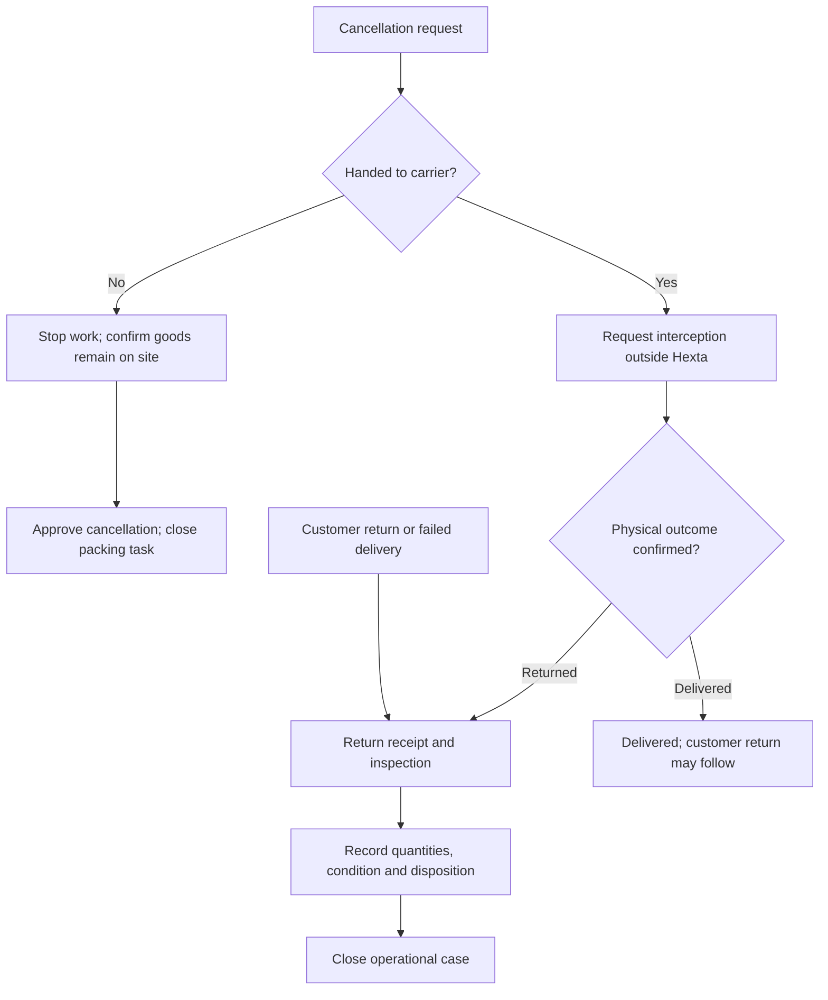

# Order Cancellation and Returns — Proposed Design

Status: Proposal for product review; not an approved implementation scope.

## Design Summary

Hexta tracks physical order execution and employee responsibility. Payments, refunds, COD reconciliation, accounting and payment-provider integration are outside this design. Operational completion does not assert financial settlement. AI is not required for these workflows.

Keep the original order and its event history. Create linked exception cases for cancellation requests and returns. Never interpret a request as confirmation that a carrier stopped delivery or goods arrived back.

## Workflow and Data Flow

Normal order states proposed: confirmed, packing, ready_for_pickup, in_delivery, delivered, cancelled. Handoff task states (pending acceptance, accepted) are separate from physical fulfillment. A return case does not erase a historical delivery.

Before carrier handoff, a request puts packing/pickup on hold. The assigned packer confirms physical stoppage; owner or authorized approver closes cancellation. Carrier handoff and final cancellation must be mutually exclusive under concurrency.

After carrier handoff, record a cancellation/interception request with pending, succeeded, failed or withdrawn outcome. Track carrier contact manually initially. Do not claim a carrier operation was performed by Hexta. Returned goods follow return receipt; successful delivery remains recorded if interception fails.

Return types: failed delivery (customer never received goods) and customer return after delivery. Proposed states: requested, approved, returning, received, closed; rejected/withdrawn are terminal alternatives. Receipt before approval must be possible for unexpected physical returns, with owner review. Closed requires expected quantities accounted for, or explicit resolution for discrepancies/loss. Record partial receipts and damaged plants; receipt never automatically makes stock sellable.

## Responsibility

Proposed defaults: original sale handles customer communication, assigned packing employee handles stopping packing and receiving/inspecting returned goods, owner assigns exceptions and approves cancellation/return outcomes. These are proposals, not confirmed user rules. Record current case owner separately from historical sale and packing assignees. Until a new assignee accepts in acceptance mode, the existing owner remains responsible. Direct mode transfers immediately.

## Data Model — Proposed Logical Schema

- orders: tenant_id UUID, id UUID PK, fulfillment_status TEXT, sale_assignee_id UUID, packing_assignee_id UUID, version BIGINT; index (tenant_id, fulfillment_status).
- exception_cases: id UUID PK, tenant_id UUID, order_id UUID FK, kind TEXT, origin TEXT, status TEXT, reason_code TEXT, note TEXT, owner_id UUID, approved_by UUID nullable, created_at/closed_at TIMESTAMPTZ; index (tenant_id, owner_id, status).
- return_lines: id UUID PK, case_id UUID FK, order_line_id UUID FK, expected_quantity NUMERIC, received_quantity NUMERIC, condition TEXT, disposition TEXT. Enforce positive quantities and compatible units. Received quantity cannot exceed shipped quantity minus prior recorded receipts for that line, unless a separately reviewed discrepancy is recorded.
- order_events: id UUID PK, tenant_id UUID, order_id UUID FK, case_id UUID nullable, actor_id UUID, event_type TEXT, occurred_at TIMESTAMPTZ, metadata JSONB.

Use composite tenant-aware foreign keys and membership validation. Product snapshots preserve ordered name, variant and quantity. No financial transaction entity is introduced. Atlas migrations and GORM models follow existing repository conventions when implementation is approved; concrete table names require inspecting the current order model first.

## API Contracts — Illustrative, Not Implemented

POST /orders/{id}/exception-cases: kind, reason, proposed lines, expected_version; returns created case.
POST /exception-cases/{id}/approve: expected_version, note.
POST /exception-cases/{id}/receive: receipt quantities, condition, expected_version.
POST /exception-cases/{id}/close: disposition, resolution, expected_version.
GET /exception-cases: status, assignee and order filters with pagination.

All mutations require an idempotency key. Controllers validate DTOs; services enforce transitions; repositories persist state and audit in one database transaction. Use standard response.Response[T], Swagger annotations and shared errors. Map malformed input to 400, forbidden action to 403, inaccessible record to 404, stale version/invalid transition to 409. Exact error symbols require code inspection before implementation.

## Security, Consistency and Performance

Scope all reads/writes to tenant and permission. Owner manages assignments; additional approval delegation remains a proposed configuration. Lock order/case or compare version atomically; cancellation and dispatch cannot both succeed. Persist audit with the mutation. No carrier network operation inside the DB transaction. No Redis cache required initially; paginate indexed work queues. Add an outbox only if external asynchronous integration is later approved.

## Dashboard Semantics

Show pending cancellations, returning goods, overdue cases, assignees, reasons and returned quantities. Attribute original sale, packing and exception handling separately; do not treat a return as employee fault. Report ordered, delivered and returned units independently. Monetary order values are not collected revenue or profit. Ad effectiveness remains descriptive association unless attribution and financial data are sufficient.

## Verification Before Implementation

Review scenarios: cancellation before/while packing; cancellation racing with dispatch; failed interception; rejected return; partial/damaged/unexpected receipt; duplicate receipt; cross-tenant access; assignee changes. This is documentation only; no executable implementation or tests were added.

## Sources and Limits

Official Sapo documentation separates return progress, receipt, warehouse disposition and employee roles: https://help.sapo.vn/quan-ly-danh-sach-don-tra-hang-tren-sapo-omniai (accessed 2026-10-15). Hexta adapts operational concepts and omits Sapo financial features. Pancake status documentation appeared in search but full retrieval failed; no detailed Pancake behavior is asserted: https://docs.pancake.biz/pos/st-f4/st-p1/st-s6?lang=vi.

Open decisions: approval delegation, exception defaults, partial return MVP scope, inventory integration and carrier integration. Product review can proceed without resolving implementation details.
