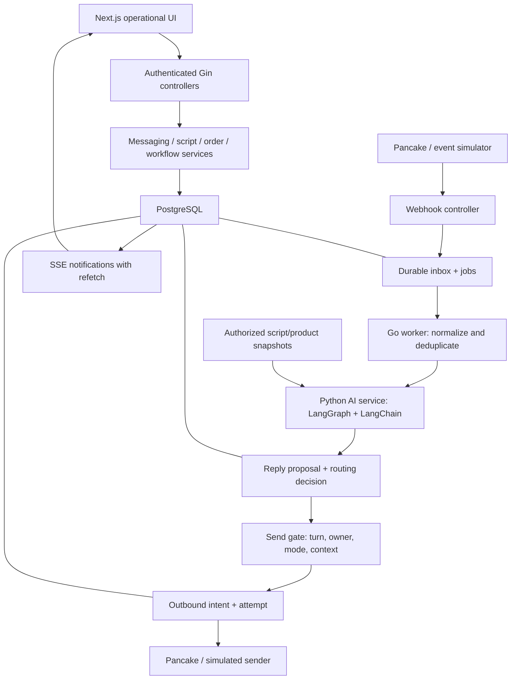
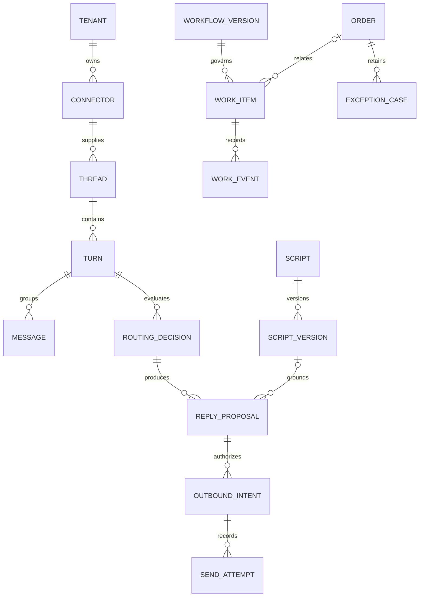

# HEX-8: Core MVP architecture, logical schema and API contracts

Status: architecture documentation baseline completed on 2026-10-18 after owner decisions. Product rules come from approved Notion HEX-6/7 and technology baseline HEX-9. No application code or migrations changed. Deployment prerequisites and detailed implementation choices remain explicit below; completion does not establish runtime compatibility or live integration.

## 1. Design summary and repository alignment

Extend the current Go/Gin/Fx API as a modular application, with a separately runnable Go worker sharing PostgreSQL. On 2026-10-18 the owner explicitly requested a dedicated Python AI service for LangChain/LangGraph and flow observability. AI orchestration moves there; Go retains ingestion, durable business jobs, authorization and sending. Preserve controller -> service -> repository -> infrastructure boundaries, typed shared errors, DTOs and Swagger. Use Next.js/TypeScript/Tailwind and shared UI/SDK. Prefer extending `apps/web`, which already contains authentication and tenant pages; `apps/admin` currently has only the starter page. This is an implementation proposal, not a change to app naming or routes.

Keep messaging and order UI separate. A conversation is a provider thread; a consultation turn is one Hexta processing period. Assignment, human escalation and automatic-send permission are different attributes, not one overloaded status.

Observed code gaps:

- Existing tenant membership has a coarse role only; script permissions need explicit grants.
- Existing `ai_drafts` represents generic business intent, not versioned message replies; use dedicated messaging entities rather than silently repurposing it.
- Existing order code supports stock reservation on confirmation, automatic confirmation and payment-status changes. These are not automatically approved by the new scope. Audit and adapt before reuse; preserve existing data and avoid destructive migration.
- Existing source code stores models under `internal/core/model`, while written rules describe repository models. Resolve placement consistently before adding models; do not move existing files in this documentation task.
- Earlier local scope and return designs are proposals from 2026-10-15, superseded where they conflict with the later approved Notion requirements.

## 2. Components and data flow



HTTP commands return after local transactional state is committed. LLM calls run in the Python service; media processing, external sends and retry work run outside business database transactions. SSE carries invalidation/update identifiers; clients refetch authorized state after reconnect. Polling is a fallback. Do not leak tenant information through a shared event channel. The Python service never sends to Pancake directly.

## 2a. Python AI service boundary and flow observability

Proposed location: `services/ai`. Python runtime and library versions will be pinned in a dedicated project/lockfile after compatibility verification. Owner-approved gRPC unary RPCs expose the internal asynchronous run lifecycle; FastAPI retains health/offline preview endpoints; LangGraph manages the execution graph and LangChain supplies model/tool adapters. No LangSmith hosted deployment is required to run the graph.

Responsibilities:

- Go owns customer/conversation truth, permissions, assignments, active script versions, settings, proposals, outbound intents, channel credentials and actual sends.
- Python owns context preparation, model-based routing, script rendering/variable checks, generation, output validation and run/checkpoint telemetry. It receives authorized snapshots or calls narrowly scoped read-only Go tools; it has no general business DB write access.
- Python returns structured candidates, clarification or escalation requests. Go persists accepted results and revalidates mode, takeover generation, current context and script eligibility before displaying/dispatching. A graph checkpoint or human-review interrupt is not business authorization.

Proposed graph: `validate_input -> prepare_context -> route -> {render_script | generate_reply | clarify | request_human} -> validate_output -> return_result`. Each node has a stable name and graph version. Bound retry/step/time budgets. No arbitrary tool access or nested agent swarm is required. Record concise routing reasons, evidence IDs and outputs; do not request or log hidden chain-of-thought.

Internal contract:

| Route | Input / output |
|---|---|
| AIService.StartRun | Go-generated run_id, idempotency key, tenant/turn IDs, context revision, control generation, graph/prompt version, authorized messages/product/script snapshots, mode and execution budget; returns run_id/status after durable acceptance in the target architecture |
| AIService.GetRun | Status queued/running/succeeded/failed/cancelled, structured decision/candidate, evidence IDs, node errors, timing and trace reference; authenticated tenant/service scope |
| AIService.CancelRun | Best-effort cancellation of graph execution; does not revoke a model request already submitted or grant sending rights |
| GET /health/live and /health/ready | Process readiness distinct from model-provider availability |

The Go job submits a stable run ID and polls the internal result endpoint initially; this avoids adding an unauthenticated callback. Same run ID with a different input digest is rejected. Input validation failure returns 400; authentication 401/403; conflicting digest 409; overload 429/503. Provider failures become typed terminal/retryable run errors, not permission to fall back to autonomous sending. Use versioned JSON Schema/OpenAPI contracts and contract tests across languages; Go public response wrappers stay outside this internal protocol.

**Bootstrap distinction (2026-10-18):** shared Protobuf plus generated Go/Python bindings and a simulation-only gRPC adapter exist. Its bounded in-memory run registry is not durable; restart discards IDs and results. Go integration is a smoke command only, not the business-worker/send gate. Frontend HTTP/SSE remains unchanged. RPC deadlines do not cancel accepted work; use CancelRun and retain the final Go authorization check.

Durability target: Python persists accepted run records before acknowledging, processes with leases and uses a persistent LangGraph checkpointer. Proposed separate AI database/schema and DB role, potentially on the same PostgreSQL instance for the demo. Python owns checkpoint schema/setup; Atlas remains authoritative for Go business tables. Never run competing migration tools over the same tables. Scoped graph execution IDs include tenant and turn/context identity; no cross-tenant checkpoint sharing. RAM checkpointers are for isolated tests only. Retention and encryption cover checkpoints as well as traces.

Submission timeout is reconciled by the stable run ID before starting another run; lease/retry logic must prevent concurrent execution of the same run. Checkpoint recovery can repeat node work, including paid provider requests: use node result keys, bounded retries and provider-supported idempotency where available, without claiming exactly-once inference or billing. Completed output is accepted once into Go through a unique run-result key; stale results are retained for diagnostics but cannot send.

Observability is an explicit requirement: one trace context from webhook -> Go job -> Python graph -> result acceptance -> send attempt. Persist minimal run/step metadata with tenant, turn, run, graph/prompt/model versions, input/context revision, chosen branch, script version, source IDs, node start/end/duration/status, safe error category and provider-reported token usage. Token cost is an estimate only when known rates and usage exist. Mask PII/secrets, cap payloads, and protect diagnostic access separately from sales conversation access. Do not expose raw prompts or credentials in regular client event streams.

LangGraph checkpoints support state recovery; they are not a monitoring UI. The owner selected self-hosted observability on 2026-10-18. Use self-hosted Langfuse as the proposed initial viewer, with its LangChain/LangGraph callback integration and trace-context propagation from Go. Keep correlated structured logs and local run/step metadata as the fallback. Do not configure LangSmith Cloud or another hosted trace destination. Capturing prompt/message bodies is configurable and should use synthetic/redacted data for initial experiments. Tracing failure must not block safe business completion or alter reply routing.

Self-host deployment proposal: an optional, separately managed Docker Compose observability stack for development/demo, containing Langfuse web/worker and its documented PostgreSQL, ClickHouse, Redis/Valkey and S3-compatible/blob storage dependencies. Use dedicated databases, credentials and volumes; do not let observability migrations modify Hexta business tables. Reusing a database server requires verified version/resource compatibility, not reusing tables or unrestricted roles. Pin a mutually compatible server/SDK release set during implementation instead of tracking latest. Compose is a single-host demo deployment, not an HA or backup solution; document backup/restore before any persistent pilot.

Only trusted backend exporters can submit traces; restrict the viewer to authorized developers/operators, not all sales users. Configure explicit local exporter endpoints, redact before export, disable optional external telemetry where supported and verify outbound traffic. Retention must cover trace payloads, object storage and graph checkpoints; a retention duration is still open. Self-hosted observability does not imply self-hosted model inference: model provider and credentials are a separate unresolved choice. No containers, accounts, dependencies or external exporters were provisioned in this documentation task.

References for the self-hosted proposal (checked 2026-10-18): https://langfuse.com/self-hosting, https://langfuse.com/self-hosting/deployment/docker-compose, https://langfuse.com/integrations/frameworks/langchain, https://langfuse.com/docs/observability/features/masking.

Additional acceptance scenarios: Python unavailable, Go submit timeout after run accepted, repeated submit, same ID/different digest, worker crash during node execution, stale AI output after takeover/new message/script archive, cross-tenant run lookup, cancellation during generation, lost trace export and restart from persisted checkpoint. Compare node timings and decisions against a deterministic fake model before a paid provider.

Official references checked 2026-10-18:

- https://docs.langchain.com/oss/python/langgraph/overview
- https://docs.langchain.com/oss/python/langgraph/persistence
- https://docs.langchain.com/langsmith/trace-with-langgraph
- https://docs.langchain.com/langsmith/trace-with-opentelemetry

Design choices here are Hexta proposals, not guarantees that framework durability prevents duplicate external effects. The local simulation now has Python packages and a gRPC listener; real providers, durable runs and tracing export are not configured.

## 3. State and invariants

- Turn lifecycle: `open`, `closed`; `needs_human` is a separate flag.
- Control: `system` or `sales`; `assignee_id` can remain set after returning control to the system, allowing a known sale to approve proposals.
- Tenant reply mode: `suggest` or `auto_send`. UI can retain the approved proposal toggle but must explain its behavior.
- Effective automatic send requires an open turn, system control, no escalation, tenant auto-send mode, current context, valid active script/data, valid connector and channel conditions.
- Claim locks the current turn; only an unassigned active turn can be self-claimed. It sets the assignee and sales control, increments a control generation and cancels unstarted automatic sends. Owner reassignment also increments generation and invalidates obsolete user authorization.
- Return-to-system requires the current sale and does not replay cancelled replies. It does not clear assignment by default.
- Human escalation stops sending regardless of tenant mode. Resolution requires the assigned sale, clears escalation and restarts the expiry clock; it does not return system control.
- Turn closure stops unstarted output and retains historical assignment/drafts. A subsequent new customer message creates a new unassigned turn. Provider conversation identity stays the same.
- New inbound customer context increments a context revision. Preserve edited drafts, mark them stale and require review against the new revision. A newly generated reply cannot overwrite a user's saved edits.
- Script `archived_at` and `active_version_id` are separate. Draft versions are never eligible. Editing an active script creates a new immutable version; activation changes the active pointer under the existing activate permission. Archiving preserves references used by historical replies.

## 4. Logical data model

Use UTC `timestamptz`, `bigint` versions, JSONB for structured provider/model payloads and UUID identifiers for new entities. Existing identifiers are varchar strings, including user IDs; inspect and retain compatible types instead of forcing a destructive global UUID conversion. The notation `id` below is a UUID-shaped identifier represented consistently with the existing schema. Every tenant-owned table includes `tenant_id`, timestamps and a tenant-aware unique key `(tenant_id,id)` where referenced. Foreign keys include tenant_id; user references use tenant membership, not merely user existence.

| Entity | Important columns and constraints |
|---|---|
| connector_accounts | id, tenant_id, provider, external_page_id, mode real/simulated, credential_ref, status; unique provider+external_page_id for a real connected page unless explicit shared routing is designed |
| conversation_threads | id, tenant_id, connector_id, external_conversation_id, customer_id nullable; unique connector+external conversation |
| consultation_turns | id, thread_id, number, lifecycle, assignee_user_id nullable, control, needs_human, escalation_reason, control_generation, context_revision, last_activity_at, expires_at, closed_at, version; unique thread+number; partial unique open turn per thread |
| messages | id, thread_id, turn_id nullable, provider_message_id nullable, direction, actor_kind customer/sale/system, actor_id nullable, body, occurred_at, received_at, revision, delivery_state; unique connector+provider message ID for identified messages |
| message_revisions | id, message_id, provider revision/hash, body/media snapshot, occurred_at; duplicates must not trigger a new reply |
| media_assets | id, storage key or provider reference, MIME metadata, source, availability; linked by message/script/product; no implicit remote video understanding |
| inbox_events | id, connector_id, provider_event_key/hash, payload JSONB, received_at, processing_state; dedup key policy must account for updates to a message |
| routing_decisions | id, turn_id, context_revision, choice script/generator/clarify/human, script_version_id nullable, reason, provider/model config version, status, timing; distinguish generated decision from validated execution |
| scripts | id, name, archived_at, active_version_id nullable, version; list/index tenant+archive state |
| script_versions | id, script_id, revision, applicability, template, variables JSONB, media snapshot, created_by; unique script+revision; active pointer must reference the same tenant and script |
| reply_proposals | id, turn_id, routing_decision_id, basis_context_revision, script_version_id nullable, body/media snapshot, draft_version, edited_by, review_revision, state; generated output is separate from actual messages |
| outbound_intents | id, turn_id, proposal_id, actor, generation, context_revision, state queued/dispatching/accepted/failed/unknown/cancelled, client_request_key, payload_hash; unique tenant+client key |
| send_attempts | id, intent_id, attempt, dispatch_started_at, result metadata, provider_message_id nullable; unique intent+attempt; never store tokens in the payload log |
| background_jobs | id, kind, entity_id, available_at, lease_owner, lease_until, attempts, state; index ready/available_at; dead-letter state for exhausted safe retries |
| member_permissions | tenant_id, user_id, permission_key, granted_by, granted_at; unique tenant+user+permission; script.create/edit/activate/archive are independent |
| tenant_reply_settings | tenant_id PK, mode, version, changed_by; only the business owner grants/revokes member permissions |
| workflow_definitions / workflow_versions / workflow_steps | tenant_id, definition ID, immutable version, ordinal, name, handoff mode; unique version+ordinal; retain older versions |
| work_items / work_item_steps | tenant_id, item ID, optional order_id, workflow_version_id, current step, current owner, proposed recipient, state, version; each execution references the selected immutable definition |
| work_events | tenant_id, work_item_id, actor, event, old/new assignment and time; transactionally append with transitions |
| exception_cases / return_lines | order_id, kind, reason, owner, state; line references, requested/received quantities and condition; preserve original order |

Reuse customer/product/order/audit foundations after scope audit. Add order snapshots and optimistic version fields as needed. Monetary values retain exact decimal semantics. Do not add a payment execution module. Detailed field validation and constraints for cancellation/partial returns must not be inherited blindly from the older proposal.



## 5. Transactions, jobs and sending races

Webhook: authenticate against the configured connector policy, cap/validate payload, resolve tenant server-side, persist inbox+job in one transaction, then acknowledge. Do not assume an undocumented Pancake signature exists. Real ingress remains gated until source authentication is verified. Simulation has a separate explicit endpoint and cannot reach the real sender.

Event processing: normalize idempotently; lock thread/current turn when creating turns or updating context. Use provider event IDs when available, otherwise a documented key incorporating event type, message identity and revision. Preserve received and provider timestamps. Delayed/replayed events must not accidentally reopen a new turn or reset inactivity clocks; use monotonic activity updates and flag ambiguous ordering for review.

Worker leasing: use short `FOR UPDATE SKIP LOCKED` transactions, commit a lease and work outside the transaction. Retry safe reads/model computations with bounds/backoff; store attempt state. Expired leases for external sends do not imply the request was never accepted. Move ambiguous sends to `unknown`, never automatic retransmission.

Send authorization: validate tenant mode, turn lifecycle/control generation/context, script active revision/data and actor permission immediately before dispatch. A per-turn dispatch gate serializes claim/reassign/close and dispatch initiation. Claim cancels only work that has not crossed the irreversible dispatch boundary. Requests already handed to the transport may still be accepted remotely; expose this as in-flight/unknown and reconcile. Do not claim database locks can revoke a remote send. A worker must not resume a cancelled generation after a lease expires; send permits are one-shot and never reissued automatically when the previous process may have dispatched. Multiple workers/process crashes need dedicated concurrency tests before live auto-send.

Expiry: controlled clock, conditional close on the current version/last activity and `needs_human=false`. Resolution resets from its command timestamp. New inbound activity and expiry serialize under the same turn/thread lock. A duplicate event does not extend a turn. The owner confirmed that successful system messages also reset the 24-hour clock, alongside incoming customer and successful sales messages. Drafts, failed sends and unknown outcomes do not. Reconciliation uses confirmed source send time rather than reconciliation time; late confirmation does not reopen a closed turn. Provider acceptance does not imply customer delivery/read. Include deterministic tests for successful automatic send, unknown-to-accepted reconciliation, duplicates and the human-escalation exception.

## 6. API contract proposal

Base `/api/v1`. Preserve existing endpoint compatibility until an implementation plan defines transition. All private requests use existing authentication; tenant path is checked against membership and resource ownership. Mutations accept an `Idempotency-Key` and expected resource version where applicable. The same key+same payload returns the original result; changed payload returns conflict. SSE is authorized and redacts sensitive connector configuration.

| Method and route | Request | Result / guard |
|---|---|---|
| POST /integrations/pancake/{connector}/webhooks | provider payload | 200 after durable receipt; tenant resolved from connector |
| POST /simulation/{connector}/events | normalized fixture | development/demo credentials, simulated connector only |
| GET /tenants/{tenant}/conversations | cursor, assignee/unassigned/needs_human filters | paginated thread/current-turn summaries |
| GET /tenants/{tenant}/conversations/{id}/messages | cursor, turn | message and delivery states, no provider secrets |
| POST /tenants/{tenant}/turns/{id}/claim | expected_version | updated turn or 409; atomic self-claim |
| POST /tenants/{tenant}/turns/{id}/assign | assignee_id, expected_version | owner permission; current membership required |
| POST /tenants/{tenant}/turns/{id}/return-to-system | expected_version | assigned sale; does not replay old sends |
| POST /tenants/{tenant}/turns/{id}/resolve | expected_version | assigned sale, clears escalation and resets timer |
| POST /tenants/{tenant}/turns/{id}/proposals | context_revision | 202 routing job; assigned sale for manual regeneration |
| PATCH /tenants/{tenant}/proposals/{id} | body, media_ids, expected_version, reviewed_context_revision | save edits; preserve stale indication until reviewed |
| POST /tenants/{tenant}/turns/{id}/send | proposal_id or manual body/media, expected_version, context_revision | 202 outbound intent; assigned sale and current context |
| GET /tenants/{tenant}/outbound-intents/{id} | none | accepted/failed/unknown; no delivered/read inference |
| POST /tenants/{tenant}/outbound-intents/{id}/reconcile | expected_version | 202 read-only provider check; not resend |
| GET /tenants/{tenant}/events | last event ID | SSE updates or authorized snapshot refetch |
| GET /tenants/{tenant}/scripts | cursor, archive state | active/draft metadata |
| POST /tenants/{tenant}/scripts | name, applicability, template, variables, media | script.create, inactive version |
| POST /tenants/{tenant}/scripts/{id}/versions | content + expected_version | script.edit, immutable draft |
| POST /tenants/{tenant}/scripts/{id}/activate | version_id, expected_version | script.activate, same script+tenant |
| POST /tenants/{tenant}/scripts/{id}/deactivate | expected_version | script.activate; preserve version history |
| POST /tenants/{tenant}/scripts/{id}/archive | expected_version | script.archive; no physical delete |
| PATCH /tenants/{tenant}/reply-settings | mode, expected_version | owner only; invalidate obsolete automatic jobs |
| PUT /tenants/{tenant}/members/{user}/permissions | exact permission set + expected_version | business owner only; target must be a current tenant member; audit grants and revocations |
| POST /tenants/{tenant}/workflow-definitions/{id}/versions | ordered steps | owner; new immutable version for new work |
| POST /tenants/{tenant}/work-items/{id}/handoff | next recipient, expected_version | actor/recipient checks; direct or awaiting acceptance |
| POST /tenants/{tenant}/work-items/{id}/accept | expected_version | nominated recipient only |
| POST /tenants/{tenant}/work-items/{id}/assign | user_id, expected_version | owner; does not change workflow version |
| POST /orders, GET /orders, GET /orders/{id} | draft creation permits partial fields; paginated reads | review compatibility with existing stricter create DTO; never implicitly auto-confirm |
| PATCH /orders/{id} | partial draft fields, expected_version | permit incomplete business information while validating supplied values/types/tenant references |
| POST /orders/{id}/confirm | expected_version | assigned sale only; customer name + contact, at least one product with positive quantity and explicit nonnegative unit price, assigned sale, and address if delivery is required; scope audit stock coupling first |
| POST /orders/{id}/exception-cases | kind, reason, line quantities | operational case, not refund |
| POST /exception-cases/{id}/receive | line quantities/condition/version | employee assigned to the case updates progress; guard duplicate receipt and original line quantity |
| POST /exception-cases/{id}/resolve | result, expected_version | business owner confirms final cancellation/return outcome; progress update permission does not grant finalization |

Customers/products use tenant-scoped CRUD and existing SDK patterns after checking current schema. Dashboard endpoints return scope, time range, definitions, source query and data completeness; do not invent ad attribution. Dashboard metric definitions remain a separate design detail.

Controller DTO example:

```go
type ClaimTurnRequest struct {
    ExpectedVersion int64 `json:"expected_version" validate:"required,min=1"`
}
// @Summary Claim an unassigned consultation turn
// @Tags Conversations
// @Accept json
// @Produce json
// @Security BearerAuth
// @Param request body dto.ClaimTurnRequest true "Expected turn version"
// @Success 200 {object} response.Response[dto.TurnResponse]
// @Router /tenants/{tenant}/turns/{id}/claim [post]
```

This is illustrative documentation, not compiled code. Add all path parameters and 400/401/403/404/409 responses in the implemented Swagger annotations. Existing error codes are BAD_REQUEST, UNAUTHORIZED, FORBIDDEN, NOT_FOUND, CONFLICT, INTERNAL_SERVER_ERROR. Use safe details to distinguish stale context, claimed turns and unknown send state without introducing guessed package symbols. Inaccessible tenant resources return 404; known unauthorized operations return 403. Model failures never imply authorization to send.

## 7. Migration and rollout outline

### Confirmed demo target: VPS

The owner confirmed the demo will run on a VPS. Propose single-host Docker Compose with pinned images and a reverse proxy terminating HTTPS. The host capacity, architecture, OS, existing workloads and domain remain unknown, so do not select resource limits or claim the full stack fits. Python inference uses the selected external provider API; a GPU is not inherently required by this design. Self-hosting refers to application/observability infrastructure, not local model inference.

Public entry points are the application/API and the narrowly scoped webhook route. Keep Python AI, databases, Redis, ClickHouse, blob storage internals and trace ingestion on private container networks. Expose the observability viewer only through authenticated access or an administrative tunnel. Separate demo credentials/data from any real business connector.

Existing infrastructure Compose files are development configurations: PostgreSQL/Redis and other stores expose host ports; Grafana explicitly enables anonymous Admin; logging and application files use different network names; the web app and Grafana both publish port 3000 in their respective contexts. These must be addressed in a dedicated VPS profile, not deployed unchanged. Existing Dockerfiles contain moving tags; pin compatible release versions during setup. Do not edit existing local configs or restart remote services in this documentation task.

Build application images before deployment where feasible to avoid a frontend build consuming the demo VPS's serving capacity. Configure health/readiness checks, bounded logs, restart policies, persistent volumes, secret injection and a documented backup/restore procedure. Langfuse's full dependency set must be included in capacity planning. Keep nonessential Kafka/Elasticsearch/Qdrant and the broader metrics stack out of the required demo profile unless a concrete feature uses them. Retention, backup destination and storage budgets remain open.

Before provisioning, ask for vCPU, RAM, disk capacity, CPU architecture, OS, existing services and whether a domain is available. SSH access and API keys are not needed to finish this design. No remote deployment, firewall change, secret reading or paid operation has occurred.

1. Audit existing migrations and models; reconcile model-placement conventions, order/inventory coupling and external-token handling before implementation.
2. Add connector, messaging, script/version and permission tables with unique/composite indexes; seed permissions without silently granting them to all members.
3. Add durable inbox/jobs/proposals/outbound attempts, control/context versions and indexes for lease/expiry scans.
4. Add workflow definitions and immutable execution versions; retain existing order data and introduce nullable compatibility columns before backfill.
5. Add constraints after validating backfills; use Atlas diff/hash/apply in an isolated database. No destructive schema reset, no rewriting applied migrations.
6. Ship simulation mode first, then routing/proposals, human control and simulated sending. Gate real connector and automatic sending behind explicit verified configuration.

Existing payment endpoints and inventory behavior require a scoped implementation decision: new UI must not advertise excluded functions. This design does not remove them or break old consumers automatically.

## 8. Verification plan

Trace each suite to HEX-6: cross-tenant foreign keys/access; independent script permissions; simultaneous claim; activation versus queued script reply; customer update versus draft review; takeover versus dispatch; duplicate/reordered webhooks; crash after external acceptance; resolution/expiry/new turn races; direct/acceptance handoffs; old workflow snapshots; duplicate/partial returns. Use fake provider and deterministic clock. No executable tests were run for this documentation-only change.

## 9. Decisions requiring owner input

Resolved on 2026-10-18: only the business owner grants/revokes permissions. An admin role or any script-management permission does not grant delegation authority. Check the authoritative tenant owner server-side and audit changes.

### MVP AI scope and three provider API keys

The owner explicitly requested a simple AI MVP supporting OpenAI, Anthropic and Gemini API keys. Keep one small LangGraph: prepare authorized context -> structured router -> render active script OR generate grounded text OR clarify/handoff -> validate result. No multi-agent loops, custom model training, vector database or autonomous business actions are required. Retain traceable nodes, immutable script versions and Go send authorization.

Use a provider adapter/factory with the provider-specific LangChain packages: `langchain-openai` / ChatOpenAI, `langchain-anthropic` / ChatAnthropic, and `langchain-google-genai` / ChatGoogleGenerativeAI. Gemini means the Gemini Developer API API-key route, not an implicit Vertex AI service-account requirement. Select a provider and compatible model explicitly; supporting three providers does not mean calling all three for every message. No silent cross-provider fallback or cross-provider data export. MVP proposal: router and generator share the selected provider/model; separate model tuning is deferred.

Normalize input messages, structured router output, text result, usage metadata, provider request ID, finish/error classification and timeout policy. Provider parameters and structured-output capabilities differ by model; validate a supported model capability set and the returned schema, rather than assuming every model accepts identical settings. Missing/invalid keys, rate limits, timeouts or invalid model output must return a visible error or human handoff, not an unvalidated automatic response.

API keys remain server-side secret references; never in checkpoints, trace metadata, source control or browser responses. The owner confirmed supplying keys after the proposal to use server-configured deployment credentials for the MVP. Use deployment-level secrets initially; no tenant key-entry UI or credential-management endpoints. The supported provider credentials are configured independently; only the selected provider's valid key is required for a run. A model/key change must invalidate cached clients safely and preserve the exact provider/config version in run records. No actual keys, model IDs or paid calls have been supplied or selected here.

Proposed runtime configuration: AI_PROVIDER (`openai`, `anthropic`, `gemini`), AI_MODEL (required model identifier), independent provider secret references, AI_REQUEST_TIMEOUT and bounded retry/output budgets. Secret values come from deployment secret injection; do not create placeholder-looking real credentials or inspect existing environment files. Validate provider, model and presence of the selected credential at startup/configuration load; an unavailable selected provider must not silently switch to another. Expose provider/model/configuration version and readiness only, never key values or reversible fragments. Keep separate fake-provider configuration for offline tests; it cannot dispatch through the real Pancake sender. Configuration ownership in the deployment does not grant a tenant member access to server secrets.

Verification: common fake-model contract tests plus opt-in real-key smoke tests per provider for a routing decision and grounded response; test script-only branch, missing data, malformed schema, authentication/rate-limit errors and redacted traces. Do not require all three valid keys to run with one selected provider. Self-hosting Langfuse does not prevent authorized inference data from reaching the selected external provider.

References checked 2026-10-18: https://developers.openai.com/api/reference/overview; https://docs.langchain.com/oss/python/integrations/chat/openai; https://docs.langchain.com/oss/python/integrations/chat/anthropic; https://docs.langchain.com/oss/python/integrations/chat/google_generative_ai.

Resolved: successful system messages reset the 24-hour clock. The owner also confirmed assigned sales employees confirm their own orders, assigned exception handlers update progress, and the business owner confirms final cancellation/return outcomes. No separately grantable permissions for these actions are introduced in the MVP. Tenant, current assignment and state/version checks apply at execution time. Do not infer permission on an order from conversation ownership.

Resolved: drafts may be incomplete. Confirmation requires a named customer with at least one contact method, at least one product with quantity and unit price, and the assigned sale; an address is required only for delivery orders. Draft persistence must allow null/absent unknown prices rather than coercing them to zero. Validate supplied quantities as positive and prices as nonnegative. Propose a `requires_delivery` field so the conditional rule is explicit. Confirmation reports field-level missing data; never manufacture customer facts, prices or addresses. Tests cover draft without lines/contact, missing price versus explicit zero, no-delivery confirmation, delivery missing address, wrong assignee and stale version. Existing nonempty-items create validation needs an intentional compatibility change.

AI credentials still need secure deployment provisioning, model/budget selection and live Pancake access remain external constraints. The exact Python/runtime/SDK pins, deployment sizing, trace retention and fine-grained exception transitions remain implementation details to validate before rollout. These do not block the architecture documentation baseline; no inference, live send or infrastructure purchase has been performed.

## References

- Local: GEMINI.md; skill execution protocol; HEX-9 technology design; existing Go models, routes, DTOs and core schema migration.
- PostgreSQL 17 constraints: https://www.postgresql.org/docs/17/ddl-constraints.html
- PostgreSQL 17 locking: https://www.postgresql.org/docs/17/explicit-locking.html
- PostgreSQL 17 queue-like SKIP LOCKED use: https://www.postgresql.org/docs/17/sql-select.html

PostgreSQL references substantiate transaction/constraint capabilities, not a guarantee of exactly-once remote delivery. Provider webhook authentication/reconciliation semantics remain unverified.
