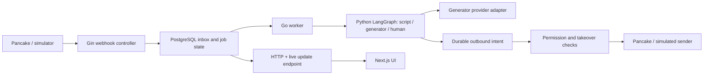

# HEX-9: MVP technology selection proposal

Status: baseline approved by the project owner on 2026-10-18. No implementation or dependency changes. AI provider/model, frontend application selection, media storage and deployment details remain open; approval does not imply a dependency upgrade or proven runtime compatibility.

## Context and evidence

The approved requirements and desktop flows are recorded in Notion HEX-6 and HEX-7. The MVP includes Pancake webhook ingestion, model routing between scripts and generated replies, human takeover, versioned scripts, tenant isolation, orders and configurable sequential workflows. Messaging and orders have separate interfaces.

Repository inspection: `services/api/go.mod` declares Go 1.25.3, Gin, Fx, GORM, Redis, Swagger and telemetry dependencies. `apps/web/package.json` and `apps/admin/package.json` declare Next.js 16.3.0 and React 19.2.8. These are manifest declarations, not verified runtime versions. `infrastructure/docker-compose.yml` declares PostgreSQL 17 and additional infrastructure. Existing auth, tenant, order and inventory code must be audited against the updated product scope before reuse. Existing code is not evidence that the new requirements are implemented.

## Recommended baseline

| Concern | Proposal | Rationale / limit |
|---|---|---|
| Desktop UI | Next.js App Router, TypeScript, Tailwind, shared UI/SDK | Reuse repository conventions; choose web versus admin shell after auditing both apps |
| Business API | Go, Gin, Fx, existing five-layer structure | Reuse authentication and tenant foundations; keep business rules independent of transport |
| Database | PostgreSQL, GORM, Atlas | Transactional assignment, script versions, workflow snapshots and audit history |
| Background work | Go worker with durable PostgreSQL inbox/outbox and job state | Persist before acknowledging webhooks; reuse one database for the first operational slice |
| Cache | Existing Redis where justified | Do not make cache authoritative for ownership, permissions or send state |
| Live updates | SSE plus authenticated HTTP mutations; polling fallback | Primarily server-to-browser notifications; validate proxy buffering, reconnect and authentication |
| Internal AI transport | Owner-approved gRPC with versioned Protobuf; StartRun/GetRun/CancelRun unary lifecycle | Generated Go/Python bindings; HTTP for health/preview, frontend HTTP/SSE unchanged; durable jobs are a separate requirement |
| AI | Dedicated Python service with a small LangGraph and provider-specific LangChain adapters for OpenAI, Anthropic and Gemini API keys | Owner requested simple AI MVP on 2026-10-18; one configured provider per run, no multi-agent system; Go owns business authorization and final sending |
| AI observability | Self-hosted; Langfuse proposed as the initial viewer | Owner selected self-hosting on 2026-10-18; separate observability storage and deployment from business state; inference provider remains open |
| Media | Storage adapter; choose managed object storage versus demo storage after deployment constraints | No vendor or signed URL implementation selected yet |
| Development | pnpm, Docker Compose, existing Go/frontend CI, vertical slices | Deliver webhook simulation through reply generation and simulated send first |

Kafka, Elasticsearch and Qdrant are already configured but are not proposed as mandatory for the first slice. Do not remove them or migrate existing integrations as part of this selection. Reconsider a broker, search service or vector retrieval after workload and retrieval evidence exists. A dedicated Python AI service is now explicitly requested; this supersedes the earlier Go-only AI proposal. See the HEX-8 design's Python AI service boundary for contracts, persistence and tracing. No hosted tracing provider or expenditure has been selected.

## Proposed flow

HTTP ingestion and user actions are synchronous. Routing, model calls and sending run asynchronously after durable persistence. Database jobs require leases, retry policy, duplicate detection and recovery; selecting PostgreSQL does not provide these automatically. An ambiguous outbound timeout remains unknown until reconciliation; an outbox cannot guarantee exactly-once delivery to an external API.

## Data and API design boundaries

HEX-8 must specify tenant-scoped conversations, consultation turns, messages, assignments, scripts and immutable versions, reply drafts/intents, inbox events, jobs and audit records. Include tenant-aware uniqueness, atomic assignment, workflow version snapshots and scheduler indexes. Exact tables, migrations, DTOs and routes are deliberately deferred to HEX-8 rather than treated as approved by this technology proposal.

Use existing DTO and `response.Response[T]` conventions, Swagger annotations and shared typed errors. Existing model locations differ from written repository guidance in places; inspect and resolve alignment before editing models. Retain current dependencies until a separate compatibility/security check justifies a change.

## Security and performance

Check tenant and authorization on every operation and again before send; keep model output outside the authority boundary. Persist routing explanations and script versions. Hide provider tokens from logs and client responses. Pancake query-token requirements need a documented connector-specific exception to the repository's general no-token-in-query guidance; never generalize that exception to Hexta authentication.

Use transactions for local ownership changes, not long transactions around network/model calls. A separate send/takeover concurrency protocol must handle the point after a request has already reached Pancake. No claim that such a request can be recalled. Define load, latency, retention, cost budgets and model quality thresholds before evaluation.

## Alternatives and validation

- All Next.js backend: would introduce a second business implementation alongside existing Go services; reconsider only if maintenance evidence supports it.
- Kafka-first pipeline: useful for independently scaling consumers, but adds operations before workload is established.
- WebSocket-first UI: reconsider if bidirectional streaming requirements emerge; ordinary sends can remain HTTP.
- Vector database from day one: not justified by ten initial products alone; evaluate structured retrieval and routing first.

No tests were run: this change only records a proposal. Review manifests and architecture boundaries, then validate a vertical slice with duplicate events, competing claims, takeover during generation, unknown send outcomes and a controlled clock. Benchmark router decisions and generated content separately. Real Pancake access and the ten-product dataset remain external prerequisites.

## Primary references

- https://nextjs.org/docs/app/getting-started/server-and-client-components
- https://developer.mozilla.org/en-US/docs/Web/API/Server-sent_events/Using_server-sent_events
- https://www.postgresql.org/docs/current/sql-select.html (SKIP LOCKED supports queue-like access, not general consistent reads)

Provider/model, operational frontend app, media storage and final deployment topology remain open. No vendor expenditure or infrastructure provisioning is authorized by this document.
