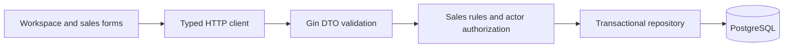

# Manual sales demo design

## Design summary

Implement the approved D1–D3 slice without keys, datasets or external effects. Reuse the existing auth, tenant, customer/product/order tables, SDK transport and UI. Add a sales repository transaction boundary and service for tenant authorization, catalog maintenance and draft/confirmation rules. The legacy inventory/AI service remains available internally; HTTP order commands move to the guarded sales boundary. Payment and generic lifecycle mutation are not exposed by the demo router.

## Architecture and data flow

Service rules execute in repository-managed transactions, including membership and related resource reads. Persistence uses row locks for current membership, customer/product references and orders. Order version predicates reject stale edits and confirmation. Confirmation stores an audit record in the same transaction, without stock reservation, payments or AI calls.

## Data model and migration

Existing customer and product records support create/list/update/archive (customer soft delete, product status archive). Product forms manage one variant on creation and preserve variant identity on edit. Variant price gets a separate price_provided flag so absent price is never represented as a known zero. Orders add version (default 1), requires_delivery and delivery_address; order items add price_provided. Existing draft lines stay unpriced for confirmation until reviewed; historical non-draft price presence is retained as legacy data. Existing rows are not deleted. Prices use fixed-point decimal with at most two fraction digits and bounded precision. No speculative tenant-FK retrofit across all historical data in this slice; every supplied reference is checked within the command transaction.

## API contracts

Authenticated routes select tenant through X-Tenant-ID, with membership checked server-side on every operation. Actor identity comes from auth context, never body fields.

- GET/POST /api/v1/customers; PUT/DELETE /api/v1/customers/{id}.
- GET/POST /api/v1/products; PUT/DELETE /api/v1/products/{id}. Delete archives, preserving history.
- GET/POST /api/v1/orders; GET/PUT /api/v1/orders/{id}; POST /api/v1/orders/{id}/confirm.
- Lists are bounded/paginated. Writes use DTOs; all responses use response.Response[T].
- Draft PUT is a full replacement of editable fields with expected version. Empty item list and absent customer/sale/price are valid drafts; supplied quantities/references remain valid. Confirmation requires current version, assigned actor, customer name/contact, items/positive quantities/explicit prices, and address only for delivery.
- Owner may assign/reassign drafts; a member may create an unassigned/self-assigned draft and edit unassigned or own drafts. Only assigned actor confirms. Another member's draft is read-only. Assigning someone else requires actual tenant owner identity, not merely a submitted role.
- 400 invalid fields/references, 401 unauthenticated, 403 membership/actor denial, 404 missing resource, 409 stale version/non-draft update/duplicate key. Swagger regenerated from controller annotations.

## UI and security

A shared workspace shell selects and persists the active tenant, links customers/products/orders/team, and resets forms/in-flight reads on tenant changes. Forms expose missing price separately from zero. Catalog empty states lead to entry forms; order draft editor supports multiple items and explicit save then confirm with current server version. Confirmed orders are read-only. Member labels use IDs until user profile lookup exists. The team page uses existing invitation APIs.

No API keys, channel sender, simulated success, financial actions or external background work. Ordinary verification records are entered only during test execution. Server-side checks remain authoritative.

## Entry-flow revision

The owner now requires a dedicated workspace selection screen before order management. /workspaces replaces automatic workspace entry. Explicit selection persists in sessionStorage, cleared on authentication changes; management navigation is gated until selection. The current source implements this revision, with runtime verification pending the local rebuild.
