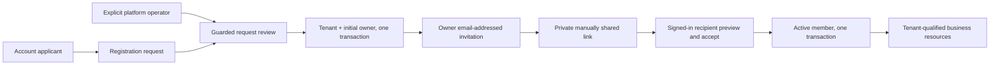

# Tenant-first onboarding implementation design

## Summary and ownership

Implements the owner's approved tenant registration -> Hexta review -> initial owner flow, and owner email invitation -> explicit recipient acceptance -> membership. Business resources use route-qualified tenant identity. Existing tenants and business records are preserved; no subscription payment is claimed. This follows the [framework plan](../plans/2026-10-19_tenant-first-framework_plan.md).

## Architecture and flow

Onboarding controller validates DTOs and delegates to Go service rules; repository owns Gorm transactions/locks. Existing sales service remains responsible for current membership, assignment, state and resource references. Hexta operators have no implicit tenant resource membership.

## Models and migration

20261019040000 creates platform_operators, tenant_registration_requests and tenant_invitations. Applications persist applicant/reviewer/status/reason/time and resulting tenant ID. Active application slugs are unique. Invitation email is normalized, role is fixed to member, token is 32 cryptographically random bytes encoded as hex, only SHA-256 digest persists, pending tenant/email is unique, expiry defaults to seven days as a bounded demo implementation choice. Status constraints and tenant FKs enforce the permitted shapes. Existing accounts, memberships and orders are not reset or automatically re-approved.

## API contracts

Authenticated account routes: GET/POST /api/v1/tenant-requests. Platform authority: GET /platform/access, GET /platform/tenant-requests, POST /platform/tenant-requests/{id}/review. Tenant owner: GET/POST /tenants/{tenantID}/invitations and POST /invitations/{id}/revoke under that tenant prefix. Recipient actions: POST /api/v1/invitations/{preview|accept|decline} with the token in the JSON body. Generic old create-tenant/direct-invite/global-sales routes are removed. Existing tenant update rejects plan/status changes. Platform plan/status editing and payment automation are not added.

Sales routes are /api/v1/tenants/{tenantID}/{orders|customers|products}; a conflicting legacy X-Tenant-ID header is rejected. Header/body cannot select another tenant. Legacy Gemini AI routes are not publicly registered in this keyless demo; their internal service remains intact.

Typed shared errors cover invalid data, missing identity/resource, wrong authority and stale state. Swagger tracks registered operations. Response data uses response.Response[T]. No token hash or raw storage error is returned.

## Authority and bootstrap

No public API grants platform privileges. The platform-operator command requires trusted database access and an explicitly supplied existing account ID. Grant/revoke is an operator action; the application never promotes the first user or trusts tenant role/email flags. Owner account bootstrap happens only during an authorized approval transaction. Tenant owners cannot mutate platform plan/access fields.

Local test fixtures may provision operators inside isolated test databases. A proposed temporary operator grant in the running demo was rejected by automatic approval review because no explicit user authorization for that live privileged change was supplied. It is not performed by this implementation.

## Invitation security and delivery boundary

No email provider/key is configured. Creation returns a one-time-visible private manual link and delivery=manual_link_not_emailed; the UI explicitly says no email was sent. The token is put in the browser fragment, captured into tab session storage and removed from the URL before authenticated API preview; it is not placed in an API route/query or request log. Account email must match and token possession is required. This manual delivery requires the owner to share only with the intended recipient; it is not a claim of automatic mailbox verification. Email delivery/verification is a later integration.

GET/link opening never activates membership. Preview requires sign-in but has no membership side effect. Acceptance/decline checks current tenant state, token status, expiry and recipient, then changes invitation/membership atomically. Repeated acceptance by the same actor is idempotent but never restores membership after later removal. A new invitation to the same email revokes its old pending link. Owner operations and acceptance acquire tenant before invitation locks; approval locks the request before provisioning.

## UI and tenant context

/tenants is the account hub: approved memberships, request statuses and an application form. /platform is an operator-only review screen. /invitations is a public entry page that preserves a pending link through sign-in, then performs authenticated actions. /tenants/{tenantId}/orders, customers, products, settings/members and settings/subscription use one route-bound tenant shell. Resource components are not mounted while membership is loading or for a different/denied/suspended tenant. No session/local storage chooses tenant scope; deep links and separate tabs remain independent. Legacy UI entry URLs redirect to /tenants.

## Verification and limits

Verify SQLite service and isolated HTTP-controller workflows, PostgreSQL concurrent review/accept and sales races, fresh/upgrade Atlas integrity, Go race/vet and frontend lint/type/production build. Browser verification can safely exercise pending registration and existing approved memberships. Live operator approval requires an explicitly authorized existing operator or a user-approved temporary test grant. Provider/email/payment/workflow/chat implementation remains outside this slice.
