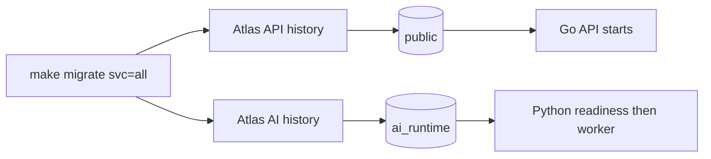

# Atlas-only migrations for current services

## Design summary

Owner requires explicit Atlas migrations for every database-owning service and no automatic migration. Current owners are Go API/public and Python AI/ai_runtime. Remove Python runtime DDL and Go test AutoMigrate, replacing them with separate Atlas histories. Retire missing user/catalog migration targets rather than invent service schemas. Application startup checks readiness only. No HTTP/RPC contract changes.

## Schema and upgrade

Keep seven existing API migrations/checksums unchanged. Add migrations/ai with a versioned initial migration, checksum and explicit desired schema. The initial AI migration adopts an existing compatible runs table using idempotent creation plus a catalog shape/constraint/index precondition, preserving all requests/results/leases and current ownership. Incompatible existing shape aborts rather than silently baselining. Runtime has no DDL. Independent revision schemas atlas_schema_revisions and atlas_ai_revisions avoid shared-history collisions when both services use one database. AI schema/role bootstrap remains explicit infrastructure initialization.

Desired SQL schema files and root Atlas environments provide explicit diff/apply/status workflows, with connection/dev URLs passed through environment variables. No migration credentials in runtime APIs. New tables belong to their service migration directory. Existing API models are not automatically reconciled into production; desired schema and reviewed versioned SQL are authoritative.

## Execution and security

Make/script target api/ai/all. Docker demo runs API and AI migration jobs before their respective application starts; both jobs use explicit migration credentials. Test PostgreSQL is provisioned separately. Go database tests create disposable isolated databases, apply real API Atlas history and clean up only generated test databases. Python integration tests depend on Atlas AI migration job; they do not create schemas/tables. Missing explicit test URL skips database tests with a clear reason; configured database/Atlas failures fail tests. CI supplies PostgreSQL and Atlas before testing.

## Verification

Validate both histories; test all/individual/invalid target behavior without exposing credentials. Apply both histories to a fresh database; verify rerun is a no-op and histories are independent. Apply AI migration to an existing legacy-compatible fixture with a retained run, and reject incompatible fixtures. Run PostgreSQL Go race/vet, offline and PostgreSQL AI suites, rebuild/start local stack, check migration job exits/readiness and preserved demo rows. No application data reset or live provider action.
