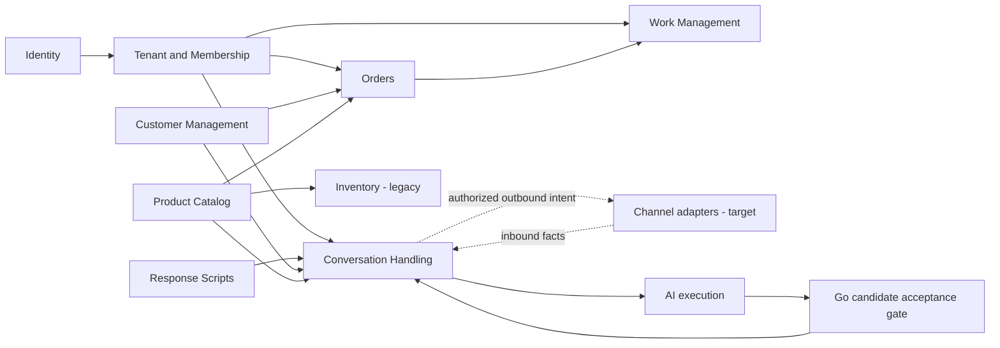

# Hexta DDD domain map

Date: 2026-10-20. Status: TARGET recommendation for owner review.
Evidence: working tree on `codex/rules-compliance`, HEAD `2abd305`, including pre-existing uncommitted compliance work. Documentation only; context boundaries are proposed, not implemented or newly owner-approved.

## Design summary

Hexta's overarching domain is tenant-isolated assisted sales and business operations. Recommend nine initial business bounded contexts across platform access, sales operations and customer engagement. Subdomains describe business problems; bounded contexts define consistent models and ownership. The initial one-to-one mapping below is a hypothesis to validate with the owner.

Orders, Work Management and Conversation Handling are proposed core subdomains. Customers, Catalog, Inventory and Scripts are supporting; identity is generic and tenant administration supports the SaaS business. Business differentiation and team ownership may change this classification.

Start with logical modules in the existing Go API. A bounded context does not require a microservice or separate database. Preserve controller/service/repository/infrastructure rules and current routes. No new code organization standard is adopted here.

## Candidate contexts

| Context | Business ownership | Candidate aggregate roots and value concepts | Current evidence |
| --- | --- | --- | --- |
| Identity & Authentication | Login identity, authentication, session refresh/revocation. Login alone grants no tenant access. | Identity, Session; AccountID, ProviderIdentity | IMPLEMENTED auth routes/services and identities/sessions. No physical users table or implemented Account aggregate is assumed. |
| Tenant Administration & Membership | Business registration/review, provisioning, owner/member access, invitations. Platform operator authority differs from tenant owner authority. | Tenant, RegistrationRequest, Invitation; Membership, TenantID, grants | IMPLEMENTED onboarding and membership foundations. Script grants/broader commercial policies remain TARGET/OPEN. Approval atomically provisions tenant and initial owner. |
| Customer Management | Tenant-owned buyer profiles, contact data and archival. Buyer differs from the business buying Hexta. | Customer; ContactDetails, Address | IMPLEMENTED in SalesService/SalesRepository; no independent context boundary yet. No full CRM/pipeline implied. |
| Product Catalog | Product/variant identity, descriptions, eligibility and catalog price facts. | Product containing ProductVariant; SKU, catalog price | IMPLEMENTED in SalesService and product models. Does not own stock or an order's agreed line price. |
| Order Management | Incomplete drafts, explicit confirmation, agreed prices/quantities, assigned sale and delivery requirements. Future cancellation/returns initially belong here. | Order containing OrderItem; Money, Quantity, DeliveryDetails. Future ExceptionCase references original order/lines. | IMPLEMENTED active draft/confirm routes. Legacy OrderService stock/payment behavior is separate. Exceptions are TARGET; money collection/refunds are outside approved scope. |
| Work Management | Configurable steps, immutable workflow versions, responsibility, direct/accepted handoff, final completion and history. | WorkflowDefinition with versions/steps; WorkItem with transition history | IMPLEMENTED WorkflowService and workflowmodel. Current work explicitly references a confirmed order. General non-order work is future scope. |
| Inventory | On-hand/reserved quantities, availability, movements and stock invariants. | InventoryItem per tenant/variant; StockMovement history, StockQuantity | LEGACY IMPLEMENTED code/tables. No active inventory routes or stock effects in current manual confirmation. Activation/reservation timing requires an explicit decision. |
| Conversation Handling | History, consultation turns, assignment, control, escalation, reply proposals and final send authorization. | Candidate Thread/Turn gate, ReplyProposal, OutboundIntent; ContextRevision, ControlGeneration | TARGET business context. Go worker, conversation persistence and send gate absent from active routes. Aggregate division remains OPEN pending concurrency design. |
| Response Scripts | Draft/version/activate/archive response knowledge, retain source versions and enforce delegated grants. | Script with immutable ScriptVersion; applicability, variable definitions | TARGET management context. Python accepts script snapshots for simulation; it does not own script lifecycle or production persistence. |

Aggregate choices are TARGET logical ownership, not claims that GORM models implement DDD aggregates. TenantID scopes independent roots; do not put all orders/products/customers into one Tenant aggregate. Six contexts have active foundations; Inventory is legacy; the final two are target business models.

## Context map and data flow

Arrows mean provider-to-consumer contracts, not direct repository imports. Dashed edges describe target asynchronous delivery. This is a proposed logical map, not the deployed call graph.

Tenant access applies to Customers, Catalog, Inventory and Scripts too; omitted arrows reduce clutter. Membership supplies access facts; each business context owns its action-specific authorization. Owner status alone does not authorize confirming another sale's order or sending a manual reply.

## Contracts and consistency

- Identity supplies account identity; Tenant supplies current membership/owner/grant facts. Recheck membership under the command transaction where revocation can race mutations. Cached/token facts alone cannot authorize these commands.
- Orders consumes tenant-qualified customer/contact and active variant facts. Its explicit line price may differ from catalog defaults. Current SalesRepository reads these within a transaction; narrow context ports are TARGET. Preserve confirmation validation/locking when separating modules. Historical contact/product snapshots are a future choice, not existing persistence behavior.
- Work Management creates work only on an explicit owner command after validating a confirmed order and selected workflow version. Replace its concrete order repository dependency with a narrow eligibility contract during refactoring. OrderConfirmed must not silently start work. Work completion does not change order/stock/payment state.
- Scripts publishes eligible immutable versions to Conversation Handling. Script/mode changes invalidate eligibility; the current-state Go send gate checks eligibility again even when asynchronous invalidation lags.
- Python executes authorized snapshots through StartRun/GetRun/CancelRun and returns candidates. Go checks context/control/config/permissions before accepting candidates or authorizing sends. AI success grants no business authority.
- Channel adapters form an anti-corruption layer for provider identities, payloads, receipts and failures. They execute authorized operations, not decide permission. Real provider capabilities/auth/reconciliation remain OPEN until verified.
- Closing a conversation or finishing AI never implicitly creates/confirms/cancels an order. An explicit application command may coordinate future approved use cases.
- Inventory reservation/deduction timing is OPEN for active sales. Do not revive legacy effects by moving code. Define concurrent availability, idempotency and compensation before integration.

## Supporting capabilities and exclusions

AI execution is a separate technical model/service with run identity, digest, lease, cancellation and result state in `ai_runtime.runs`. It can be treated as a supporting technical bounded context; it is excluded from the nine business contexts to distinguish execution state from sales decisions. Current provider behavior is fake.

Pancake belongs behind channel adapters initially. A dedicated Channel Integration context may become useful as provisioning, credentials and multiple providers acquire independent policies. No real Pancake connector is implemented today.

Audit and overview/search are cross-context capabilities or read projections initially. Kafka, Redis, PostgreSQL, HTTP/gRPC, tracing and Atlas are infrastructure, not business subdomains. audit_logs/work_events do not imply event sourcing or an implemented Kafka backbone. Inbox/outbox, Kafka integration and projected overview remain TARGET.

Billing/subscriptions, payment execution, refunds, shipping-provider logistics and procurement are not established contexts in this evidence. Tenant.plan, payment flags and optional delivery steps do not establish those businesses.

## API, persistence and security impact

No new routes, DTOs, HTTP errors, tables or migrations in this discovery slice. Preserve existing tenant-qualified routes, Swagger envelopes, shared errors and Atlas API/AI desired-state schemas. Context ownership can coexist in current public tables.

Future modules should own command/query contracts and persistence ports, keep persistence models outside domain policy, and avoid importing another context's repository/model graph. Share minimal identity/value contracts and technical utilities. SalesService/ISalesRepository currently mix customers, products, orders, membership and audit; WorkflowService uses concrete repositories and reads order/member facts. These are refactoring seams, not isolated DDD contexts today.

## Adoption sequence and open validation

1. Validate vocabulary, ownership and core priorities through registration, order confirmation, work handoff and conversation takeover scenarios.
2. Separate logical Customer, Catalog and Order responsibilities from SalesService behind narrow ports while preserving API and transaction behavior. Keep order line updates under Order and distinguish zero from omitted price.
3. Isolate Work Management's order/member dependencies; retain version, handoff and history invariants together. Definition and execution stay one context initially.
4. Design Conversation Handling's aggregate/locking gate and Scripts lifecycle before messaging implementation. Assignment, control and escalation remain independent.
5. Decide active Inventory policy and whether returns, channel administration or billing merit independent contexts. Introduce asynchronous contracts only where needed, after committed state, with inbox/outbox and replay safeguards for sends.

These steps are recommendations, not authorization to execute refactoring.

## Verification and sources

Inspected active routes, service methods, desired-state CREATE TABLE definitions, sales draft/confirmation, explicit work creation, workflow models and Python fake graph against canonical product/architecture/workflow modules and ERD. Documentation-only; no runtime tests or live PR/CI reconciliation. No existing delivery state is promoted.

Code evidence: `services/api/internal/core/service/{sales,workflow,tenant_onboarding,tenant,auth,inventory,order}_service.go`, `services/api/internal/present/http/router/router.go`, `services/api/internal/repository/workflowmodel/models.go`, `migrations/schema/{api,ai}.sql`, `services/ai/hexta_ai/graph.py`. The canonical gRPC/AI design and existing runtime records describe the supporting durable run boundary.
