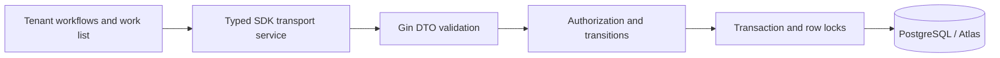

# Configurable sequential order work (D4)

## Design summary

Implement the approved D4 demo after bounded D1–D3 browser acceptance. Owners publish named workflows with 1–30 ordered, user-named steps; each source step chooses direct or acceptance handoff. Publishing edits creates an immutable version. Confirmed orders can explicitly create linked work; confirmation does not create work automatically. Owner nominates the first responsible member. Members can read tenant work; only its current responsible member progresses it. Owner can reassign or clear responsibility, including recovery from a departed member.

## Data model and migration

New repository-layer GORM models: workflow_definitions (tenant, name, current version), workflow_versions (immutable name and number), workflow_steps (version, ordinal, name, handoff_mode), work_items (confirmed order, pinned workflow version, current ordinal, responsible member, nominated recipient, active/waiting/completed state, optimistic version, create actor/key/hash), work_events (actor, event, before/after responsibility, step and state, work version). Composite tenant/reference foreign keys prevent cross-tenant links. Retain earlier versions and events; no delete endpoints. A populated database upgrade is additive. Existing order/business tables retain their semantics.

## API contracts

Routes are authenticated under /api/v1/tenants/{tenantID}; actor derives from auth context. Standard response.Response[T] wrappers and Swagger annotations apply.

| Route | Request / result |
| --- | --- |
| GET/POST /workflow-definitions | Paginated current definitions with latest immutable steps; owner create with Idempotency-Key UUID |
| POST /workflow-definitions/{id}/versions | Owner publishes name/ordered steps with expected_version |
| GET/POST /work-items | Paginated work; owner explicit create with confirmed order_id, workflow_version_id, responsible_id and Idempotency-Key UUID |
| GET /work-items/{id} | Pinned steps and latest 100 events |
| POST /work-items/{id}/handoff | Current responsible actor, expected_version and recipient_id; advances to next step immediately for direct mode, or waits with old step/owner retained |
| POST /work-items/{id}/accept | Only nominated current member, expected_version; transfers responsibility and advances exactly one step |
| POST /work-items/{id}/assign | Owner, expected_version, nullable responsible_id; cancels pending nomination and retains step/version |
| POST /work-items/{id}/complete | Current responsible actor, expected_version, active final step only |

Creation keys are durable; exact replay returns the existing resource, changed payload conflicts. Workflow definition UUID uses the creation key as identity; work creation stores tenant+actor+key and request digest. Publishing uses expected version rather than automatic retry. Invalid fields 400, unauthenticated 401, forbidden 403, missing/cross-tenant resource 404, stale/illegal transition or reused key 409. UUID route validation prevents malformed database identifiers. No payment, inventory or message effects.

## Security, concurrency and UI

Transactions lock active tenant and current membership for authorization, then definition/work/order rows as needed. Current recipient membership is checked at handoff and again on acceptance. Row locks plus expected-version predicates serialize accept/assign/handoff/complete and append one work event atomically. Definition publishing pins old instances to old step names/order/policy. Owner reassignment cancels pending nomination so an obsolete acceptance cannot transfer responsibility. Reassignment never advances a step. The unassigned queue is visible; only owner assigns it. Do not cache mutable authorization/work state in Redis.

Tenant navigation adds Work and Workflows. Owner workflow editor supports add/remove/rename/reorder and explicit publish. Work creation selects a confirmed order, current workflow and initial employee. List/detail shows current step, responsible person, waiting recipient, pinned version and recent history. Authorized controls offer handoff, nominated acceptance, final completion and owner reassignment. Mutations submit displayed versions; conflicts require explicit refresh. Forms reset on tenant changes.

## Verification plan and boundary

Service tests cover version pinning, acceptance retaining old responsibility, direct transitions, actor/tenant/recipient denial, owner reassignment/unassignment, stale commands, durable create replay and payload conflict, transactional events and final-step completion. Real PostgreSQL concurrent acceptance versus reassignment must have one winner. Validate Atlas checksums, apply fresh and upgrade migrations, regenerate Swagger, run Go race/vet and frontend lint/type/build, and verify rebuilt browser path. No external provider or messaging scope. Delivery remains in-progress/in-review until merge verified.
