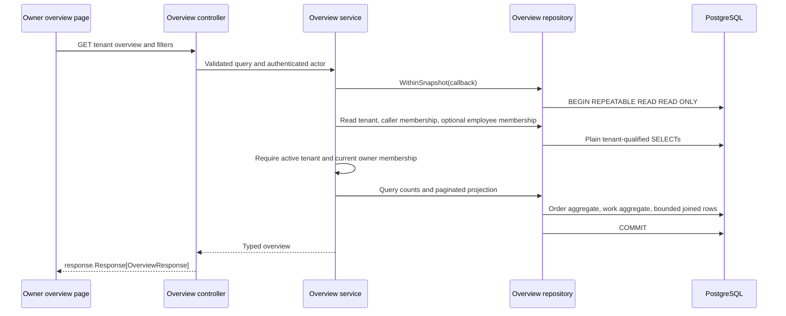

# D5 minimal owner overview

Date: 2026-10-23. Primary epic: EPIC-007. Work unit: U07. Status: TARGET, in-review; completed: false. Baseline inspected: merged `656a6c4`, on `codex/demo-work-units` with unrelated documentation preserved.

## Design summary and boundary

Provide one read-only owner overview over existing orders and operational work: global matching counts plus a page of work rows. U08 implements this contract; U09 renders it. This document proposes new behavior, not an existing API or accepted browser result. The user authorized all nine units; design preparation proceeds independently while original U01–U06 browser/operator acceptance gates remain OPEN. Automated checks reported by the coordinator are supporting evidence, not substitutes for those gates. Parent epic completion is unchanged.

Use the existing tenant, membership, order and pinned workflow schema. No migration, cache, event, AI, revenue, payment, product-interest, stock or messaging feature is required. Do not introduce a configurable metrics engine or a new authorization framework.

## Architecture and data flow



All calls are synchronous HTTP/SQL. Service owns authorization and domain validation; repository owns SQL/GORM and transaction options. Add focused overview files/types and Fx/router wiring rather than extending command responsibilities. Core query/result types must not depend on HTTP DTOs; HTTP DTOs live under `internal/present/http/dto/`. Return `*errors.Error` through service/repository boundaries.

## Existing data model and query inputs

| Table | Fields used | Existing integrity/indexes |
| --- | --- | --- |
| tenants | id, owner_id, status | UUID-shaped varchar(36) PK |
| tenant_members | tenant_id, user_id | Unique tenant/user; user IDs are opaque strings up to 255 chars |
| orders | id, tenant_id, order_number, employee_id, status, created_at, deleted_at | Tenant index, employee/status indexes, unique tenant/id; soft deletion |
| work_items | id, tenant_id, order_id, workflow_version_id, current_step, responsible_id, recipient_id, state, version, created_at, updated_at | Tenant/created_at DESC/id index; tenant-qualified order/version/step FKs; state checks |
| workflow_versions | tenant_id, id, name, number | Immutable published versions |
| workflow_steps | tenant_id, workflow_version_id, ordinal, name | Unique version/ordinal; tenant-qualified step FK |

Work states are `active`, `waiting`, `completed`. Unassigned means `responsible_id IS NULL`, an orthogonal subset of active in the current valid schema, never a fourth work state. Waiting retains its current responsible member and current step until acceptance. Completed retains its final responsible member and final step. Read these stored facts; never infer completion from order status or recipient nomination.

Migration outline: none. Do not call AutoMigrate/startup DDL or add indexes speculatively. Reassess query plans only if actual data demonstrates a performance issue, then use a separate reviewed Atlas change.

## HTTP request contract

`GET /api/v1/tenants/{tenantID}/overview`, Bearer authenticated, owner-only. Optional `X-Tenant-ID` must match the path if supplied, matching tenant-qualified sales middleware. No request body. Read-only route has no command/idempotency/version input.

| Query | Type/default | Exact rule |
| --- | --- | --- |
| from | Optional RFC3339 timestamp with explicit UTC offset or Z | Inclusive lower bound on creation time; both from/to omitted means all time |
| to | Optional RFC3339 timestamp with explicit UTC offset or Z | Exclusive upper bound; if either bound supplied require both, and `from < to` |
| employee_id | Optional opaque string, max 255 characters | Must identify a current member of this tenant, including owner if selected; omitted means all employees |
| assignment | `all` (default), `assigned`, `unassigned` | Apply nullable assignment predicate in each population below |
| page | Integer default 1 | 1–100000 inclusive |
| size | Integer default 20 | 1–100 inclusive |

Parse timestamps with RFC3339Nano support, normalize to UTC, and preserve fractional precision. Reject missing offsets, date-only values, invalid/empty explicit values, repeated known query keys, out-of-range pagination and non-integer pagination with 400. Unknown keys can be ignored, consistent with ordinary query binding. Unlike older list helpers that clamp invalid pagination, this new endpoint deliberately validates explicitly; reuse bounds only after validation. Do not create a new pagination convention for existing routes.

`employee_id` combined with `assignment=unassigned` is contradictory and returns 400. With a specific employee, `all` and `assigned` yield the same assignment predicate. A syntactically valid foreign/nonexistent/former member yields the same 400 `employee must be a current tenant member`, without revealing whether that account exists elsewhere. Employee IDs are not required to be UUIDs.

The backend compares instants, not server-local calendar dates. U09 displays/converts date controls in **Asia/Ho_Chi_Minh** and labels that timezone. An inclusive UI end date becomes the next local day's midnight exclusive; a same-day UI range is valid. Defaults are visibly **All time**. Example week 19–25 October is `[2026-10-19T00:00:00+07:00, 2026-10-26T00:00:00+07:00)`, equivalent to `[2026-10-18T17:00:00Z, 2026-10-25T17:00:00Z)`. Percent-encode `+` as `%2B` when building query URLs.

## Population and count semantics

There are two independent creation cohorts. These are counts of **current state among records created in the interval**, not transitions/completions/activity during the interval. An old order may have new work inside the interval. A work handoff changes its current-state count but does not move its creation timestamp. UI copy must explain this and label employee as **Assigned sale / current work responsibility**.

Order population O:

1. `orders.tenant_id = tenantID AND orders.deleted_at IS NULL`.
2. If range selected: `orders.created_at >= from AND orders.created_at < to`.
3. If employee selected: `orders.employee_id = employee_id` (assigned sale, not work responsibility).
4. `assignment=assigned`: `orders.employee_id IS NOT NULL`; unassigned: `IS NULL`.

Work population W:

1. `work_items.tenant_id = tenantID`.
2. If range selected: `work_items.created_at >= from AND work_items.created_at < to`.
3. If employee selected: `work_items.responsible_id = employee_id`, never `recipient_id`, order employee, creator or history actor.
4. `assignment=assigned`: `work_items.responsible_id IS NOT NULL`; unassigned: `IS NULL`.

Work remains included if its source order was created outside the interval or soft-deleted. Read source order number through a same-tenant left join without silently dropping work on a soft-delete scope; do not apply O's employee/date/deletion predicates to W. The FK ensures the physical source order exists. Never join work into the order aggregate: several work items can reference one order and must not multiply order counts. Legacy NULL order creation times appear only in all-time O, not a bounded cohort.

Order counts: `total`, `draft`, `confirmed`, `processing`, `fulfilled`, `cancelled`, `returned`, `other`. Every value is a nonnegative int64 JSON integer. Six named status buckets reflect existing persisted enum values; `other` handles any legacy/unrecognized status. `total` equals their sum. Showing legacy states does not authorize their mutation. U09 can render total/draft/confirmed as primary cards and a compact labelled breakdown for any remaining states; do not hide a nonzero other count.

Work counts: `total`, `active`, `waiting`, `completed`, `unassigned`. All use W before pagination. `total = active + waiting + completed`; `unassigned <= active` under existing constraints and must not be added to that sum. No status filter is included in this minimal version. All work rows and the work total use exactly W. `page`/`size` affect rows only, never either population's cards. Sorting: `work_items.created_at DESC, work_items.id ASC`; ties are deterministic. Out-of-range valid pages return `items: []` with matching counts retained. Separate requests/pages may observe newer snapshots; no cursor or cross-request snapshot guarantee is promised.

## Response DTOs and example

New DTO shapes (JSON field names are authoritative):

```text
OverviewResponse {
  filters: OverviewFilters,
  orders: OverviewOrderCounts,
  work: OverviewWorkCounts,
  work_items: { items: OverviewWorkRow[], total: int64, page: int, size: int }
}
OverviewFilters {
  from: time.Time|null, to: time.Time|null,
  employee_id: string|null, assignment: string
}
OverviewOrderCounts { total, draft, confirmed, processing, fulfilled, cancelled, returned, other: int64 }
OverviewWorkCounts { total, active, waiting, completed, unassigned: int64 }
OverviewWorkRow {
  id: string, order_id: string, order_number: string,
  workflow_version_id: string, workflow_name: string, workflow_version_number: int64,
  current_step: int, current_step_name: string,
  responsible_id: string|null, recipient_id: string|null,
  state: "active"|"waiting"|"completed", version: int64,
  created_at: time.Time, updated_at: time.Time
}
```

`current_step` is the stored **zero-based ordinal**; UI may display ordinal+1. `workflow_name`, version number and step label come from the item's pinned version and `(tenant_id, workflow_version_id, current_step)`, never the latest definition. No history, all-step preload, creation digest or private request key appears. Explicit nulls are emitted for absent assignments/bounds; arrays are always `[]` rather than null. UTC timestamps serialize as RFC3339. Reuse the existing current-tenant users endpoint for selector options, once per page scope rather than per row. It exposes user IDs/roles, not profile names: display `You` or user ID and do not add a profile lookup API. A stored responsible/recipient ID absent from current members remains visible as an ID with an unavailable-member label; never erase or replace that stored fact.

Existing order/work details are inline selections rather than dedicated detail routes. U09 may add minimal `?order_id=` and `?work_id=` support in the existing tenant pages/components to open the selected record via its existing tenant-qualified detail API even when absent from the first list page. Overview links preserve the tenant path. Do not introduce replacement detail pages or assume an unimplemented deep link already works. Preserve existing default landing route.

Worked fixture (symbolic IDs below are test aliases; production resource IDs remain UUIDs). All dates are +07:00; A/B are current members. All five work items pin v1 with step 0 `Review` and step 1 `Finish`; latest published v2 renames step 0 `New review`.

| Order | Created | Current status | Assigned sale |
| --- | --- | --- | --- |
| O0 | Oct 18 10:00 | confirmed | A |
| O1 | Oct 19 00:00 | draft | A |
| O2 | Oct 20 09:00 | confirmed | A |
| O3 | Oct 21 09:00 | confirmed | B |
| O4 | Oct 22 09:00 | confirmed | null |
| O5 | Oct 26 00:00 | draft | A |

| Work | Source order | Created | State | Current responsible | Pending recipient | Step |
| --- | --- | --- | --- | --- | --- | --- |
| W1 | O2 | Oct 20 10:00 | active | A | null | 0 |
| W2 | O2 | Oct 21 10:00 | waiting | A | B | 0 |
| W3 | O3 | Oct 22 10:00 | active | null | null | 0 |
| W4 | O3 | Oct 23 10:00 | completed | B | null | 1 |
| W5 | O0 | Oct 24 10:00 | active | B | null | 0 |

For the week interval, no employee/assignment restriction: O total4/draft1/confirmed3, remaining order buckets zero; W total5/active3/waiting1/completed1/unassigned1; rows W5,W4,W3,W2,W1. O1 is included at the lower boundary; O5 is excluded at the upper. W5 remains included despite O0's creation time.

For that interval plus employee B: O total1/confirmed1; W total2/active1/completed1/waiting0/unassigned0; rows W5,W4. W2 is excluded although B is its nominated recipient. With assignment unassigned and no employee: O total1/confirmed1; W total1/active1/unassigned1 and only W3. Without date bounds/all assignments: O total6/draft2/confirmed4; W unchanged.

Request: `GET /api/v1/tenants/{tenantID}/overview?from=2026-10-18T17:00:00Z&to=2026-10-25T17:00:00Z&employee_id=A&page=1&size=1`.

Illustrative response, using fixture aliases for resource IDs:

```json
{
  "data": {
    "filters": {
      "from": "2026-10-18T17:00:00Z",
      "to": "2026-10-25T17:00:00Z",
      "employee_id": "A",
      "assignment": "all"
    },
    "orders": {
      "total": 2, "draft": 1, "confirmed": 1,
      "processing": 0, "fulfilled": 0, "cancelled": 0, "returned": 0, "other": 0
    },
    "work": { "total": 2, "active": 1, "waiting": 1, "completed": 0, "unassigned": 0 },
    "work_items": {
      "items": [{
        "id": "W2", "order_id": "O2", "order_number": "DEMO-002",
        "workflow_version_id": "v1", "workflow_name": "Demo flow", "workflow_version_number": 1,
        "current_step": 0, "current_step_name": "Review",
        "responsible_id": "A", "recipient_id": "B", "state": "waiting", "version": 2,
        "created_at": "2026-10-21T03:00:00Z", "updated_at": "2026-10-21T04:00:00Z"
      }],
      "total": 2, "page": 1, "size": 1
    }
  },
  "meta": null
}
```

Page 2 returns only W1 with the same counts; page 3 returns an empty array and the same counts. Real integration fixtures must use valid resource UUIDs. Empty O/W populations return all count keys with zero, no fabricated cards, empty rows and normalized filters.

## Authorization, errors and consistency

Check authentication before serving records. Validate path UUID/query syntax in controller. In one repository snapshot read tenant and caller membership; require active tenant, current caller membership and `tenant.owner_id == actor`. A membership role label `owner`/`admin` alone does not grant this feature. A platform operator without current owner identity also has no bypass. Validate employee membership only after caller authorization. Existing tenant IDs may return 403 to nonmembers as existing workflow conventions do; no tenant rows/counts are returned.

| Status | Case | Existing error constructor |
| --- | --- | --- |
| 200 | Authorized valid request including empty results | `response.Response[dto.OverviewResponse]`, meta null |
| 400 | Invalid UUID/query/date/member filter; conflicting tenant header | `ErrBadRequest` |
| 401 | Missing/invalid authenticated actor | `ErrUnauthorized` / existing auth middleware |
| 403 | Suspended tenant, no membership or non-owner | `ErrForbidden` |
| 404 | Well-formed tenant ID absent | `ErrNotFound` |
| 500 | Repository/transaction failure | `ErrSystemError`, generic detail without SQL/credentials |

Use the existing structured shared error response through controller `ErrorData`, not a new success-envelope error shape. GET has no 409 conflict state. Swagger must document path, all six query parameters, Bearer security, 200 generic DTO envelope and 400/401/403/404/500 responses, then regenerate with `make swagger` in U08.

Run all plain authorization reads, optional employee check, two aggregates and row projection in the **same PostgreSQL read-only REPEATABLE READ transaction**. Use `sql.TxOptions{Isolation: sql.LevelRepeatableRead, ReadOnly: true}` at repository entry. No write operations/audits are performed. IMPORTANT: existing `SalesRepository.Tenant` and `Member` use `FOR SHARE`; do not reuse them inside a read-only transaction. Add plain SELECT overview methods without locking clauses. Authorization and data are coherent as of that transaction's snapshot; later membership revocation affects subsequent requests, not retroactively an already running snapshot.

Queries are bounded in count, not in total scan cardinality: two aggregate scans over tenant/filter cohorts and one page query using same predicates and tenant-qualified joins to order, pinned workflow version and current step. Counts must scan all matches; never limit before aggregation. Avoid N+1, loading all items into Go, or preloading every workflow/event. Aggregate with SQL conditional counts or grouped counts and fill missing zero buckets. Reuse predicate construction for work count and rows. `work_items.total == work.total`. Context cancellation must reach all SQL calls; release transaction promptly and return no partial response on failure. No Redis cache/invalidation, network calls or browser work occurs within the transaction. Existing tenant/created index supports work ordering; no new index is justified by this contract alone.

## U08/U09 acceptance matrix

| Case | Required result/evidence |
| --- | --- |
| Worked fixture | Exact full/date/A/B/unassigned counts and row sets above |
| Pagination | More matching rows than size, deterministic tied timestamps, counts invariant, beyond-last empty |
| Time | Include exact from, exclude exact to; equivalent offsets same result; explicit same-local-day UI conversion |
| Invalid inputs | One missing bound, inverted/equal bounds, date-only/offsetless date, unknown assignment, empty/repeated known key, invalid page/size, employee+unassigned ->400 |
| Employee authorization | Current owner/member filter accepted; opaque non-UUID member accepted; foreign/former/missing same400 after caller owner check |
| Caller authorization | Missing401; member/admin/nonmember/foreign-owner403; suspended403; missing tenant404; header mismatch400; no payload leak |
| State semantics | Waiting credited to old responsible only; unassigned counted in active and subset; completed retains final responsible |
| Pinned display | New definition version leaves existing work step/name on v1; no row joins to current definition |
| Independent cohorts | Several work items per order do not multiply O; old source order/new work; soft-deleted source order does not drop W; NULL legacy order dates handled as specified |
| Legacy/empty data | Every known order status plus unknown bucket; zero counts and [] on empty data |
| Consistent read | Deterministic database test pauses between aggregate and rows while another transaction changes responsibility/state; response keeps one pre-change snapshot, later request sees committed change |
| Read-only/performance | No data mutation or N+1; SQL uses explicit tenant predicates; repeatable-read transaction actually configured; no locking auth helpers |
| UI evidence | API-backed cards/filters, refresh after transition, pinned labels, recipient separate from responsible, empty/error/403, small viewport, reload and tenant switching without stale data |

U08 runs focused Go race/integration tests on explicit disposable Atlas-migrated PostgreSQL, formatting/vet, Swagger regeneration and generated-contract check. U09 runs web lint/types/build and actual browser acceptance, recording NOT RUN when prerequisites are absent. No test was executed by this documentation-only U07 unit.

## Canonical module integration proposal

Coordinator should add a TARGET subsection to `system/04-http-api.md`: owner-only GET tenant overview with this document linked, half-open creation cohorts, assignment semantics, full matching aggregates and paginated work. Add a TARGET D5 subsection to `system/07-workflows.md`: current-state creation cohorts, responsibility retained while waiting, unassigned subset, pinned version display, single snapshot. Keep existing implementation inventory unchanged until U08 delivery. These proposals are intentionally not written by this unit to avoid concurrent shared-file edits.

## Implementation follow-up

U08/U09 implement this contract locally and are published in [draft PR #59](https://github.com/TruongHoang2004/Hexta/pull/59). Earlier TARGET wording records the design snapshot, not current absence of code. Canonical API/workflow/operations modules and [execution evidence](../epics/EPIC-007-orders-workflows/sessions/2026-10-23_work-unit-execution.md) distinguish implemented/tested behavior from remaining manual acceptance and merge. No parent completion.
