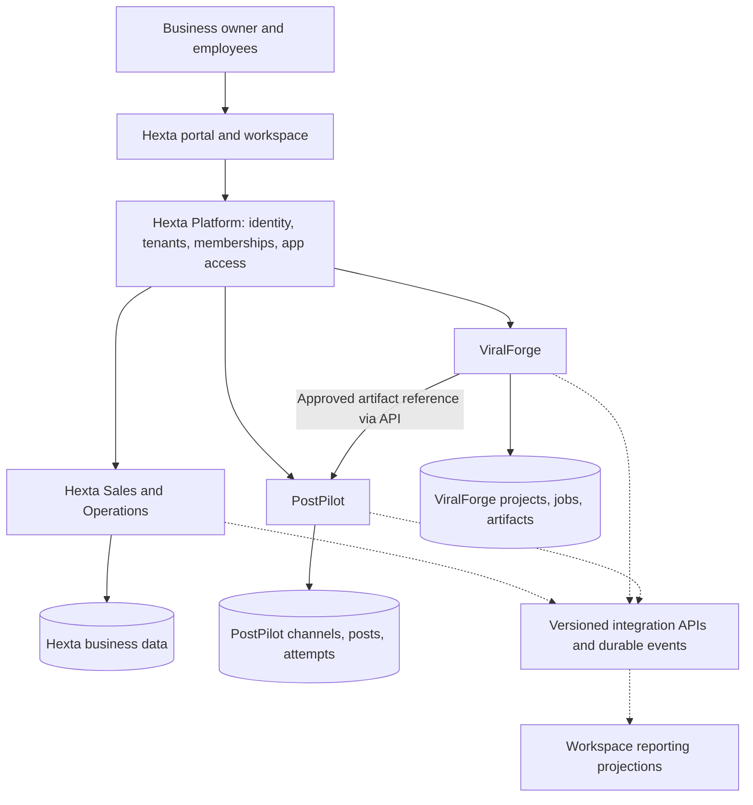

# Hexta SaaS application platform — proposal

## Owner correction — three connected product responsibilities

The owner found the initial platform/module split confusing and clarified the product emphasis: Hexta manages orders and business operations; PostPilot manages fanpages; ViralForge creates content. Treat the three as connected products with these clear responsibilities. The earlier statement that Hexta is central remains context, but does not authorize splitting it into a separate platform product and a sales app. That split and the detailed portal/identity/billing architecture below are historical proposals, not the accepted product structure.

Current discussion model: ViralForge creates content; PostPilot manages fanpages and publishes selected content; Hexta manages orders and business operations. Human-approved content transfer is a proposed integration. Page management is broader than publishing, but inbox, comments, analytics and ownership of conversation handling still require explicit scope decisions; do not infer them from the correction. Shared sign-in, workspace, commercial packaging and infrastructure remain OPEN.

Date: 2026-10-27. Status: TARGET, discussion draft; no runtime changes.

## Design summary

DECIDED by the owner: Hexta is the central SaaS platform for businesses; ViralForge and PostPilot become connected applications. This does not approve the detailed contracts, pricing, rollout or infrastructure below.

TARGET: distinguish Hexta Platform (shared business identity and application access) from Hexta Sales & Operations (existing customer/order/workflow capability). Keep both as modules in the current Hexta repository initially. Keep ViralForge and PostPilot independently owned/deployed applications. A common portal provides one workspace, app launcher and consistent navigation; full frontend consolidation is optional later.

## Architecture and ownership

Edges from Platform represent identity/access relationships, not mandatory proxying of every media byte or model call. Solid integration edge is a proposed command boundary; dotted edges are future asynchronous integration. All diagram components are a target composition, not implemented connections.

| Owner | Source of truth |
| --- | --- |
| Hexta Platform | User identities, tenant IDs, current memberships, tenant approval/suspension, application installations and entitlements; subscription/usage policy later |
| Hexta Sales & Operations | Customers, products, orders, work items, business workflow versions, future conversation handling |
| ViralForge | Projects, source material, generation jobs, scripts, render attempts, private artifacts and provider usage evidence |
| PostPilot | Social channel bindings and credentials, publishing drafts/schedules, attempts and external post IDs |
| Reporting module | Rebuildable cross-app summaries and source references; never authoritative order/job/publish state |

Each application owns its tables and migration history. Logical databases can initially share a PostgreSQL server with distinct roles; no cross-app table reads/writes or distributed foreign keys. Shared infrastructure does not imply a shared domain model. Keep existing RabbitMQ/Redis internal jobs during migration. Existing Hexta Kafka direction remains a separate decision; this sketch does not authorize introducing or replacing brokers immediately.

## Tenant isolation and authentication

Use Hexta tenant ID as the canonical business identifier across apps. Retain existing approved onboarding; account registration alone grants no tenant access. Apps validate authenticated identity, active membership, app entitlement and action permission on every protected operation. Never trust a supplied tenant header or URL alone. Token claims carry issuer/audience/expiry and narrow scopes; services also need an explicit authenticated caller identity and delegated tenant authority.

Prefer standards-based SSO with authorization-code exchange and app-local server sessions. Provider choice is OPEN; do not turn existing Hexta login into a custom identity provider without a separate design. Keep browser refresh credentials HttpOnly and out of URLs/JavaScript. Cross-app handoff passes resource IDs and server-authorized grants, not browser bearer credentials or permanent media links. Each app checks same-tenant access to referenced resources. Suspension/revocation needs bounded cache expiry and fresh checks before high-impact execution, including dispatch of a queued publish.

ViralForge currently has no multi-user ownership; PostPilot currently lacks a demonstrated tenant-aware SaaS boundary. Both require migration/backfill, authorization and isolation acceptance before exposure to business tenants. Existing unscoped records must be explicitly assigned or quarantined; do not expose them as shared defaults.

## Proposed workflow and integration contracts

1. A member creates a video job in an authorized workspace in ViralForge.
2. A ready artifact remains private and owned by ViralForge. Readiness does not authorize publication.
3. An authorized user reviews it and explicitly requests a PostPilot draft with caption/channel choices.
4. PostPilot validates access and imports the artifact using a bounded, renewable server-to-server grant into its own durable media storage. A temporary preview URL is not the scheduled publishing source.
5. An authorized user approves/schedules the post. PostPilot owns dispatch, outcomes and reconciliation.
6. Publishing events update reporting; Hexta continues to receive contacts/conversations through separately authorized channel integrations. A published post does not create a customer or order. Attribution requires campaign references and observable source identifiers; coverage remains OPEN.

Candidate contracts, not existing routes:

| Method and route | Request / response | Checks |
| --- | --- | --- |
| GET /api/v1/tenants/{tenantId}/apps | App code, installation state, effective capabilities | Active membership; no credential values |
| PUT /api/v1/tenants/{tenantId}/apps/{appCode} | Desired enabled state and expected version / installation | Owner authority; entitlement; optimistic concurrency |
| POST /api/v1/tenants/{tenantId}/imports/viralforge (PostPilot) | source_artifact_id, source_project_id, caption, channel_id; Idempotency-Key / accepted import ID | Authenticated user, action scope, same-tenant artifact and channel, durable import job |

Use typed DTOs and `response.Response[T]` for Hexta endpoints; add Swagger when implementing. Hexta service/repository methods return shared typed errors. Target status mapping: 400 invalid input, 401 unauthenticated, 403 forbidden/disabled app, 404 inaccessible resource, 409 stale version or conflicting idempotency key, 202 durable import acceptance, 503 dependency unavailable before acceptance. Async failure is recorded on the import job.

Candidate events: `viralforge.artifact.ready.v1`, `postpilot.post.published.v1`, `postpilot.post.failed.v1`. Envelope: event_id, event_type, schema_version, tenant_id, producer, aggregate_id, aggregate_version, occurred_at, trace_id, payload. Use local transactional outbox and consumer inbox/deduplication. Authenticate producer and enforce tenant/resource ownership. Assume at-least-once delivery and possible out-of-order arrival; projections reject stale aggregate versions. Use commands for requested actions and events for completed facts. Never blindly retry an ambiguous external publish result.

## Data model sketch and migrations

Platform candidates (final schema requires a separate implementation design):

- `applications`: code varchar primary key, name, status; seeded first-party app catalog.
- `tenant_app_installations`: id uuid primary key; tenant_id matching existing tenant key type; app_code FK; state; version bigint; created_at/updated_at timestamptz; unique (tenant_id, app_code), index (tenant_id, state).
- `tenant_app_grants`: id uuid primary key; installation_id FK; user_id matching existing user type; capability varchar; unique (installation_id, user_id, capability). Membership remains authoritative; a stale grant cannot resurrect membership.
- Optional later `usage_events`: event_id uuid primary key; tenant_id; app_code; operation; quantity numeric; unit; occurred_at. Metered consumption is not automatically invoiceable usage; pricing, budgets and reconciliation remain OPEN.

Each app adds canonical tenant_id to all tenant-owned roots and derived records, tenant-scoped unique keys/query indexes and local composite constraints where supported. Cross-app references are immutable IDs with owning-service validation. Store credentials in their owning app, encrypted with controlled key access, never in integration events.

For Hexta implementation: update migrations/schema/api.sql, generate/review Atlas diff and validate history; no startup DDL. PostPilot and ViralForge migration tooling stays separately owned until explicitly redesigned. Backfill existing single-user data before making tenant_id non-null, then test isolation, revoke unsafe legacy access and enable app installation per tenant.

## Reliability, caching and performance

Persist commands/jobs locally before 202 acknowledgement; keep provider and media calls outside DB transactions. Application runtimes enforce job leases/idempotency according to their own contracts. Propagate trace IDs without secrets. Stream large media server-to-server; avoid routing video bodies through the Hexta control API. Bound file size, type, expiry and transfer time; avoid arbitrary server URL fetches. Cache app/membership lookups only with bounded staleness and invalidation; cache is not permission authority. Reporting can lag and must show its update time. Define quotas and spend reservation policy before paid multi-tenant generation.

## Incremental adoption

1. Hexta portal, canonical tenant identity and app access; independently harden both apps for tenant ownership and SSO.
2. Explicit ViralForge artifact → PostPilot draft import, approval and scheduling. Verify cross-tenant denial, expired grants, duplicate imports, restart recovery and private artifact access.
3. Durable events, correlated traces and tenant reporting; connect Hexta conversations only through authorized channel adapters.
4. Subscription billing, credit budgets, larger app catalog and richer automation after commercial requirements are chosen. Keep customer messages, order confirmation and external publishing separately authorized.

## Verification and open decisions

Documentation only. Inspected current repositories and existing Hexta architecture/schema/router, ViralForge job pipeline and PostPilot domain/router/recent review. No runtime tests, paid calls, deployments, PR/CI refresh or merge claims. Check local document links and git whitespace before handoff.

OPEN: product packaging/app pricing, standalone app availability, SSO provider, permission granularity, suspension semantics, budgets, attribution coverage, retention, shared asset catalog, broker topology and scale. Owner vision is accepted; this proposal remains open for discussion.
