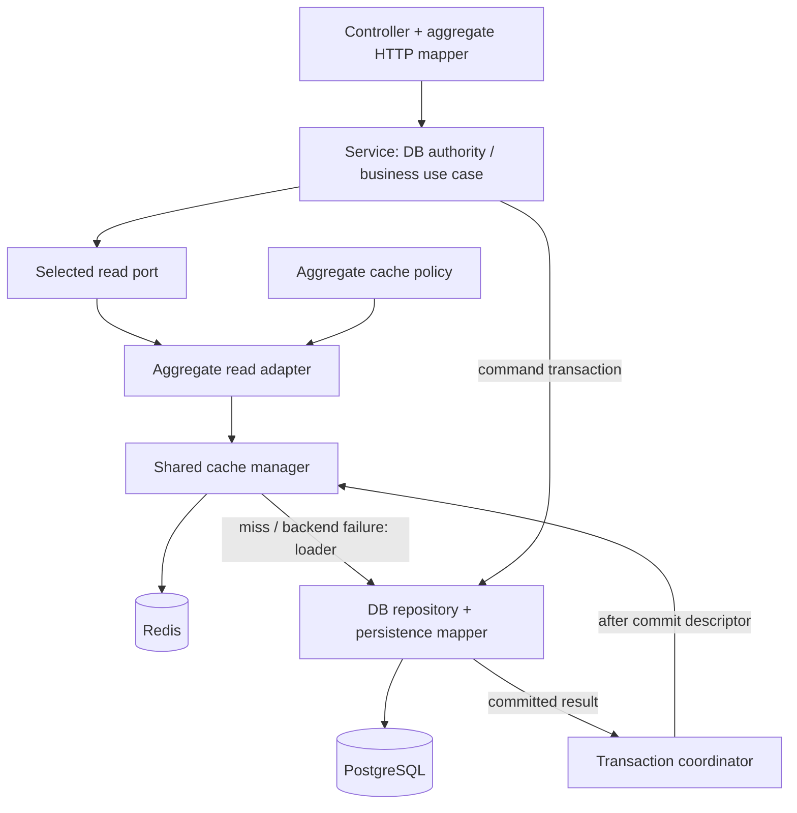

# Aggregate mappers, shared cache and root rules

Status: review draft, 2026-10-28. Baseline `b52a8ba`, branch `codex/demo-work-units`. EPIC-001 primary. Owner-directed scope: relocate detailed API rules to root rules/, require aggregate-owned mapper modules, and redesign cache management beyond repository wrappers. No runtime refactor or hook requested in this slice.

## Decisions versus proposals

DECIDED by owner: root [rules entry](../../rules/README.md), separate mapper module per aggregate, replacement of per-repository cache wrappers. PROPOSED: boundary-specific mapper subpackages, one shared cache manager, opt-in aggregate policies/read adapters, DB-authoritative security state, and fenced fill/post-commit invalidation protocol. Implemented in this session: documentation/navigation only. No DB schema, HTTP API, gRPC, provider or deployment changes.

## Current evidence

`TenantCacheWrapper` and `SessionCacheWrapper` duplicate cache lookup/DB load/fill/delegation. Tenant cache stores full ORM payload by ID/slug with 24-hour TTL; update invalidates using the updated slug, leaving the old alias outside that invalidation. Tenant Delete ignores Redis deletion failures. Session cache duplicates payload by ID/token with seven-day TTL; auth constructor currently bypasses that decorator. Fx registers both DB and wrapper paths. These findings establish maintenance/consistency concerns, not measured latency/throughput regressions.

Existing DTO aliases/derived models and inline service/controller assembly establish the need for explicit structural mapper ownership. They do not prove existing DDD aggregate boundaries; those must be named from their invariants before a code migration.

## Mapper architecture

Target example: `internal/mapper/order/{httpmap,persistencemap,cachemap}`. One aggregate owns the module; independent subpackages prevent transport/ORM dependencies from crossing into core. HTTP mapper depends on owning DTO and core inputs/results; persistence mapper on ORM rows/core values; cache mapper on versioned snapshot/core read values. DTO/model/schema packages never import their mapper; callers import both. No facade pulls every mapper into one dependency closure.

Mapper functions are pure and deterministic: no DB/Redis/network, authorization, state transition, UUID/time generation or business price/default decisions. Services keep business work; controllers validate transport and delegate conversion; repositories execute queries and delegate conversion. Cross-aggregate projections use a named projection mapper rather than growing unrelated aggregate modules. Full rules: [MAP-001–007](../../rules/api-service/10-aggregate-mappers.md).

## Cache architecture



TARGET, not current runtime. Cache read adapters implement selected read ports, not an entire CRUD repository interface. Shared manager owns lookup/fill, error classification, expiry/jitter, bounded operations, process-local duplicate suppression and fencing/metrics. Aggregate policies own typed scope/schema/keys/invalidation groups; cache mapper owns minimal snapshot conversion. Repository contains no cache client/wrapper in the target. Bootstrap wires ports and resources; core does not import Redis.

Write invalidation is registered during the use case but dispatched only after successful DB commit by a coordinator through the cache port. Commit failure runs no callbacks. No Redis/network call inside the locked transaction. Coordinator API is still a proposal, not a new framework already implemented. Non-durable callbacks can be lost after a crash; do not claim exactly-once invalidation. No Atlas migration is needed for this proposed in-memory callback mechanism; durable invalidation/outbox, if selected later, requires a separate schema/migration design.

## Consistency, security and failure modes

- Session validity, grants/membership, owner/operator authority and tenant active status remain DB-authoritative. Commands/locks/version checks and overview snapshots bypass cache. Do not split current sales/workflow transactions to introduce a cache.
- Opt-in policy must state maximum staleness, bounded TTL including jitter/fill delay, tenant/principal/filter scope, schema version and invalidation dependencies. No raw credentials/ORM objects in cache snapshots or keys. No negative cache/SWR initially.
- Invalidation atomically replaces a generation token; filled keys include generation and publication atomically checks the captured token. Missing/recreated generation metadata must reject old tokens, never reset generation to a reusable default. This fences stale fill after successful invalidation; it is not linearizable read consistency.
- Missing old slug/alias scope, projections and deletion failure must be tested. DB commit → invalidation has a race/crash gap; Redis outage may leave bounded stale display values. Mutation returns the committed DB result, not a fictional rollback. Strict subsequent reads bypass cache.
- TTL/metrics and fill suppression must be measured; local coalescing is not distributed coordination. Default cache policies remain disabled until reuse/freshness/benefit evidence exists. Display TTL up to 60 seconds including jitter is only a pilot proposal, not an enabled default.

Detailed rules: [CACHE-001–014](../../rules/api-service/11-cache-management.md). No public endpoint/response changes are made; shared safe application-error handling remains. Cache outage must not turn a failed authoritative loader into success.

## Migration and review sequence

1. Review mapper subpackage layout, aggregate boundaries, cache policy/read-adapter responsibilities and freshness guarantees.
2. Separate core/ORM/DTO representations and pilot a mapper for one aggregate with conversion tests; preserve external behavior.
3. Implement/test shared manager and one useful non-sensitive read policy with cache optional/disabled fallback; retain DB authority. Benchmark against bypass and old path.
4. Add tested post-commit invalidation/fill fencing; verify aliases, rollback, DB/Redis fault and concurrency cases.
5. Remove old wrappers/bindings after parity; explicitly preserve separate OAuth state/legacy draft contracts. Add hook/CI checks only in a separately approved implementation.

## Documentation verification

Root catalog v0.2: 91 unique active rule IDs across 13 API Markdown modules (including catalog README); 40 E, 18 O, 31 P, 2 D. Source-backed inventory remains historical/current as labeled. Root rules index and AGENTS navigation point to the moved catalog; Markdown links are rebased. Old 73-ID session/design counts remain historical with follow-up notes, not overwritten completion history. No fresh application tests, migrations, benchmarks, live CI or merge checks in this documentation-only revision.


## Detailed v0.2 cache proposal retained for implementation reference

The following package/protocol detail is optional implementation context, not required loading for unrelated API work.

### Proposed ownership and flow


```text
core/ports/cache/                    # backend-neutral capability/descriptors
infrastructure/cache/manager/       # shared lookup/fill/TTL/fencing/metrics
infrastructure/cache/redis/         # Redis operations, atomic scripts, connection
cachepolicy/<aggregate>/           # typed policy/key scope/invalidation descriptors
readmodel/<aggregate>/             # selected read adapter: manager + DB loader
readmodel/<aggregate>/cachevalue/  # minimal versioned cache snapshot
mapper/<aggregate>/cachemap/       # pure snapshot conversion
repository/                        # DB queries/transactions; no new cache wrappers
bootstrap/                         # wire read ports, policies, manager, repositories
```

These packages are proposed. New cache capability/read ports can be consumer-owned without forcing unrelated existing repository interfaces to move immediately. Cache policy packages contain typed identity/scope/TTL declarations, not Redis clients, business authorization or SQL. Read adapters implement selected read ports, not the full write-capable repository interface.

Read: service validates current authority from DB → selected read port → aggregate reader creates complete scoped key → manager reads snapshot or invokes bounded DB loader → aggregate mapper converts snapshot → service/controller returns the authorized result. Cache cannot make a forbidden read permitted. Existing service ordering must be corrected where authorization currently follows a cached tenant lookup.

Do not split the current sales/workflow authorization transaction merely to enable caching. A cached display use case needs its own reviewed read-consistency contract; command reads and snapshot reports keep their existing DB transaction guarantees.

Write: service chooses DB transaction → repository commits all required changes/audits → transaction coordinator invokes registered post-commit invalidation descriptors through a cache port → aggregate manager invalidates affected cache groups. No Redis request occurs while DB locks are held. Post-commit callbacks are not durable/exactly-once delivery: a process crash after commit can miss invalidation. Registering callbacks must not execute them early; callbacks do not run on commit failure. This limitation is accepted only for explicitly stale-tolerant reads.

The transaction coordinator is an application port with a persistence implementation and post-commit dispatch composed at bootstrap. It must not make repositories depend on cache/mapper/read adapters. Its exact interface is a follow-up implementation decision; no new UoW framework is built in this session.

## Consistency and failure contract

- Use a fresh generation token per invalidation group. A fill captures the token before loading and publishes only with an atomic comparison against that token. Invalidation changes the token atomically; generation identity must not reset/reuse on metadata expiry. Missing/recreated metadata invalidates in-flight fill tokens. Keys for filled values include the generation so old values cannot become reachable again.
- Group invalidation covers both ID/slug aliases or a bounded projection namespace; retain old alias scope in the mutation descriptor. Snapshot/key schema version is independent of entity version and invalidation generation.
- A hit racing an invalidation can still finish using its already-read value. Fencing prevents a late stale fill from repopulating the current generation; it does not provide linearizable reads or eliminate the DB-commit/invalidation gap.
- TTL has a documented maximum including jitter and fill delay. Never extend TTL on hits. No stale-while-revalidate or negative caching in the initial design. Corrupt entries are rejected/deleted best effort; authoritative load failures stay failures.
- An invalidation outage or process crash permits bounded stale display data until expiry. Return the committed mutation result directly for immediate feedback. A subsequent strict read must explicitly bypass cache; no implicit read-your-write guarantee is claimed for cached GETs.
- Process-local singleflight is the initial proposed duplicate-fill optimization; it must not reuse a cancelled leader's context indefinitely. Cross-instance contention remains a measurement question, not a reason to introduce a distributed lock automatically.

## Initial cache classification for review

| Data/use | Proposal | Reason |
| --- | --- | --- |
| Session validity, member/owner/operator grants, tenant active status | Always DB for authorization | Revocation/current authority cannot wait for TTL |
| Work transitions, order confirmation, DB transaction reads | Bypass | Needs locks/version/current consistency |
| Owner overview count/row snapshot | Bypass initially | Multi-query snapshot consistency must remain intact |
| Tenant display name/avatar | Candidate only after separate DB authority check | Display-only staleness can be bounded; mutable slug needs group invalidation |
| Product/customer display reads | Disabled until reuse/measurement and invalidation policy approved | Current CRUD does not establish a caching benefit |
| Published immutable workflow version display | Candidate by tenant/version after current authorization | Content immutability simplifies invalidation; business commands still load authoritative state |
| Legacy AI Redis drafts and OAuth state | Separate temporary-state contracts | Not ordinary read cache; do not migrate blindly through GetOrLoad |

No TTL/cache is enabled by this document. A non-sensitive pilot can start with a proposed maximum 60-second display TTL (including jitter), but its actual bound must be approved per policy. Preserve existing behavior until a separately tested code migration is delivered.
