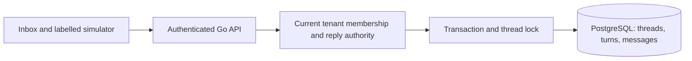

# Messaging inbox: first demonstrable slice

Date: 2026-11-02. Primary epic: EPIC-004. Status: in-progress; completed: false.

## Summary and scope

Implement a tenant-isolated text inbox before AI/provider integration: simulated customer input, conversation list and history, atomic self-claim, owner reassignment and assigned-sale manual simulated replies. This is a bounded first slice of the approved conversation domain, not completion of messaging requirements. No real customer sending, order mutation, Kafka or paid model calls. Existing thesis-first roadmap supplies the implementation objective.

## Data model

`messaging_threads`: UUID, tenant FK, simulator external key, display name, created/updated timestamps; unique tenant/source key and tenant/id. Source is simulator only in this slice.

`messaging_turns`: UUID, tenant/thread composite FK, lifecycle, optional assignee, control, needs_human, context revision, control generation, resource version and activity timestamp. Partial unique index ensures one open turn per thread. Assignment references an identity; current tenant membership is checked under transaction before assignment/sending. Historical assignment remains after membership removal.

`messaging_messages`: UUID, tenant/thread/turn composite FK, direction, actor, text, durable request key/hash, timestamp and explicit simulated status. Unique tenant/request key makes customer/reply retries durable. Messages are immutable; reuse with different content or operation conflicts. Thread lock serializes incoming input, claim, reassignment and manual reply; writes and shared audit entries commit together.

Aggregate mappers own pure HTTP/persistence conversion. Core values carry no ORM/transport tags. No cache. No network operations inside transactions.

## HTTP contracts

All routes use `/api/v1/tenants/{tenantID}` and current authenticated membership. Lists use UUID cursors, ordered by immutable ID, limit 20 (maximum 100); history is descending UUID with stable cursor, presented chronologically per page in UI. UUIDv7 IDs preserve chronological order without timestamp cursor precision loss.

- GET `/conversations`: cursor/limit and `filter=all|unassigned|mine|needs_human`; summaries include current open turn.
- GET `/conversations/{id}/messages`: cursor/limit; bounded message history and current thread/turn.
- POST `/simulator/messages`: `external_key`, `display_name`, `body`, UUID `request_key`; durable simulated inbound message. Any current member can use the visibly labelled tenant sandbox.
- POST `/turns/{id}/claim`: expected_version; only unassigned open turn or current assignee taking sales control.
- POST `/turns/{id}/assign`: expected_version and nullable assignee_id; owner only, current target membership required; sales control, advance control fence.
- POST `/turns/{id}/send-simulation`: expected_version, context_revision, body and UUID request_key; only current assignee under sales control, and fresh context. Saves `simulated` outbound message; it does not claim provider acceptance/delivery. Exact retry returns original saved message after current authorization.

Errors: 400 malformed/bounds, 401 no actor, 403 membership/authority, 404 tenant-scoped resource missing, 409 stale version/context, claim race or key mismatch. Shared response envelopes and safe application errors apply; Swagger generated from annotations.

## Acceptance and deferred requirements

Verify tenant isolation, revoked membership, owner send denial unless assigned, concurrent claim single winner, stale context, key replay/mismatch, history pagination and transaction rollback. Fresh/upgrade Atlas checks use disposable DBs only. UI preserves reply text after failure; switches isolate local drafts and ignore late loads. Requests are bounded; refresh is explicit in this slice.

Automatic 24h expiry/new turns, needs-human commands, return to system, scripts/grants, proposals, AI routing, asynchronous outbox/intents/attempts, Kafka/SSE and provider connection remain tracked follow-up requirements. The simulator does not provide those capabilities. The schema retains independent lifecycle/control/context dimensions to avoid replacing the model when they arrive. No scope reduction is inferred.
