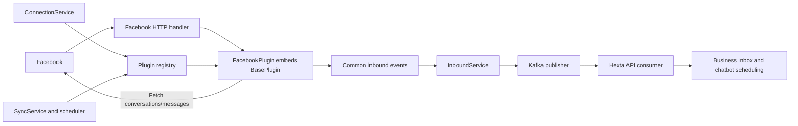

# Connector redesign based on local Omni Bridge

Status: PROPOSAL / in-review, 2026-11-03. The owner rejected the previous connector design and requested the local Omni Bridge as reference. This replaces that draft for discussion, not as approved implementation authority. No application code has changed.

## Reference and observed architecture

Read-only reference: `/Users/truonghoang/Documents/dev/piscale/omni-bridge`, HEAD `8ec0efd`, with existing local documentation/rule edits. No files there were changed; no credentials were read. Findings below come from code, not README capability claims.

| Reference source | Observed behavior to learn from |
| --- | --- |
| `internal/plugin/base/base.go` | `BasePluginImpl` supplies default platform operations. Most unsupported methods return an error. |
| `internal/plugin/facebook/facebook.go` | `FacebookPluginImpl` embeds the base and injects Facebook client, cache and other dependencies. |
| `internal/services/webhook-management/service.go` | Consumer-owned `PluginManager` interface and registry keyed by platform type. |
| `internal/services/inbound/service.go` | Shared inbound service consumes common `BaseWebhookRequest`; currently creates/resolves users/threads and calls Piscale APIs/gRPC. |
| `internal/model/form/plugin.go` | Common message fields across platforms: account/user/message IDs, text, attachments, reply, reactions and timestamps. |
| `internal/app-api/connector/facebook/controller.go` | Dedicated platform HTTP handler verifies webhook, queues to an ordered worker pool and delegates to plugin/shared inbound service. |
| `internal/plugin/facebook/sync-old-message.go` | Plugin actively calls conversation/message APIs for bounded history. This is explicit historical sync, not proof of continuous durable polling. |
| `internal/app-worker/listeners/message.listener.go` | Kafka listener drives outbound forwarding to platforms. The inspected inbound path is not a Kafka producer. |
| `internal/di/provider.go` | Concrete plugins constructed once and registered into service-specific maps. |

Interpretation: the useful pattern is **base implementation -> concrete platform plugin -> shared service**, with platform-specific controllers/clients. Hexta must adapt the inbound destination to Kafka as explicitly requested, rather than copying Piscale chat/user/bot integration.

## What changes from the rejected draft

- Start from platform plugin operations and a reusable base, not a receipt/normalization framework with independent adapter registries.
- Use the same plugin object for connection lifecycle, webhook parsing and active fetching. Services declare only the methods they consume.
- Keep a small common inbound message model as the contract between plugins and the inbound service.
- Model a connection as a configured external account with tenant association, enabled state and provider settings.
- Do not make the rejected receipt/item/event/outbox schema mandatory. Delivery persistence is a separate explicit tradeoff below.
- Preserve Hexta ownership: API owns business conversations, authorization and chatbot scheduling. Connector owns platform integration, not business user/thread creation.

DECIDED: connector service, direct Facebook first, abstraction before plugins, webhook and active fetching, normalized events into Kafka. PROPOSED: the concrete interfaces/layout/transport choice below. Referencing Omni Bridge does not approve every behavior or dependency in that repository.

## Architecture



One service with two runtime roles is enough: HTTP server and optional scheduled sync worker. They may initially run in one deployment. Kafka publishing is a dependency of `InboundService`; no service branch switches over Facebook/Telegram/etc. Platform clients own HTTP serialization, timeouts and provider error parsing.

Suggested Go layout, adapted to Hexta's existing Gin/Fx stack rather than importing Omni Bridge's Fiber/Wire or private libraries:

```text
services/connector/
  cmd/server/
  internal/bootstrap/                 # plugin construction and registries
  internal/present/http/facebook/      # provider-specific callback handler
  internal/present/http/internal/      # machine-only connection/sync API
  internal/core/types/                 # Connection, InboundEvent, SyncPage
  internal/core/service/               # connection, inbound, sync
  internal/plugin/base/
  internal/plugin/facebook/
  internal/infrastructure/platform/    # Facebook HTTP client interface/impl
  internal/infrastructure/kafka/
  internal/repository/                 # connections and sync progress
```

## Abstract contract and embedding

Illustrative contract sketch; implementation must define these before the Facebook plugin. Method names intentionally resemble the reference where useful. DTOs are internal typed values, not ORM rows or framework contexts.

```go
// Interfaces belong to the service/handler consuming them.
type PluginManager interface {
    ValidateSettings(context.Context, ConnectionSettings) error
    SubscribeWebhook(context.Context, Connection) error
    UnsubscribeWebhook(context.Context, Connection) error
}

type WebhookPlugin interface {
    VerifyChallenge(context.Context, ChallengeRequest) (ChallengeResponse, error)
    VerifyWebhookSignature(context.Context, WebhookRequest) error
    GetWebhookRequestInformation(context.Context, WebhookRequest) ([]InboundEvent, error)
}

type PlatformReader interface {
    SyncMessages(context.Context, Connection, SyncRequest) (SyncPage, error)
}

type BasePlugin struct{}
// Default methods return ErrUnsupportedCapability, never false success.

type FacebookPlugin struct {
    base.BasePlugin
    api FacebookAPI
    // App configuration/secret resolver supplied through constructor.
}

// A single plugin object can satisfy several consumer-owned interfaces.
// Same method signatures in base and concrete implementation are required.
var _ WebhookPlugin = (*FacebookPlugin)(nil)
var _ PluginManager = (*FacebookPlugin)(nil)
var _ PlatformReader = (*FacebookPlugin)(nil)
```

The base provides uniform unsupported behavior and reusable pure helpers. Facebook overrides verification, parsing, subscription and sync. It does not inherit a hidden processing loop. Optional capabilities are declared explicitly; embedding a default method does not mean a provider actually supports it. An unsupported platform/capability fails clearly rather than silently consuming an event.

Registry example: `map[Platform]PluginManager`, `map[Platform]PlatformReader`, built in bootstrap from the same concrete plugin instances. Provider HTTP controllers can inject their concrete plugin, as Omni Bridge does. Services use narrow interfaces; there is no requirement for one giant `Plugin` interface. A fixture plugin embeds the base and overrides selected methods for contract tests before real plugin development.

Later outbound can add `PlatformWriter` with send/typing methods using the same registry pattern. It is outside the first inbound implementation, and it cannot bypass API's final current-state send gate.

## Common data and connection model

`Connection`: UUID, tenant ID, platform, external account/Page ID, app registration ID, display name, enabled state, version, settings and secret reference. Connector stores operational settings; API authorizes provisioning/disable and the tenant relationship. Never accept a tenant from an unauthenticated platform payload. A connection cannot be reassigned to another tenant in place. Delayed messages against revoked/old connection versions are rejected or quarantined by the business consumer.

`InboundEvent` fields:

- Platform, external account ID, external conversation key, external message ID and source event identity/revision.
- External sender/recipient IDs; direction (`inbound`, `outbound`) and event kind (`message`, `reaction`, `read`, etc.).
- Message body, reply-to source ID and typed attachment references. No fabricated size/dimension metadata.
- Source timestamp, receive timestamp and purpose (`live`, `history`, `reconciliation`).
- Resolved connection ID/version and tenant ID are added by the shared service after verifying the account binding, not by trusting provider data.

The model supports batches: parse **all** entries/messages, not just `Entry[0].Messaging[0]`. Unsupported events are explicit outcomes rather than empty messages. Keep reactions/read receipts distinct from customer messages. Facebook thread key is Page + peer PSID, consistently derived for both inbound and echo directions. History Graph conversation IDs need an explicit mapping to that identity.

Kafka envelope adds schema version, stable source identity, event ID and correlation ID to the common event. Proposed topic stays `hexta.ingress.received.v1`, now normalized connector output. Key is a canonical encoding of tenant + connection + external conversation key. This is source observation, not a business `message_created` event. Business IDs are allocated by the API consumer.

Wire format/schema tooling remains to agree with the Kafka owner; no new registry/framework is imposed by this redesign. Before independently released consumers, follow the existing Kafka module's schema compatibility requirements. Do not publish raw credentials or full provider bodies. Attachment download credentials remain private to connector.

## Incoming webhook flow

1. Dedicated Facebook route receives the original bounded body and verifies signature using the configured app. Challenge is a separate GET handler.
2. Facebook plugin parses provider fields into common events without network enrichment. Missing profile names or unavailable media inspection must not block a text message.
3. Shared inbound service resolves active account connections, validates common fields and derives stable dedup keys for each event. A multi-Page batch resolves each Page independently.
4. Publish normalized events with the conversation partition key. Return provider success only at the selected durability boundary below.
5. API consumer validates current connection/tenant, records dedup and business message in one DB transaction, then commits its offset. Only eligible live customer messages schedule chatbot work.

### Delivery choice: revised proposal, not approved

For the first slice, propose direct Kafka publication with broker acknowledgement before HTTP success. This avoids requiring the previous draft's separate receipt database/outbox pipeline. Parsing/publishing must be bounded to fit the provider timeout; no profile/media/API/AI network calls in that path. Parallel publication is bounded and awaited, never fire-and-forget.

- Broker failure, buffer pressure or timeout: return retryable failure; provider retries depend on its actual documented retry window.
- Crash after broker ACK but before HTTP response: provider may redeliver, so business dedup is required.
- Partial batch success: return failure for the batch; already published entries may repeat. Stable semantic keys handle duplicates.
- Authenticated unsupported items: publish a restricted quarantine event and ACK only after its broker ACK. Invalid authentication is rejected, not quarantined as trusted input.
- Extended Kafka outage can exceed the provider retry window. If availability requirements demand accepting during outages, add a durable spool/outbox as a separately evaluated extension. Do not claim both minimal persistence and unlimited outage buffering.

Omni Bridge's in-memory worker pool followed by early HTTP success is not durable acceptance. It can be used for bounded scheduling, but success cannot mean merely enqueued in RAM if accepted-message durability is required. Ordering within one local pool also does not establish order across instances. Kafka ordering is per partition; delayed provider events still need source-aware reconciliation.

## Active fetching and history

Use `SyncService -> PlatformReader.SyncMessages -> FacebookAPI`, then the same `InboundService` publication path. `SyncRequest` contains purpose, opaque cursor and limits. `SyncPage` returns common events, next cursor and completion state. This is intentionally more typed than Omni Bridge's `map[string]any` history result.

Persist sync jobs/cursors and a lease/fencing token per connection/stream. Fetch outside DB transactions; advance the checkpoint only after all page events receive Kafka ACKs. Crash before checkpoint commit can republish the page; consumer dedup makes it safe. Enforce time/page limits, cancellation, retry-after and per-account throttling. Expired credentials pause the job with an explicit status. Checkpoint expiry requires bounded recovery rather than silent restart.

One-time history sync and periodic incremental polling are separate modes. Webhook and polling must use the same source identity for the same message. History imports do not open active turns or invoke AI; a later live observation is evaluated separately without duplicating message content. Merely copying `SyncOldMessage` does not establish reliable continuous polling. Existing Omni Bridge API calls are implementation reference, not evidence that this owner's Meta app has the required access today.

## Minimal persistence and machine API

Proposed connector-owned tables: `connections` (unique active platform/account, immutable tenant binding), `platform_apps` (secret references), `sync_jobs` (request idempotency key, status/limits), `sync_checkpoints` (connection/stream, cursor, lease/fence). Use Hexta PostgreSQL/Atlas with separate ownership; no auto-migrate or copied MySQL schema. Business conversation/user/message tables remain in API. Storage/privacy/retention values remain open.

- `GET/POST /facebook/webhook`: public provider callback, not a user API.
- `PUT /internal/v1/connections/{id}`: authenticated API service provisioning with expected version; repeated identical configuration is idempotent.
- `POST /internal/v1/connections/{id}/activate` and `/deactivate`: desired subscription state; provider action and applied state tracked separately so failed remote calls can be retried. Disabled state blocks intake eligibility immediately.
- `POST /internal/v1/connections/{id}/sync`: bounded durable job, idempotency key, returns 202/job ID.
- `GET /internal/v1/sync-jobs/{id}` and `/connections/{id}/status`: safe operational status, no credentials/payload dump.
- Health endpoints distinguish process liveness from ability to accept/publish callbacks.

Private management network/authentication, public callback source verification, payload limits and secret redaction are required. API remains responsible for who may configure a Page. Subscription management is proposed scope, not authorization to modify the live app now.

## Reference behavior not copied blindly

Observed code uses first-entry parsing, a memory queue before downstream completion, raw webhook logging and ordinary string signature comparison. Hexta should process the full batch, choose an explicit durability boundary, redact payload logs and use strict signature parsing with constant-time comparison. Omni Bridge also embeds base methods with different signatures in some concrete plugins; matching signatures and compile-time interface checks avoid accidental fallback to base behavior.

These are bounded static observations, not a full security review or runtime failure claim. Private Piscale libraries, bot IDs, chat/user creation and repository code are not imported into Hexta.

## Implementation sequence and review points

1. Agree on this plugin/base architecture and the Kafka ACK tradeoff. No approval is inferred from this proposal.
2. Implement common types, consumer interfaces, base defaults, registry and fixture tests.
3. Implement Facebook signature/challenge/parser plus external API client. Verify batch handling, echo classification and source identities.
4. Add shared inbound Kafka publishing and the API ingestion consumer; validate real text -> inbox.
5. Add bounded historical sync, then periodic polling only after verifying actual platform capability. Outbound and AI orchestration are subsequent slices.

Required tests: default unsupported behavior, plugin overrides, registry selection, invalid signature, multi-entry/multi-Page payload, no cross-tenant mapping, echoes, duplicates/partial batch, broker timeout, crash before HTTP ACK, consumer transaction/offset crash, history without AI, poll/checkpoint crash and credential revocation. Live Meta access, throughput, application tests and deployment were NOT_RUN in this design research.
