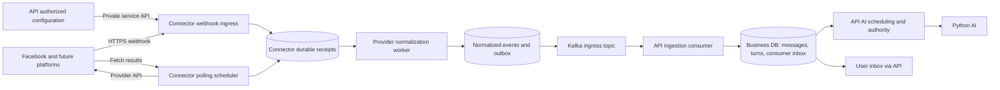

# Connector service design

Date: 2026-11-03. Status: REJECTED by owner; retained for history only. No service implementation or live verification.

The owner explicitly rejected this design and requested local Omni Bridge as reference. Its proposed Go interfaces, receipt/outbox schema and operational choices are not approved requirements. See the [replacement discussion draft](2026-11-03_connector-omni-bridge_design.md).

## Decisions and scope

DECIDED by owner: replace Pancake with direct Facebook integration; create a separate machine-facing API service named `connector`; support provider webhooks and active fetching; define abstractions before provider plugins; normalize incoming data and publish it to Kafka. Owner reports Page administration and an existing Meta app. App permissions, subscriptions, tokens and public callback reachability are not verified.

PROPOSED: Go service at `services/connector`, interfaces and composition rather than class inheritance, statically registered plugins, PostgreSQL durable intake/outbox and capability-specific adapters. This reuses the repository's Go workspace and Atlas approach; it is not Apache Kafka Connect. No plugin download, dynamic shared-library loading or extra framework is required. Dependency versions and Kafka client selection belong to implementation review.

Initial vertical slice: Facebook Page text-message webhook -> connector -> Kafka -> API conversation inbox. Polling abstraction and fixture plugin come first; real Facebook historical fetching is a later capability after endpoint/permission verification. AI scheduling and real outbound sending are subsequent slices. This design does not claim the full chatbot is ready.

## Ownership and architecture



- Connector owns protocol verification, provider credentials at runtime, acquisition, normalization, transport deduplication, polling cursors, retries and Kafka publication. Its DB is authoritative for transport state only.
- API owns tenants, authorization, approved Page-to-tenant bindings, business conversation/message IDs, turns, current context, AI jobs and final sending authority. It provisions connector bindings using authenticated internal requests. No frontend calls connector directly.
- Connector holds a versioned operational copy of each binding; it cannot invent or change business authorization. API consumer validates the current binding/version and tenant state before accepting an event. Disabled or obsolete bindings cannot trigger AI work.
- Python consumes authorized context and produces candidates; connector never invokes AI or writes business tables.
- Shared PostgreSQL instance is acceptable initially, with separate `connector_runtime` schema, DB role and Atlas migration ownership. No cross-service table writes or ORM imports. Redis is unnecessary for correctness.
- Outbound transport is deferred. If later moved behind a connector send capability, API must still issue and validate a current dispatch permit; an old Kafka event alone never grants send authority.

## Abstraction first

Suggested layout (TARGET):

```text
services/connector/
  cmd/server/
  internal/bootstrap/
  internal/core/{types,ports,service}/
  internal/present/http/
  internal/repository/
  internal/infrastructure/{kafka,secrets}/
  internal/plugins/{fixture,facebook}/
proto/hexta/connector/v1/       # owning normalized wire schema, proposed
migrations/connector/          # Atlas history, generated during implementation
```

The wire schema is shared with the API consumer; internal plugin structs are not public contracts. Extend the existing owning generators for new protobuf packages, without manually editing generated files.

Illustrative Go contracts, not compiled implementation:

```go
// The registry requires identity + normalization; acquisition is optional.
type Adapter interface {
    Descriptor() Descriptor
    Normalize(context.Context, SourceRecord) (Normalization, error)
}
type WebhookAdapter interface {
    VerifyChallenge(context.Context, AppScope, WebhookRequest) (ChallengeResponse, error)
    Authenticate(context.Context, AppScope, WebhookRequest) (VerifiedEnvelope, error)
    Split(context.Context, VerifiedEnvelope) ([]SourceRecord, error)
    Acknowledgement() WebhookResponse
}
type PollingAdapter interface {
    Fetch(context.Context, Binding, PollRequest) (PollPage, error)
}
```

- `Descriptor`: provider key, adapter version and capabilities (`webhook`, `poll`, supported event types). Registry fails startup for duplicate keys or capabilities without matching interface implementation.
- `WebhookRequest`: bounded original bytes, selected headers/query values; not a framework handler. Signature verification uses unchanged bytes. `AppScope` is trusted route configuration plus secret references, never user-supplied tenant authority.
- `SourceRecord`: raw receipt reference/index, provider/account identity, acquisition mode, binding ID/version, observed/received time and bounded provider payload. Payload is untrusted even after source authentication.
- `Normalization`: typed normalized events plus explicit ignored/quarantined classifications. Empty output must include a reason. Every supported source message yields a deterministic source identity; parser failures never fabricate IDs.
- `PollRequest`: opaque checkpoint, page limit, bootstrap/live/history mode and bounded time window. `PollPage`: records, next checkpoint, more-pages flag, optional retry-after. Plugin owns provider cursor meaning; framework owns leases and persistence.
- Shared ports: `ReceiptStore`, `OutboxStore`, `BindingStore`, `SecretResolver`, `EventPublisher`, `Clock`. Plugins do not choose Kafka topics, commit DB transactions, resolve tenant authority or spawn their own scheduler.
- Typed failures distinguish invalid source/authentication, unsupported capability/payload, invalid credentials, rate limits, transient failures and expired checkpoints. Safe error codes only in logs/public responses.
- A fixture adapter must exercise webhook and polling contracts before Facebook is implemented. A future plugin can implement only polling or only webhook; unsupported operations are explicit, not silent no-ops.

## Webhook processing

1. Route by provider/app registration; enforce TLS, method/content type, bounded body/batch sizes and request deadline. Challenge endpoint verifies configured challenge token and returns the provider-required response without creating a receipt.
2. Adapter authenticates the original request. Invalid signature is rejected with no trusted intake record. Route identifier is not authentication.
3. Persist the authenticated raw envelope as an encrypted, restricted receipt; commit before returning the provider-specific success ACK. No Kafka/provider/AI call inside this transaction. DB outage -> retryable non-success. Kafka outage alone does not prevent ACK while intake capacity is healthy.
4. Background worker leases the receipt, splits every entry, resolves each external account to a unique binding for the authenticated app, then normalizes. One envelope can contain multiple Pages; never assign the entire batch to the first Page's tenant. Unknown account/unsupported item is quarantined; valid siblings continue. Track item completion so crashes do not skip remaining entries.
5. In one transaction, deduplicate each normalized event, create outbox rows and mark item processed. Receipt finishes only once all items have a persisted outcome. Transient failures retry with jitter/backoff; permanent payload errors remain in restricted quarantine.
6. Relay publishes outbox rows with stable event IDs and producer idempotence / `acks=all`; marks published only after acknowledgement. Lost ACK or crash can produce duplicates. Kafka delivery is at-least-once; consumer DB deduplication is mandatory.

Bound raw receipts by byte quota and age, not an unbounded queue. On storage pressure, stop acceptance with retryable errors and alert. Providers have finite retry windows; prolonged outages require verified reconciliation where supported, not a promise of lossless delivery under every failure.

## Polling, bootstrap and history

Scheduler selects enabled bindings with polling capability using durable `next_due_at`, renewable leases and fencing tokens. Provider HTTP runs outside transactions. Only the current lease holder may commit a fetched page.

Commit fetched records, checkpoint and next schedule atomically. The checkpoint may advance after durable receipt storage (before normalization), because records can then be retried locally. Failed fetch/commit leaves checkpoint unchanged. Enforce bounded pagination, provider/account quotas, jitter, retry-after and credential-revocation suspension.

Webhook and polling use the same normalized identity so overlap does not create two business messages. An adapter must demonstrate cross-mode identity equivalence; until then enable only one live acquisition mode for that provider. Provider cursor expiry triggers bounded reconciliation, never blind checkpoint reset. Persist bootstrap state separately from incremental state.

History/backfill carries `historical` purpose. API may import it into history but must not create active turns or invoke AI. A history observation must not suppress a later live observation: delivery identity includes purpose while business identity remains the same. Consumer treats live eligibility separately and schedules at most once, with a freshness policy. Overlap windows are proposed reconciliation mechanisms, not guaranteed complete history retrieval.

## Normalized Kafka contract

Reuse proposed topic `hexta.ingress.received.v1`; change its ownership to connector and define it as normalized source observations, not business domain events. No deployed producer/consumer was found, so this is a pre-implementation contract revision. Do not publish both raw and normalized payloads under the same schema.

Proposed key: canonical encoding of `(tenant_id, binding_id, external_thread_id)`. For Messenger, derive thread identity consistently from Page + peer PSID; do not assume a webhook contains a Graph conversation ID. Keying offers per-partition ordering, not provider chronological order or global ordering. Use provider revisions when present; preserve source time and do not invent aggregate versions.

Envelope fields:

| Field | Meaning |
| --- | --- |
| event_id / schema_version / event_type | Persisted UUID, version 1, typed source observation |
| tenant_id / binding_id / binding_version | Resolved server-side; current authority rechecked by API |
| provider / external_account_id | Source platform and Page/account |
| external_thread_id / external_message_id | Stable provider-scoped identities |
| source_event_key / source_revision | Adapter-defined semantic dedup identity; revision optional |
| occurred_at / received_at | Nullable provider time vs connector receipt UTC time |
| acquisition / purpose | webhook or poll; live, historical or reconciliation |
| direction / actor_kind | inbound/outbound; customer/page/unknown; ambiguity quarantined |
| payload | Typed text, attachment references, edit/delete, delivery/read or interaction data |
| correlation_id / causation_id | Transport tracing references; no sensitive baggage |

Initial event type `channel.message.observed`; reserve separate typed events for updates, deletion, receipts and interactions. Receipt events without a single message ID have their own identity/payload (for example a watermark); never force them into fake messages. Unknown schema/type goes to quarantine.

Dedup uniqueness: `(binding_id, source_event_key, purpose)`. Message identity is `(binding_id, external_message_id)`; webhook/poll source keys must normalize to the same create identity. Edits need a provider revision or documented deterministic mutation identity. Hashing arbitrary JSON is not the default identity strategy. Never include acquisition mode in a semantic source key.

Protobuf schema owns compatibility; JSON above is conceptual. Introduce backward-compatible schema validation and the registry deployment before independent producer/consumer releases, following the Kafka module. Registry product remains OPEN. Events contain only needed message text and references; no raw provider bodies, credentials, media binaries or signed download URLs. Raw payload access stays in connector's restricted store. A later media resolver must authenticate requests and constrain outbound destinations.

## Persistence proposal

All IDs UUID, timestamps UTC `timestamptz`, identity strings bounded, payloads size-limited; precise SQL is deferred to Atlas implementation.

| Table in connector_runtime | Core fields and constraints |
| --- | --- |
| app_registrations | id, provider, external_app_id, secret_ref, verify_token_ref, enabled; unique provider/app |
| bindings | id, app_id FK, tenant_id, external_account_id, config_version, credential_ref, enabled, polling policy; unique active provider/account binding to prevent cross-tenant duplication |
| receipts | id, app_id, encrypted body/ref, received_at, parser_version, status, lease_until, fence, retry_at, safe error; due-work index |
| receipt_items | receipt_id FK + item_index PK, binding/version when resolved, outcome, attempt/retry metadata; preserve individual batch outcomes |
| normalized_events | event_id PK, binding FK, source_event_key, purpose, typed payload, source time; unique binding/key/purpose |
| outbox | event_id PK/FK, topic, partition_key, payload bytes, lease/fence, published_at, retry_at; unpublished due index |
| poll_states | binding_id + stream PK, opaque checkpoint, bootstrap state, next_due_at, lease/fence, failure count |

Bindings have no cross-service FK into API tables; authority is established by internal provisioning and checked by the API consumer. A binding ID cannot be reassigned to a new tenant. Moving a Page requires disabling/draining the old binding, explicit cutover and a new identity; ambiguous delayed events remain quarantined. Retain tombstones/version history long enough to interpret backlog.

Raw/quarantine/event retention, encryption key management, Kafka retention and dedup lifetime require explicit operational values before live rollout. Dedup retention must cover supported replay; after it expires, default replay is non-operational. Reuse encrypted-secret infrastructure if available; do not store plaintext credentials in ordinary config rows or logs.

## Machine API

| Route | Purpose / response |
| --- | --- |
| GET /webhooks/{provider}/{app_registration_id} | Provider verification challenge; exact plugin response |
| POST /webhooks/{provider}/{app_registration_id} | Public authenticated provider callback; ACK only after receipt commit |
| PUT /internal/v1/bindings/{id} | API service only: versioned binding configuration and secret references; stale version 409 |
| POST /internal/v1/bindings/{id}/sync | Durable bounded sync request, request key, mode/window; 202 job reference; unsupported capability 422 |
| GET /internal/v1/bindings/{id}/status | Safe credential/readiness/lag summary; no payloads or secrets |
| GET /health/live, /health/ready | Liveness and intake readiness; readiness reflects DB/storage capacity |

Separate private management listener/network with service authentication and scoped authorization; user JWTs are not accepted. Configuration endpoints cannot trust arbitrary tenant fields from an unprivileged caller. API verifies ownership and Page entitlement before provisioning. Repeated same version/content is idempotent; same version/different content conflicts. Disable and rotation advance version. Audit management actions without private payloads. Public provider callbacks remain internet reachable even though this is not a user API.

Webhook status mapping is plugin-specific; typical invalid-auth 401/403, malformed 400, oversized 413, capacity/DB 503. Authenticated unsupported events can be durably quarantined and ACKed to avoid poison retry loops. Kafka degraded status is observable separately from intake readiness.

## Facebook plugin

First capability: Page Messenger webhook, preserving original bytes for source verification, challenge handling, all batch entries, Page account IDs, peer PSIDs, message IDs, source timestamps and echo classification. Echo/outbound observations may update history but never trigger a customer response. Unsupported attachment/receipt/edit shapes are explicitly classified until implemented.

Use app-level credentials for webhook verification and Page-scoped credentials for provider fetches; bind Page only under the correct app/approved tenant. Validate requested Graph version, actual Page subscription and required app permissions before live acceptance. Token expiry/revocation pauses polling and surfaces status without losing accepted receipts.

Do not claim live polling support merely because the abstraction exists. Graph conversation/history APIs, app access level, available fields, pagination, limits and historical access need permission-backed verification against the owner's app. No promise of complete personal Messenger history; scope is a Facebook Page.

References checked: [Meta-owned Messenger API collection](https://www.postman.com/meta/messenger-platform-api/documentation/iyp204x/messenger-platform-api) documents Page/app messaging permissions and Page-token sending requirements. Direct Meta webhook/get-started pages returned HTTP 429 during research; exact webhook setup/security contract must be reverified against official documentation and captured fixtures before implementation acceptance. [Kafka delivery semantics](https://kafka.apache.org/41/design/design/#message-delivery-semantics) supports the at-least-once boundary; cross-system exactly-once is not claimed.

## Implementation order and acceptance

1. Core types/interfaces, capability registry and fixture adapter, contract tests. Define shared wire schema before plugins.
2. Connector Atlas schema, durable receipts, normalization, leased outbox; isolated PostgreSQL/Kafka integration tests.
3. Facebook webhook plugin and signed fixtures; provisioning and public HTTPS callback.
4. API ingress consumer: atomic consumer inbox + conversation mutation + business outbox. Map external IDs to API IDs; validate current binding/tenant; commit Kafka offset only after DB commit. Do not call the simulator endpoint or persist real input as simulated.
5. Live Page text -> exactly one business message in Hexta, including duplicate delivery and connector restart. This is the first usable milestone.
6. Polling fixture crash/cursor tests, then actual Facebook polling only after capability verification. AI scheduling and real sending follow independently.

Required tests: invalid challenge/signature, mixed-Page batch, unknown account, cross-tenant binding, disabled/reassigned binding, echo suppression, malformed sibling, duplicate webhook/poll, DB down, broker down, crash after ACK/before normalization, publish success before DB mark, expired worker lease, cursor commit crash, rate limits, revoked credentials, source-time disorder, consumer crash around commit, schema incompatibility, bounded backlogs and historical replay without AI/send effects. Logs must redact secrets and message bodies.

Metrics: receipt/normalization/outbox oldest age and count, provider auth failures, quarantines, duplicate count, poll latency/checkpoint freshness, rate-limit duration, Kafka lag and end-to-end receive-to-inbox latency. Readiness and acceptance need explicit measured budgets during implementation; no fabricated capacity estimate.

## Evidence and open choices

Inspected current router/service: simulator routes and simulated persistence exist; operational Kafka ingestion and connector service do not. Existing generated AI RPC/smoke code is not an ingestion consumer. Unrelated web registration/privacy edits are preserved.

OPEN proposals: approval of Go as connector language, exact credential storage/encryption mechanism, Graph access capabilities, Kafka client/schema registry, retention/quotas and public callback hosting. These do not block abstraction design; live verification requires account configuration. No code, migration, deployment, paid call or external messaging performed in this design session.
