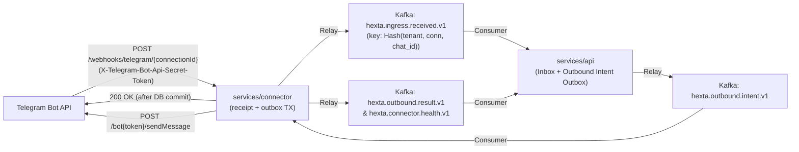

# Technical Design: Kết nối nền tảng Telegram Bot (MVP v1.0)

- **Status:** IMPLEMENTED (2026-11-16, PR in review, not merged); live Telegram acceptance NOT_RUN. Implementation amendments are listed in §7 and await owner acceptance. Evidence: [implementation session](../epics/EPIC-008-integrations-deployment/sessions/2026-11-16_telegram-bot-connection.md).
- **Date:** 2026-11-16
- **PRD:** [PRD — Kết nối nền tảng Telegram Bot (Notion, Đã chốt v1.0)](https://app.notion.com/p/PRD-K-t-n-i-n-n-t-ng-Telegram-Bot-419b0ea49f09816d95a4d4f3e5da8252)
- **Baseline:** Reuses the connector architecture (`BasePlugin` + durable receipt/outbox + Kafka) from [2026-11-03_connector-service_design.md](2026-11-03_connector-service_design.md) and the shared outbound/health contracts defined in [2026-11-14_facebook-platform-connection_design.md](2026-11-14_facebook-platform-connection_design.md).
- **Boundary Note:** Covers **only** Telegram Bot connection (Bot Token onboarding/rotation, 1-1 private inbound reception, outbound text transport). Conversation routing and reply orchestration (Chatbot, AI, Desk, Sale workflow) are **out of scope**.

---

## 1. Architecture & Burst-Handling Data Flow

Both **Inbound** and **Outbound** paths flow asynchronously through **Kafka** so sudden message bursts never overwhelm `services/api` or block webhook ACKs:



| Component | Owns | Must NOT Do |
| --- | --- | --- |
| **`services/api` (Go)** | Owner-only channel authorization, `messaging_connections` mirror (1 Bot ID = 1 Tenant), outbound intent outbox & single-attempt dispatch, Inbox/Settings HTTP APIs. | Call Telegram Bot API directly, store raw Bot Tokens in API DB, or embed Chatbot/Desk routing logic. |
| **`services/connector` (Go)** | Telegram `getMe` / `setWebhook` / `deleteWebhook` / `sendMessage`, AES-256-GCM encrypted Bot Token & webhook secret storage, `PUT /internal/connections`, webhook secret verification + receipt/outbox, outbound execution & result outbox. | Access API PostgreSQL schema, make tenant/business authorization decisions, or auto-retry failed/unknown sends. |
| **`packages/shared`** | Shared JSON event contracts (`ingress`, `outbound`) and Kafka transport helpers. | Hold business logic. |
| **`apps/web` (Next.js)** | Owner Channel Settings UI (Bot Token input, masked token display, token rotation, status badges, pause/disconnect), expired-connection banner, media placeholder UI, outbound send status. | Hold raw Bot Tokens (after submission) or connector management tokens. |

---

## 2. Inter-Service Communication & API Contracts

### 2.1 HTTP Endpoints — `services/api` (Public / Tenant-Scoped)

| Action | Method & Path | AuthZ | Request DTO | Response DTO |
| --- | --- | --- | --- | --- |
| **Add** | `POST /api/v1/tenants/{tenantId}/channels/telegram/connections` | Tenant `Owner` | `ConnectTelegramBotRequest { BotToken string }` | `TelegramConnectionDTO` |
| **Add** | `GET /api/v1/tenants/{tenantId}/channels/telegram/connections` | Tenant `Member` (Owner sees management controls; Sale sees status/banner) | — | `ListTelegramConnectionsResponse { Connections []TelegramConnectionDTO }` |
| **Add** | `PATCH /api/v1/tenants/{tenantId}/channels/telegram/connections/{connectionId}` | Tenant `Owner` | `UpdateTelegramConnectionRequest { Action string /* "pause" \| "resume" \| "disconnect" \| "rotate_token" */, BotToken string /* required if rotate_token */ }` | `TelegramConnectionDTO` |
| **Reuse** | Existing Inbox message read/send endpoints | Tenant `Member` | `SendMessageRequest { ClientMessageID string, Text string }` | Uses `ContentType`, `PlaceholderMetaDTO`, `DeliveryStatus`, `DeliveryErrorReason` (shared with Facebook design) |

#### Key HTTP DTO Definitions (`services/api/internal/present/http/dto`)
```go
type ConnectTelegramBotRequest struct {
    BotToken string `json:"bot_token" validate:"required"` // never logged or returned
}

type UpdateTelegramConnectionRequest struct {
    Action   string `json:"action" validate:"required,oneof=pause resume disconnect rotate_token"`
    BotToken string `json:"bot_token,omitempty"`
}

type TelegramConnectionDTO struct {
    ID               string    `json:"id"`
    TenantID         string    `json:"tenant_id"`
    Platform         string    `json:"platform"` // "telegram"
    AccountID        string    `json:"account_id"` // Telegram Bot ID (stringified int64)
    AccountName      string    `json:"account_name"` // Bot display name
    AccountUsername  string    `json:"account_username,omitempty"` // @bot_username
    Version          int64     `json:"version"`
    Status           string    `json:"status"` // "active" | "paused" | "disconnected" | "auth_expired"
    LastErrorCode    string    `json:"last_error_code,omitempty"`
    LastErrorMessage string    `json:"last_error_message,omitempty"`
    UpdatedAt        time.Time `json:"updated_at"`
}
```

### 2.2 HTTP Endpoints — `services/connector`

| Action | Method & Path | Auth | Request DTO | Response DTO |
| --- | --- | --- | --- | --- |
| **Add** | `POST /internal/telegram/bots/verify` | Machine Service Token | `VerifyTelegramBotRequest { BotToken string }` | `VerifyTelegramBotResponse { BotID string, DisplayName string, Username string }` |
| **Modify** | `PUT /internal/connections` | Machine Service Token | Extend `UpsertConnectionRequest` with `Platform: "telegram"`, optional `BotToken string` (when connecting or rotating token), and `UnsubscribeOnDisable bool` | `UpsertConnectionResponse { ID, Version, Enabled, Subscribed bool }` |
| **Add** | `POST /webhooks/telegram/{connectionId}` | Public HTTPS + `X-Telegram-Bot-Api-Secret-Token` header | Raw Telegram `Update` JSON payload | `200 OK` (after receipt/outbox commit; `503` if DB unavailable / admission limit reached) |

### 2.3 gRPC (`proto/` & `services/ai`)
- **No changes.** Python AI runtime is not involved in Telegram Bot onboarding, ingress reception, or outbound transport.

---

## 3. Kafka Topics & Event Contracts (`packages/shared`)

**No new Kafka topics needed** — Telegram reuses the exact platform-agnostic topics and event DTOs with `Platform = "telegram"`:

| Action | Topic | Producer → Consumer | Telegram-Specific Mapping |
| --- | --- | --- | --- |
| **Reuse** | `hexta.ingress.received.v1` | `services/connector` → `services/api/cmd/ingress` | `Platform = "telegram"`, `AccountID = bot_id`, `ConversationKey = telegram_chat_id`, `SourceIdentity = update_id` / `message_id`. Private (`chat.type == "private"`) text maps to `event_type = "text"`; private non-text media/sticker/voice maps to `event_type = "unsupported_media"` with `Attachments[].Type`. Group/supergroup/channel updates are dropped before outbox. |
| **Reuse** | `hexta.outbound.intent.v1` | `services/api` → `services/connector` | `Platform = "telegram"`, `AccountID = bot_id`, `RecipientID = telegram_chat_id`. |
| **Reuse** | `hexta.outbound.result.v1` | `services/connector` → `services/api` | `Status = "sent" \| "failed" \| "unknown"`. `ErrorCategory` adds `"bot_blocked"` and `"chat_not_found"` alongside `"auth_expired"`, `"rate_limit"`, `"transport"`. |
| **Reuse** | `hexta.connector.health.v1` | `services/connector` → `services/api` | Emits `Status = "auth_expired"` when Telegram returns `401 Unauthorized` (revoked/invalid Bot Token). |

#### Additive Shared Contract Update (`packages/shared/outbound/event.go`)
- Allow `ErrorCategory = "bot_blocked"` (Telegram `403 Forbidden: bot was blocked by the user`) and `ErrorCategory = "chat_not_found"` (Telegram `400 Bad Request: chat not found`) in `ResultEvent` validation.

---

## 4. Database Schema & Atlas Migrations

All schema changes are authored in `migrations/schema/{api,connector}.sql` and generated via `make migrate-diff svc=<api|connector> name=<name>`.

### 4.1 API Schema (`migrations/schema/api.sql`)
1. **Modify `messaging_connections`:**
   - Add `account_username text NOT NULL DEFAULT ''` (stores `@bot_username` for Telegram; empty for Facebook).
   - Existing partial unique index `uq_messaging_connections_active_page ON messaging_connections (platform, account_id) WHERE status <> 'disconnected'` (from Facebook design) automatically enforces **1 Telegram Bot ID = 1 Tenant**.
2. **Outbound & Inbox tables:**
   - Reuses `outbound_intents`, `outbound_attempts`, and inbox `content_type` / `placeholder_meta` / `delivery_status` / `delivery_error_reason` from the Facebook design without extra tables.

### 4.2 Connector Schema (`migrations/schema/connector.sql`)
1. **Modify `connections`:**
   - Add `webhook_secret_ciphertext bytea` (encrypted per-connection secret sent to Telegram `setWebhook` as `secret_token` and verified via `X-Telegram-Bot-Api-Secret-Token` on `/webhooks/telegram/{connectionId}`).
   - Reuses `credential_ciphertext`, `key_version`, `token_updated_at` to store the AES-256-GCM encrypted Bot Token.
2. **Outbound dedup table:**
   - Reuses `connector.outbound_attempts` keyed by `attempt_id`.

---

## 5. Core Flows & Failure Semantics

1. **Connect Bot (Owner):**
   - Owner submits `POST .../telegram/connections` with `bot_token`.
   - API calls Connector `POST /internal/telegram/bots/verify` -> Connector calls Telegram `getMe` -> returns `(bot_id, display_name, username)`. (If Telegram returns 401/404, API returns `400 Bad Request` with clear message).
   - API DB transaction inserts `messaging_connections` (`platform='telegram'`, `account_id=bot_id`, `status='active'`), enforcing partial unique index (`1 Bot = 1 Tenant`).
   - API calls Connector `PUT /internal/connections` -> Connector encrypts `bot_token` + generates random `secret_token`, persists both, and calls Telegram `setWebhook` pointing to `https://<host>/webhooks/telegram/{connectionId}` with `allowed_updates=["message"]`.
2. **Rotate Bot Token:**
   - Owner submits `PATCH .../telegram/connections/{id}` with `action="rotate_token"` and new `bot_token`.
   - API calls Connector `POST /internal/telegram/bots/verify`; **must match existing `account_id` (Bot ID)** — if `verified.BotID != existing.AccountID`, reject with `409 Conflict` (must connect as a new Bot).
   - On match, API increments `version` and resets `status = 'active'`; Connector updates encrypted token and re-calls `setWebhook`.
3. **Pause / Disconnect:**
   - API transaction sets `status = 'paused' | 'disconnected'`, `enabled = false`, increments `version`, and cancels all `pending` `outbound_intents` for that `connection_id`.
   - Connector `PUT /internal/connections` calls `deleteWebhook` on Telegram; on `disconnect`, also wipes `credential_ciphertext` and `webhook_secret_ciphertext`.
4. **Inbound Update (`/webhooks/telegram/{connectionId}`):**
   - Verify `X-Telegram-Bot-Api-Secret-Token` against decrypted secret for `connectionId` and check `enabled == true`.
   - Ignore non-message updates or non-private chats (`message.chat.type != "private"`), returning `200 OK` so Telegram does not retry.
   - Normalize `message.text` -> `event_type = "text"`, or non-text media (`photo`, `video`, `audio`, `voice`, `document`, `sticker`) -> `event_type = "unsupported_media"` with `Attachments[].Type`.
   - Commit `receipt` + `outbox` in Connector DB before returning `200 OK` -> Relay to Kafka `hexta.ingress.received.v1`.
5. **Outbound Send (`hexta.outbound.intent.v1` → Telegram `sendMessage`):**
   - Connector deduplicates by `attempt_id`, decrypts `bot_token`, calls `POST https://api.telegram.org/bot{token}/sendMessage`.
   - Outcome mapping:
     - `200 OK` -> `sent` + `provider_message_id` (`message_id`).
     - `403` (`bot was blocked by the user` / `user is deactivated`) -> `failed` (`bot_blocked`), no retry.
     - `400` (`chat not found`) -> `failed` (`chat_not_found`), no retry.
     - `401` (`Unauthorized` — token revoked) -> `failed` (`auth_expired`), API sets `messaging_connections.status = 'auth_expired'`, Web shows Inbox & Settings banner.
     - `429` (`Too Many Requests`) -> `failed` (`rate_limit`).
     - Network timeout / `5xx` after dispatch -> `unknown`, no silent resend.

---

## 6. Verification Strategy

- **Unit & Contract Tests:** Bot Token verification & Bot ID mismatch on `rotate_token`, Owner-only RBAC, 1-Bot-1-Tenant uniqueness, `X-Telegram-Bot-Api-Secret-Token` validation, dropping `group`/`supergroup`/`channel` updates, `unsupported_media` mapping, outbound error classification (`bot_blocked`, `chat_not_found`, `auth_expired`, `unknown`).
- **Isolated Integration (`compose.connector-test.yml`):** Mock Telegram Bot API HTTP server (`getMe`, `setWebhook`, `deleteWebhook`, `sendMessage`) -> Connector -> Kafka -> API -> Inbox read/send status transitions.
- **Live Telegram Acceptance (`NOT_RUN` until live test):** Real `@BotFather` token, public HTTPS webhook callback, live 1-1 text & media message, live block/revoke test.

---

## 7. Amendment log (implementation, awaiting owner acceptance)

The design text above is unchanged; these are the places where the implementation is more specific or differs. Evidence: [implementation session](../epics/EPIC-008-integrations-deployment/sessions/2026-11-16_telegram-bot-connection.md).

| Area | Target text | Implemented | Reason |
| --- | --- | --- | --- |
| Text event type (§3, §5.4) | `event_type = "text"` | `event_type = "message"` | The shared ingress v1 contract has no `text` type; `message` is the existing text type the API consumer accepts. |
| Source identity (§3) | `update_id` / `message_id` | `message:<chat_id>:<message_id>` | `message_id` is unique only per chat; `update_id` changes nothing for dedup because the receipt hash covers redelivery. |
| Connector app identity | Not specified | `app_id = "telegram"` for every Telegram connection | Connector tables key receipts/connections by app; each bot has its own credential. |
| Configuration | Not specified | Connector `TELEGRAM_WEBHOOK_BASE_URL` (enables Telegram; unset → 503) and `TELEGRAM_API_URL` (test override). No new API settings. | `setWebhook` needs the connector's public HTTPS origin. |
| Credential order (§5.1) | Encrypt, persist, `setWebhook` | Same order; on a replayed connector version carrying a token, the new token/secret are still stored | Prevents registering a webhook secret the connector cannot verify. |
| Pause/disconnect webhook (§5.3) | `deleteWebhook` | `deleteWebhook(drop_pending_updates=true)`, best effort | Messages sent while paused are not received (same as a paused Facebook Page); a revoked token cannot delete its webhook, and the disabled connection quarantines updates. |
| Disabled connection updates (§5.4) | Check `enabled == true` | A verified update for a disabled connection is acknowledged and quarantined (`disabled_connection`), not published | Same durable path as Facebook; avoids Telegram retry storms. |
| Webhook statuses (§2.2) | 200 / 503 | Adds 403 (wrong secret or unknown connection, indistinguishable) and 400 (verified but unparseable body) | Secret check must fail closed; an unparseable body never succeeds on retry. |
| Media mapping (§5.4) | photo, video, audio, voice, document, sticker | Also `animation`/`video_note` → `video`; kinds `image`/`video`/`audio`/`file`/`sticker`; captions dropped. Other private content (location, contact, …) and text over 4,000 chars are quarantined. | Reuses the shared placeholder kinds and the existing 4,000-char inbox limit. |
| Error mapping (§5.5) | 401 → `auth_expired` | 401 and 404 → `auth_expired` (+ health event); other 400 → failed `transport` | Telegram returns 404 for invalid tokens. |
| Reconnect (§5.1) | Insert | A bot already bound to this tenant (not disconnected) is re-activated in place with `version+1` | Lets an owner retry a failed connect without a 409 against their own binding (same as Facebook reconnect). |
| Rotate (§5.2) | Bot ID must match | Also 409 for a disconnected connection; rotation re-activates a paused bot (per §5.2 "resets status = active") | A disconnected binding has no stored credential to replace. |
| Thread DTO | Not specified | Inbox thread adds optional `connection_id` | Lets the web composer lock replies when the bound connection is paused/expired/disconnected; the API still enforces it. |
| Conflict message | "page" | "channel account is already connected to another workspace" | The same index now covers Pages and bots. |
