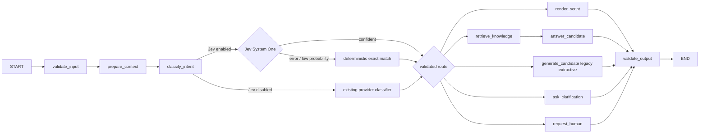

# Jev routing, Claude answers and pgvector knowledge (AI service)

Status: implementation design, local/unmerged (branch `worktree-agent-a95cbb162d3887625`, based on
`integrate/mvp5-6`). Scope: EPIC-002 (Python runtime) with EPIC-004 (reply router) and EPIC-006
(real providers) consumers. Owner decisions 2026-11-26 are DECIDED; everything marked PROPOSED or
OPEN below still needs owner/integrator confirmation. Go keeps all business authority and sending.

## 1. Summary

The Go reply router (`reply_router_service.go`) matches script triggers deterministically and asks
Python only when no trigger matches. Python today classifies with the configured LLM and can only
produce extractive "generate" text from caller-supplied facts (Go supplies none), so the AI path
ends in clarify or handoff.

This design adds, inside `services/ai` only:

| Part | Decision | Status |
| --- | --- | --- |
| Router | Jev (TypeSafe System One, `jev-1.14.0`, pinned, configurable) chooses `script` / `answer` / `clarify` / `human` | DECIDED (owner), IMPLEMENTED |
| Feature flag | `AI_JEV_ENABLED=false` by default; also off without `TYPESAFE_API_KEY` | DECIDED, IMPLEMENTED |
| Fallback | Jev disabled → the pre-existing classifier path, unchanged (deterministic exact match with the default fake provider). Jev error, low probability or invalid output → deterministic exact-match matcher → `human`. Jev failure never triggers a paid LLM routing call | PROPOSED reading of "existing deterministic behavior" (see §9) |
| PII | Typed redaction (`[PHONE]`, `[EMAIL]`, `[ADDRESS]`) before any text reaches TypeSafe | DECIDED, IMPLEMENTED |
| Answers | Claude (`claude-sonnet-5-5` default, via langchain-anthropic) structured output grounded on retrieved knowledge; always labelled `generated` + `requires_review` | DECIDED, IMPLEMENTED |
| Memory | RAG in PostgreSQL + pgvector, Gemini embeddings via langchain-google-genai, vectors in the AI-owned `ai_runtime` schema | DECIDED, IMPLEMENTED |
| Ingest | Go pushes knowledge over new additive RPCs `UpsertKnowledge` / `DeleteKnowledge` | PROPOSED path; Python side IMPLEMENTED, Go side is a follow-up |

The multi-provider LangChain architecture stays: OpenAI/Gemini/Anthropic all implement the new
`answer` port through the same `LangChainProvider`. Claude becomes the default real provider
(`AI_PROVIDER=anthropic` documented default model `claude-sonnet-5-5`); the process default stays
`fake` so an unconfigured service never makes paid calls.

## 2. Flow

Go → Python stays asynchronous (`StartRun` → `GetRun` polling). Knowledge ingest is synchronous
unary gRPC from Go (idempotent, retryable). No Kafka is introduced: `packages/shared/events`
defines no product or script events today (only messaging, delivery, connection health and order
confirmation), and Python has no Kafka client.

### 2.1 Jev routing

One System One call per routed message (`AsyncTypeSafeClient.system_one`), questions:

| Name | Type | Purpose |
| --- | --- | --- |
| `intent` | Choice `script` / `answer` / `clarify` / `human` | Main route; acted on by the chosen option's probability |
| `script` | Choice over the active scripts passed by Go (`s1..sN`, ≤ 50, labels mapped back to script IDs locally; IDs are not sent) | Asked only when active scripts exist |
| `script_fits` | Noul | Companion yes/no instead of a weak "none of the above" option |
| `wants_human` | Noul | Explicit staff request / complaint / order or payment problem |

State sent to TypeSafe: the redacted customer message and at most `AI_JEV_HISTORY_MESSAGES`
(default 2) redacted recent messages. Script options carry only redacted trigger phrases and a
short redacted answer excerpt. Facts, knowledge, constraints and identifiers are not sent.

Decision policy (all thresholds are configuration, Vietnamese accuracy is undocumented):

1. `wants_human ≥ AI_JEV_NOUL_YES` (0.7) → `human` (`customer_requested_staff`).
2. Best `intent` probability `< AI_JEV_MIN_PROBABILITY` (0.6) → fallback.
3. `script`: needs `script` probability ≥ `AI_JEV_SCRIPT_MIN_PROBABILITY` (0.6) and
   `script_fits ≥ AI_JEV_NOUL_YES`; otherwise fallback.
4. `answer`: needs `wants_human ≤ AI_JEV_NOUL_NO` (0.3) and the caller's `allow_knowledge_answer`;
   otherwise `human` (`business_review` / `knowledge_answer_not_enabled`).
5. `clarify` / `human` are taken as is.

Fallback = deterministic unique exact trigger match, else `human` with reason
`router_uncertain`. Jev output is untrusted: labels are validated against the options sent,
probabilities are bounded, missing answers count as errors.

SDK use: `typesafe-sdk` 0.7.x (async client, `httpx2` transport injection for offline tests,
typed errors). Retries limited to HTTP 429/529 (`RetryPolicy(http_statuses={429, 529})`,
connection/timeout retries disabled to avoid re-charging an accepted request), plus an overall
`asyncio.timeout`. The SDK's `typesafe_sdk` logger is forced to WARNING because DEBUG logs bodies.
Errors map to safe categories: 400/413/415/422 → `jev_bad_request`, 401/403 → `jev_auth`, 429 →
`jev_rate_limited`, 529/5xx → `jev_unavailable`, timeouts → `jev_timeout`, invalid response →
`jev_invalid_output`. Verified against the installed SDK: `response.choices[name]`,
`response.nouls[name]` and `response.answers[name]` all exist; the adapter uses the typed
`choices` / `nouls` accessors and `ChoiceAnswer.probabilities`.

Dependency justification: the SDK is the vendor's official client, depends on `httpx2` (already a
dev dependency of this lockfile), `tenacity`, `anyio`, `packaging`, `truststore`; it gives typed
errors, Retry-After handling and an injectable transport. Re-implementing it with `httpx` would
duplicate retry/error parsing. It is imported lazily only when Jev is enabled.

### 2.2 PII redaction for TypeSafe

`hexta_ai/redaction.py`: Vietnamese phones (`+84`/`84`/`0` prefixes, mobile and landline, spaced,
dotted or dashed), emails, and best-effort Vietnamese street addresses (house number + street
keywords, `số`, `ngõ/ngách/hẻm/kiệt`, `đường/phố`, `phường/quận/huyện/xã/tp`) → `[PHONE]`,
`[EMAIL]`, `[ADDRESS]`. Prices such as `1.250.000đ` are not phones. Redaction is heuristic
defense in depth, not a completeness claim. Claude receives phone/email-redacted customer text
but keeps addresses (shipping questions need them) and unredacted tenant knowledge (prices,
hotline). The legacy `graph.redact` stays for the legacy classifier path.

### 2.3 Retrieval

`retrieve_knowledge`: embed the redacted customer message (Gemini `RETRIEVAL_QUERY`), cosine top-k
with `tenant_id = $1 AND embedding_model = $2`, similarity ≥ `AI_RAG_MIN_SIMILARITY` (0.55),
`AI_RAG_TOP_K` (6), then a context budget (`AI_RAG_MAX_CONTEXT_TOKENS`, 6000 estimated tokens,
same conservative estimator as the provider budget). Script chunks are kept only when their
`version_id` attribute is in the active script snapshot of the run. Caller facts are added as
`fact:<id>` items. No retrieved items → `human` (`insufficient_information`) without a Claude call.
Retrieval failures (DB/embedding) → `human` (`ai_error`).

### 2.4 Claude answer

Structured output (`GroundedAnswer`): `kind` (`answer`/`clarify`), `text`, `cited_source_ids`,
`confidence`, `needs_human`. Prompt layout for caching: a stable system prompt (Anthropic
`cache_control: ephemeral` block), then one human message with `knowledge` → `conversation` →
`customer_message`. Validation: `needs_human` → handoff; answers must cite ≥ 1 retrieved source,
no unknown/duplicate citations, confidence ≥ `AI_ANSWER_MIN_CONFIDENCE` (0.7), ≤ 2000 characters,
no template braces, and every number in the answer must appear in the cited sources or the
customer message (no invented prices/stock). Refusals (`stop_reason=refusal`, OpenAI
`content_filter`, Gemini `SAFETY`) → `LLM_REFUSAL`; refusals, timeouts, quota and invalid output in
the answer node become `human` candidates (`ai_error`, reason `answer_<category>`), not failed runs.
All Claude-authored text is labelled `candidate_kind=generated` (or `clarify`) with
`requires_review=true`.

## 3. Data model and Atlas migrations (AI schema only)

Owner: Python (`ai_runtime`, revisions in `atlas_ai_revisions`). Desired SQL:
`migrations/schema/ai.sql`.

`ai_runtime.knowledge_sources` — one row per source, also the tombstone/revision fence:

| Column | Type | Notes |
| --- | --- | --- |
| tenant_id, source_type, source_id | text | PK; `source_type IN ('product','document','script')` |
| source_revision | bigint ≥ 0 | Go-assigned monotonic revision; older upserts/deletes are `stale` |
| content_hash | bytea | sha256 of the embedded text (title + body) |
| title | text | |
| attributes | jsonb object | Non-embedded current facts (price, stock, SKU, version_id) |
| embedding_model | text | Re-embed when the configured model changes |
| chunk_count | integer ≥ 0 | 0 when deleted |
| deleted | boolean | Tombstone keeps the revision fence |
| created_at, updated_at | timestamptz | |

`ai_runtime.knowledge_chunks` — PK `(tenant_id, source_type, source_id, chunk_index)`, FK to the
source with `ON DELETE CASCADE`, `content text`, `token_estimate integer > 0`,
`embedding_model text`, `embedding public.vector(768)`; HNSW index `vector_cosine_ops`.

Migrations (`migrations/ai`):

1. `20261126950000_enable_pgvector.sql` — created with `atlas migrate new`, authored SQL:
   `CREATE EXTENSION IF NOT EXISTS vector WITH SCHEMA public` and a guard that the extension is in
   `public` with version ≥ 0.8.0 (iterative HNSW scans). Atlas Community cannot diff extensions
   ("extensions are available to logged-in users only"), and a dev database must have a clean
   `ai_runtime`, so the extension lives in `public` (database-wide object) instead of
   `ai_runtime`. pgvector is not a trusted extension: when the AI login is not a superuser, a
   superuser must create it first (owner follow-up); `IF NOT EXISTS` then makes the job a no-op.
2. `20261126950001_knowledge_store.sql` — generated with `atlas migrate diff --env ai` against a
   disposable pgvector dev database (`AI_DEV_URL`) that has `vector` preinstalled in `public`.

Existing `runs` rows are untouched. Rollback: drop both tables (data is re-pushable from Go);
the extension may stay.

## 4. Contracts (`proto/hexta/ai/v1/service.proto`, additive)

`StartRunRequest`: `12 bool allow_knowledge_answer` — the caller opts into RAG answers and
acknowledges `requires_review`. Old callers (field absent) never receive RAG answers.

`Run` (all new, defaults preserve old meaning): `20 candidate_kind` (`script`, `generated`,
`clarify`, `handoff`), `21 repeated cited_source_ids` (`product:<id>`, `document:<id>`,
`script:<id>`, `fact:<id>`), `22 needs_human`, `23 handoff_reason` (Go vocabulary:
`customer_requested_staff`, `insufficient_information`, `ai_error`, `business_review`),
`24 requires_review`, `25 router` (`jev`, `deterministic`, `provider`), `26 router_model`,
`27 route_probability`, `28 router_fallback_reason`. Route strings stay `script`, `generate`,
`clarify`, `human` (RAG answers use `generate` + `candidate_kind=generated`).

New RPCs: `UpsertKnowledge(UpsertKnowledgeRequest) returns (UpsertKnowledgeResponse)` and
`DeleteKnowledge(DeleteKnowledgeRequest) returns (DeleteKnowledgeResponse)`.

| Message | Fields |
| --- | --- |
| KnowledgeDocument | 1 source_type, 2 source_id, 3 int64 source_revision, 4 title, 5 body, 6 map<string,string> attributes |
| UpsertKnowledgeRequest | 1 tenant_id, 2 repeated KnowledgeDocument documents (1–20) |
| KnowledgeResult | 1 source_type, 2 source_id, 3 outcome (`created`, `updated`, `attributes_updated`, `unchanged`, `stale`), 4 int32 chunk_count |
| UpsertKnowledgeResponse | 1 repeated KnowledgeResult results |
| DeleteKnowledgeRequest | 1 tenant_id, 2 source_type, 3 source_id, 4 int64 source_revision |
| DeleteKnowledgeResponse | 1 outcome (`deleted`, `not_found`, `stale`) |

Errors: `UNAUTHENTICATED` (token), `INVALID_ARGUMENT` (identifiers, type, sizes, negative
revision, duplicate source), `FAILED_PRECONDITION` (knowledge store not configured),
`RESOURCE_EXHAUSTED` (embedding quota), `UNAVAILABLE` (DB, embedding timeout/error; retry with the
same revision). No HTTP endpoint or Kafka topic changes.

Ingest semantics: same revision + same hash → `unchanged` (no embedding call); higher revision,
same embedded text → `attributes_updated` (no embedding call); changed text or embedding model →
re-chunk + embed outside any transaction, then a short transaction locks the source row, rechecks
the revision and replaces chunks. Delete writes a tombstone with the revision.

## 5. Security, performance, recovery

- Tenant isolation: every knowledge statement filters by `tenant_id`; the shared service token
  authenticates Go, which must derive the tenant (unchanged trust model).
- Paid-call fence: the run is non-simulated when the answer provider, Jev or embeddings are real,
  so `LLM_CALL_STARTED` prevents replay of Jev/Claude/embedding calls after lease loss.
- No DB lock spans provider work. Retrieval uses `SET LOCAL hnsw.iterative_scan = strict_order`.
- Hosted tracing stays disabled; provider/Jev bodies never reach logs or RPC errors.

## 6. Configuration

`AI_JEV_ENABLED`, `TYPESAFE_API_KEY`, `AI_JEV_MODEL` (`jev-1.14.0`), `AI_JEV_BASE_URL`,
`AI_JEV_TIMEOUT`, `AI_JEV_MAX_RETRIES`, `AI_JEV_MIN_PROBABILITY`, `AI_JEV_SCRIPT_MIN_PROBABILITY`,
`AI_JEV_NOUL_YES`, `AI_JEV_NOUL_NO`, `AI_JEV_HISTORY_MESSAGES`; `AI_EMBEDDING_PROVIDER`
(`fake`/`gemini`), `AI_EMBEDDING_MODEL` (`gemini-embedding-001`), `AI_EMBEDDING_TIMEOUT`;
`AI_RAG_TOP_K`, `AI_RAG_MIN_SIMILARITY`, `AI_RAG_MAX_CONTEXT_TOKENS`, `AI_ANSWER_MIN_CONFIDENCE`.
Embedding dimension is fixed at 768 by the schema.

## 7. Verification plan

Offline only: fake Jev transport/client, fake embeddings, fake/stub LLM. Routing branches and
fallbacks, threshold config, redaction, structured answer validation, refusal/error → handoff,
proto compatibility (old requests keep old semantics), RPC validation; DB-backed tests with a
disposable pgvector database migrated by Atlas: tenant isolation, ingest idempotency, staleness,
delete. Offline Vietnamese eval harness (`services/ai/evals/`) with replay of recorded Jev
answers; live mode needs `--live` plus explicit owner approval.

## 8. Go adapter follow-up (integrator, not in this branch)

Recorded in the session report: map the new `Run` fields, set `allow_knowledge_answer`, exclude
`requires_review` / `generated` candidates from auto-send, map `handoff_reason`, and push
product/script/document knowledge through `UpsertKnowledge` / `DeleteKnowledge` from a durable job.

## 9. Open questions

- Confirm the fallback reading: Jev disabled keeps the existing classifier; Jev failure uses only
  the deterministic matcher.
- Clarify text is still the static English sentence; Vietnamese wording/configuration is OPEN.
- Business documents have no Go table yet; their owner-entry UI/API is OPEN.
- pgvector image, superuser extension creation, Atlas dev image and CI image are owner follow-ups.
- Live Vietnamese evaluation of Jev needs owner approval and a key.
