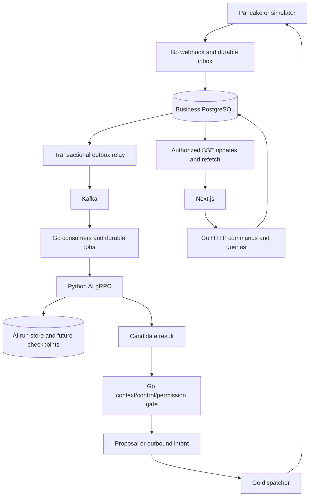

# Architecture and service ownership

## Proposed DDD ownership map — 2026-10-20

The [DDD domain map](../2026-10-20_ddd-domain-map_design.md) proposes nine business contexts from current code and approved scope. Six have active foundations, Inventory is legacy, Conversation Handling and Response Scripts are targets. Context isolation, aggregate choices and core/supporting classification remain recommendations. AI execution is a supporting technical boundary; no code, schema, route or deployment change is made by this discovery. Existing layered architecture remains applicable.

## Current implementation versus target

| Component | IMPLEMENTED baseline | DECIDED/TARGET |
| --- | --- | --- |
| `apps/web` | Next.js/TypeScript/Tailwind, authentication/tenant pages; standalone Docker build | Conversation inbox/detail, review/send, script editor, settings, independent order/workflow UI |
| `apps/admin` | Starter application | No decision to make this the primary business UI |
| `services/api` | Go/Gin/Fx/GORM; auth, tenants, legacy orders and Gemini order-draft endpoints | Conversation commands, scope enforcement, outbox/inbox, event consumers, send gate |
| Go worker | gRPC smoke command only | Durable business dispatch, Kafka consumers/relay, reconciliation, expiry |
| `services/ai` | FastAPI health/preview, grpc.aio lifecycle, fake LangGraph, PostgreSQL leased whole-run jobs | Router/generator adapters, richer result contracts, checkpoints, result outbox, trace export |
| PostgreSQL | Public business schema, Python-owned ai_runtime schema; separate local AI role | Messaging/script/event/workflow tables and tenant-aware constraints |
| Redis | Session/tenant cache and legacy order-draft cache | Bounded cache only; never sole source of new business drafts/events |
| Kafka | Legacy infrastructure declaration, no new application integration | Owner-selected event backbone; see Kafka design |
| Observability | Safe local graph steps/logs; no hosted export for simulation | Self-host Langfuse with correlated business/AI traces |

## Target data flow

The diagram is TARGET. Today's local runtime has web/API/database/cache/AI, not the entire message-processing path.

## Responsibility boundaries

Go owns tenant membership, owner grants, conversation/source identity, context revisions, control generation, script active versions, product/customer facts, proposals, outbound authorization, channel credentials and external sends. Python can process an authorized snapshot and return a candidate; a checkpoint, classifier confidence or model tool call cannot grant business permissions. Python has no general write access to public business tables and must never send directly to Pancake.

PostgreSQL owns mutable state and transactions. Kafka distributes immutable facts/work notifications and retains them for a configured window. Redis accelerates reads and temporary state only. A Kafka event, Redis entry or an AI result must never bypass the final current-state business gate.

## Repository map

| Path | Responsibility |
| --- | --- |
| `services/api/cmd` | Go API entry and local AI interoperability CLI |
| `services/api/internal/present/http/{controller,dto,router,middleware}` | HTTP validation, transport DTOs, routing, identity |
| `services/api/internal/core/service` | Business services and policy |
| `services/api/internal/repository` | GORM and cache repository implementations |
| `services/api/internal/infrastructure` | DB/Redis/provider/generated RPC clients |
| `services/api/internal/bootstrap` | Fx providers/lifecycle; IDraftCache is explicitly bound to RedisClient |
| `services/api/internal/core/model` | Existing model location; written rules mention repository models, so resolve placement before adding/moving new models |
| `packages/shared` / `packages/sdk` / `packages/ui` | Shared Go utilities / browser SDK / UI components |
| `proto/hexta/ai/v1` | Shared authoritative Protobuf contract |
| `services/ai/hexta_ai` | Graph, runtime RPC adapter, durable service/store and migration |
| `migrations/api` | Ordered Atlas business migrations; SQL governs installed schema |
| `infrastructure/compose.demo.yml` | Isolated current local stack |

Use controller -> service -> repository -> infrastructure boundaries; Fx is the composition root. Preserve typed shared errors, transport DTOs and Swagger for new public routes. Do not move old models or change legacy behavior merely to make documentation look uniform.

## Synchronous and asynchronous work

HTTP mutations return after a local state/job/outbox transaction. Webhook acknowledges durable receipt, not AI completion. StartRun gRPC returns after committed acceptance; GetRun polls results. Model/media/sending work occurs outside DB transactions. Kafka offsets advance after durable local consumer work, not a long model call. SSE reports authorized changes and supports refetch; it is not durable event history.

## Dependency failure behavior

DB unavailable: no new durable acknowledgement; return retryable error. Kafka unavailable: committed outbox waits, user commands can still commit within configured capacity. Python unavailable: Go job retains the deterministic run ID and queries/retries acceptance. Trace exporter unavailable: business work continues with safe local metadata. External send uncertain: mark unknown and reconcile, never assume safe resend. Exact live behavior for unimplemented components requires failure tests before rollout.

## Local manual sales slice — 2026-10-19

The web now has a shared workspace shell and customer/product/order pages. Authenticated sales HTTP commands use SalesController -> SalesService -> ISalesRepository, with database transactions, current membership checks, tenant-scoped references, order versions and audits. Legacy order stock/payment behavior is not the new confirmation path. This local slice has no queue, external sending or model dependency. Its delivery is unmerged; conversation/workflow automation remains target scope.

## Tenant-first onboarding — implemented locally, 2026-10-19

The account hub is /tenants. Business routes use /tenants/{tenantId}/{orders|customers|products|settings/...}, with route-bound membership loading and a keyed resource subtree. Separate tabs need no shared tenant selector. Former workspace/global business URLs redirect to the account hub.

TenantOnboardingController -> TenantOnboardingService -> TenantOnboardingRepository provides pending applications, explicitly authorized platform review and atomic tenant/owner provisioning. Owner email invitations activate only after signed-in recipient acceptance. Platform authority is independent of tenant membership and provisioned only by a trusted database CLI. The manual private-link delivery clearly states that no email was sent. Existing tenants/data are retained. Public direct creation/direct membership invitations and legacy AI routes are unregistered; owners cannot change plan/status. See [the implementation design](../2026-10-19_tenant-onboarding_design.md). Delivery remains local/unmerged.

## Shared web branding — 2026-10-19

IMPLEMENTED locally/unmerged: apps/web/components/brand-logo.tsx renders approved PNG assets from public/brand with class-based light/dark selection. Landing, authentication, account/workspace shell and invitations share the component. It requires no theme hook or API contract change.

The icon-only master is public/brand/hexta-icon.png. app/icon.png and app/favicon.ico use Next.js metadata file conventions for browser icons; the same blue emblem serves both themes. Locally verified, merge pending.

## Legacy AI boundary repair — 2026-10-20, local/unmerged

The dormant AIAgentService now depends on a read-only IAICatalogRepository and core generation/cache ports. Tenant-qualified catalog/stock/customer persistence belongs to the repository; conversation input, draft and event types belong to core/types, with HTTP/SSE mapping in the controller and Gemini adaptation in infrastructure. Services/repositories return sanitized shared errors. The legacy HTTP routes remain unregistered; this refactor does not authorize messaging, new sending or automatic order creation. Fx graph and Atlas-backed tenant/limit tests cover the extracted boundary; see the [shared session](../../epics/EPIC-001-system-design/sessions/2026-10-20_rule-compliance-fixes.md).
