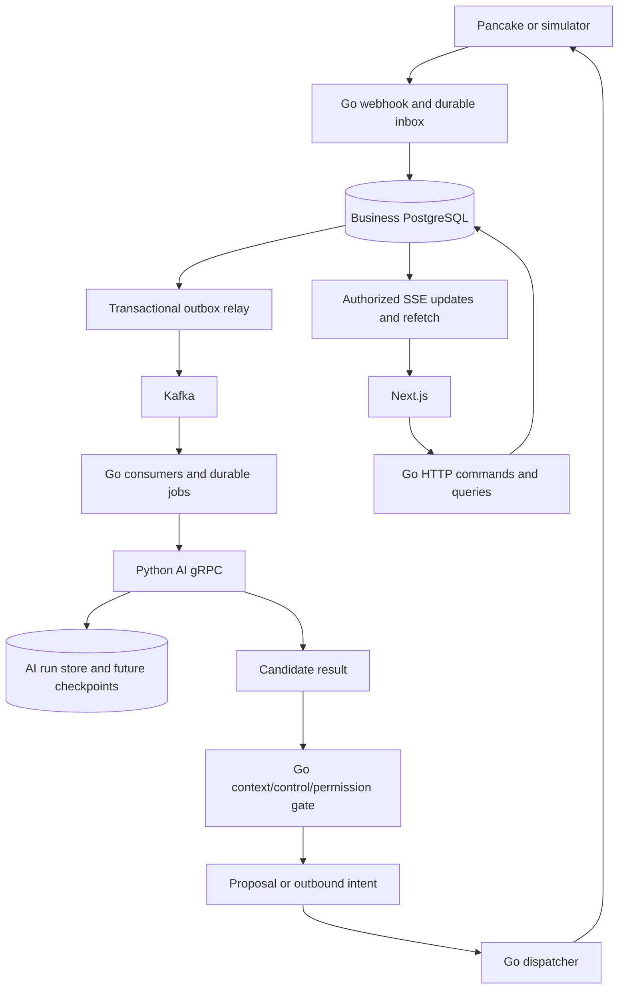

# Architecture and service ownership

## Current implementation versus target

| Component | IMPLEMENTED baseline | DECIDED/TARGET |
| --- | --- | --- |
| `apps/web` | Next.js/TypeScript/Tailwind, authentication/tenant pages; standalone Docker build | Conversation inbox/detail, review/send, script editor, settings, independent order/workflow UI |
| `apps/admin` | Starter application | No decision to make this the primary business UI |
| `services/api` | Go/Gin/Fx/GORM; auth, tenants, legacy orders and Gemini order-draft endpoints | Conversation commands, scope enforcement, outbox/inbox, event consumers, send gate |
| Go worker | gRPC smoke command only | Durable business dispatch, Kafka consumers/relay, reconciliation, expiry |
| `services/ai` | FastAPI health/preview, grpc.aio lifecycle, fake LangGraph, PostgreSQL leased whole-run jobs | Router/generator adapters, richer result contracts, checkpoints, result outbox, trace export |
| PostgreSQL | Public business schema, Python-owned ai_runtime schema; separate local AI role | Messaging/script/event/workflow tables and tenant-aware constraints |
| Redis | Session/tenant cache and legacy order-draft cache | Bounded cache only; never sole source of new business drafts/events |
| Kafka | Legacy infrastructure declaration, no new application integration | Owner-selected event backbone; see Kafka design |
| Observability | Safe local graph steps/logs; no hosted export for simulation | Self-host Langfuse with correlated business/AI traces |

## Target data flow

The diagram is TARGET. Today's local runtime has web/API/database/cache/AI, not the entire message-processing path.

## Responsibility boundaries

Go owns tenant membership, owner grants, conversation/source identity, context revisions, control generation, script active versions, product/customer facts, proposals, outbound authorization, channel credentials and external sends. Python can process an authorized snapshot and return a candidate; a checkpoint, classifier confidence or model tool call cannot grant business permissions. Python has no general write access to public business tables and must never send directly to Pancake.

PostgreSQL owns mutable state and transactions. Kafka distributes immutable facts/work notifications and retains them for a configured window. Redis accelerates reads and temporary state only. A Kafka event, Redis entry or an AI result must never bypass the final current-state business gate.

## Repository map

| Path | Responsibility |
| --- | --- |
| `services/api/cmd` | Go API entry and local AI interoperability CLI |
| `services/api/internal/present/http/{controller,dto,router,middleware}` | HTTP validation, transport DTOs, routing, identity |
| `services/api/internal/core/service` | Business services and policy |
| `services/api/internal/repository` | GORM and cache repository implementations |
| `services/api/internal/infrastructure` | DB/Redis/provider/generated RPC clients |
| `services/api/internal/bootstrap` | Fx providers/lifecycle; IDraftCache is explicitly bound to RedisClient |
| `services/api/internal/core/model` | Existing model location; written rules mention repository models, so resolve placement before adding/moving new models |
| `packages/shared` / `packages/sdk` / `packages/ui` | Shared Go utilities / browser SDK / UI components |
| `proto/hexta/ai/v1` | Shared authoritative Protobuf contract |
| `services/ai/hexta_ai` | Graph, runtime RPC adapter, durable service/store and migration |
| `migrations/api` | Ordered Atlas business migrations; SQL governs installed schema |
| `infrastructure/compose.demo.yml` | Isolated current local stack |

Use controller -> service -> repository -> infrastructure boundaries; Fx is the composition root. Preserve typed shared errors, transport DTOs and Swagger for new public routes. Do not move old models or change legacy behavior merely to make documentation look uniform.

## Synchronous and asynchronous work

HTTP mutations return after a local state/job/outbox transaction. Webhook acknowledges durable receipt, not AI completion. StartRun gRPC returns after committed acceptance; GetRun polls results. Model/media/sending work occurs outside DB transactions. Kafka offsets advance after durable local consumer work, not a long model call. SSE reports authorized changes and supports refetch; it is not durable event history.

## Dependency failure behavior

DB unavailable: no new durable acknowledgement; return retryable error. Kafka unavailable: committed outbox waits, user commands can still commit within configured capacity. Python unavailable: Go job retains the deterministic run ID and queries/retries acceptance. Trace exporter unavailable: business work continues with safe local metadata. External send uncertain: mark unknown and reconcile, never assume safe resend. Exact live behavior for unimplemented components requires failure tests before rollout.
