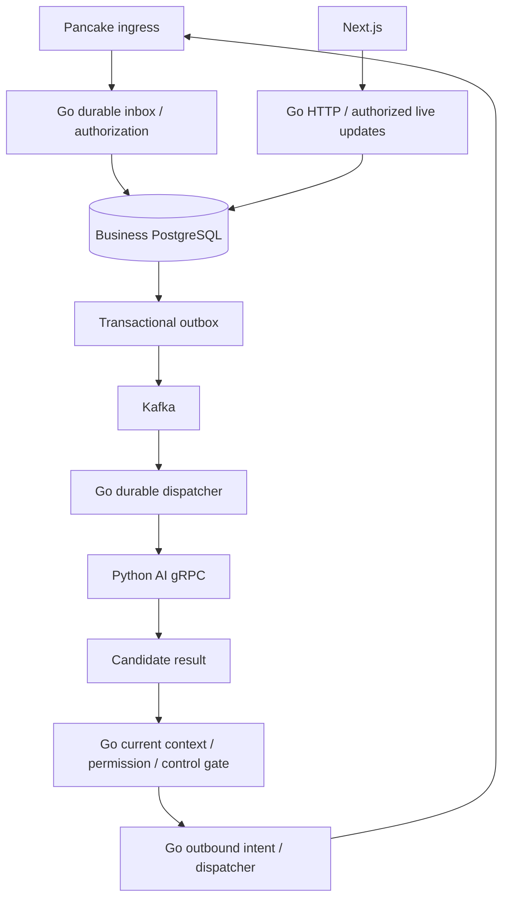

# Architecture and ownership

Current source snapshot: codex/demo-work-units at b52a8ba; source reviewed in the [2026-10-28 audit](../../reviews/2026-10-28_architecture-compliance_review.md). This is an implemented-versus-target map, not a claim of exhaustive fresh runtime verification.

## Implemented components

| Component | Present behavior | Not established by that behavior |
| --- | --- | --- |
| apps/web + SDK/UI | Next.js tenant-first auth, customer/product/order and workflow UI; local owner overview | Full manual/mobile/two-identity acceptance or merged overview |
| services/api | Go/Gin/Fx/GORM auth, tenant onboarding/invitations, sales, workflow and local owner overview | Full DDD isolation, business conversation dispatcher or new send gate |
| services/ai | FastAPI diagnostic preview, authenticated gRPC, fake LangGraph and PostgreSQL-leased durable runs | Real provider inference, node checkpoints or direct business writes/sends |
| PostgreSQL | Public business schema and isolated ai_runtime; explicit Atlas histories/jobs | Automatically approved future conversation/outbox/billing schema |
| Redis | Existing tenant/session primitives and legacy AI draft/state cache; auth currently uses DB session repo | Durable business authority or a completed shared-cache redesign |
| Kafka / Langfuse | Target designs; legacy infrastructure declarations only | Application producers/consumers, outbox/inbox or self-host trace deployment |

Current HTTP orders route to SalesController. Legacy OrderService inventory effects and dormant Go Gemini/AIController foundations are not the active manual-sales route or approved new messaging scope. Generated RPC/smoke CLI is not an operational business dispatcher. apps/admin remains a starter, not the selected business UI.

## Layer and ownership map

| Location | Responsibility |
| --- | --- |
| services/api/cmd, internal/bootstrap | Entry, Fx assembly/resource lifecycle |
| internal/present/http | Transport binding/validation, DTOs, routing and actor context |
| internal/core/service | Business policy, authorization and orchestration |
| internal/repository | Queries, transactions, persistence/locking; current legacy wrappers are migration debt |
| internal/infrastructure | DB/cache/provider/protocol clients |
| internal/core/model/types | Current mixed data location; domain/ORM separation remains incomplete |
| packages/shared, sdk, ui | Go shared primitives, browser API/auth client and UI |
| proto/hexta/ai/v1 | Authoritative Go/Python wire contract |

Rules are not duplicated here: use [root router](../../../rules/README.md) for the task's boundaries/stack modules. [Audit](../../reviews/2026-10-28_architecture-compliance_review.md) retains six OPEN deviations. The [DDD map](../2026-10-20_ddd-domain-map_design.md) is a proposal, not current aggregate/context isolation.

## Owner decisions and proposed refactors

- Each aggregate owns a pure mapper module; conversion must not lengthen controllers/services/repositories. Boundary-specific mapper subpackages are proposed, not code already moved.
- Replace per-repository wrappers with shared cache mechanics/aggregate policies. [Mapper/cache design](../2026-10-28_aggregate-mappers-cache_design.md) retains scope keys, after-commit invalidation, fill fencing, DB authority and explicit stale-read/outage limits. No measured speedup or enabled new cache policy.
- Hexta handles orders/business operations, PostPilot fanpages, ViralForge content. A separate Platform/Sales product split was rejected. Shared identity/billing and cross-app contracts remain OPEN. [Roadmap](../../plans/2026-10-27_thesis-first-ecosystem_plan.md) prioritizes Hexta thesis 1Dec2026 and one product at a time; [ecosystem proposal](../2026-10-27_saas-app-platform_design.md) is discussion only.

## Target conversation/event flow

TARGET: today's services do not implement this entire path. Go owns tenant/member/owner authority, connector credentials, proposal acceptance and sending. Python receives an authorized snapshot and returns candidates; no classifier/tool/checkpoint grants permission. PostgreSQL owns mutable truth; Kafka distributes facts; Redis accelerates reads. No event/cache/AI result bypasses the final current-state gate.

Delivery snapshot checked 2026-10-28: #52–55/#57/#58 merged; #59 OPEN/draft. Exact test/acceptance boundaries remain with EPIC-002/003/007 sessions. Parent epics are incomplete; no new runtime test or CI success inferred from cleanup.
