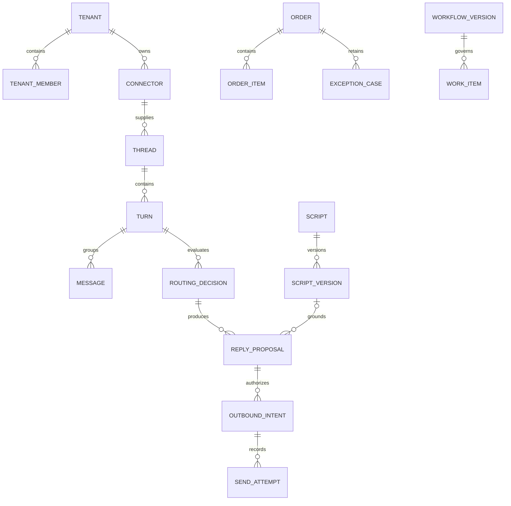

# Database design: installed schema and target domain

## Ownership and migration boundaries

IMPLEMENTED: one local PostgreSQL instance/database `hexta_demo`, Atlas-owned `public` business tables, Python-owned `ai_runtime.runs`. Local Go uses the demo DB owner; Python connects as `hexta_ai`, owns only ai_runtime and has no general public table write grant. Production should also restrict the Go runtime role and separate migration credentials. Local setup role/password constants are for loopback demo only; never reuse them publicly.

Atlas business migrations live in `migrations/api`; Python version-001 DDL lives in `services/ai/hexta_ai/migrations/001_runs.sql`. Atlas uses public search_path and an explicit atlas_schema_revisions metadata schema. There is no implicit Go AutoMigrate in the local launcher. New Python schema revisions need versioned migrations rather than silently mutating 001. No runtime data is deleted by this documentation.

## Sales demo additive schema (implemented locally, 2026-10-19)

[Migration 20261019030000](../../../migrations/api/20261019030000_sales_demo.sql) adds orders.version (bigint default 1), requires_delivery (boolean default false), delivery_address (text default empty), and price_provided on product_variants/order_items (boolean default false). Historic non-draft lines are marked as legacy price-provided; historic draft prices require explicit review. No existing business records are deleted. Unit price stays numeric(15,2); the presence flag distinguishes omitted from explicit zero without changing legacy Go decimal fields.

The customer phone unique index is now partial on (tenant_id,phone) where phone is nonempty and deleted_at is null, allowing multiple customers without phone and reuse after archive. The models match the new index definition. Customer archive is soft deletion; product archive retains variants/history. Order save, related-tenant/current-member/active-product checks and audit inserts share one transaction. Row locks plus order version fencing serialize edit/confirm races. Product references are validated and locked in a batch, not queried per line. Broad tenant-FK retrofits remain target work; these service gates are not a claim of new database constraints.

The catalog below remains the original baseline; apply this overlay and all migration files to interpret the current physical schema. Fresh PostgreSQL application and existing local DB upgrade both passed. The existing make migrate-diff configuration resolves a legacy Docker hostname postgres; host invocation failed DNS resolution. The additive SQL was scoped manually and checksummed/validated/applied with Atlas through the local profile, avoiding unrelated historical Gorm drift.

## Existing public table catalog (IMPLEMENTED)

The following columns/constraints are extracted from CREATE TABLE blocks in ordered API migrations at baseline 01b2e11. They are a readable catalog, not executable migration instructions. Apply all ALTER/index migrations too; specifically identities.password becomes nullable and identity uniqueness changes to (provider,identifier). SQL and Atlas history remain the authoritative installed-schema definition. Timestamp types below reflect historical SQL, not a claim they already follow the target UTC convention.

### public.identities

Source: [migration](../../../migrations/api/20260220100303_init.sql).

```sql
"id" bigserial NOT NULL,
  "user_id" text NOT NULL,
  "provider" character varying(50) NOT NULL,
  "identifier" character varying(255) NOT NULL,
  "password" character varying(255) NOT NULL,
  "created_at" timestamptz NULL,
  "updated_at" timestamptz NULL,
  PRIMARY KEY ("id")
```

### public.sessions

Source: [migration](../../../migrations/api/20260220100303_init.sql).

```sql
"id" bigserial NOT NULL,
  "user_id" text NOT NULL,
  "token" text NOT NULL,
  "provider" text NOT NULL,
  "device_info" character varying(500) NULL,
  "ip_address" character varying(45) NULL,
  "user_agent" character varying(1000) NULL,
  "is_active" boolean NOT NULL DEFAULT true,
  "created_at" timestamptz NULL,
  "expires_at" timestamptz NOT NULL,
  "revoked_at" timestamptz NULL,
  PRIMARY KEY ("id")
```

### public.tenants

Source: [migration](../../../migrations/api/20260912160000_create_tenants.sql).

```sql
"id" character varying(36) NOT NULL,
  "name" character varying(255) NOT NULL,
  "slug" character varying(255) NOT NULL,
  "plan" character varying(50) NOT NULL DEFAULT 'free',
  "status" character varying(50) NOT NULL DEFAULT 'active',
  "owner_id" character varying(255) NOT NULL,
  "created_at" timestamptz NULL,
  "updated_at" timestamptz NULL,
  PRIMARY KEY ("id")
```

### public.tenant_members

Source: [migration](../../../migrations/api/20260912160000_create_tenants.sql).

```sql
"id" bigserial NOT NULL,
  "tenant_id" character varying(36) NOT NULL,
  "user_id" character varying(255) NOT NULL,
  "role" character varying(50) NOT NULL DEFAULT 'member',
  "created_at" timestamptz NULL,
  "updated_at" timestamptz NULL,
  PRIMARY KEY ("id"),
  CONSTRAINT "fk_tenants_members" FOREIGN KEY ("tenant_id") REFERENCES "public"."tenants" ("id") ON UPDATE CASCADE ON DELETE CASCADE
```

### public.products

Source: [migration](../../../migrations/api/20261009180000_create_core_business_schema.sql).

```sql
"id" character varying(36) NOT NULL,
  "tenant_id" character varying(36) NOT NULL,
  "name" character varying(255) NOT NULL,
  "description" text NULL,
  "category" character varying(100) NULL,
  "status" character varying(32) NOT NULL DEFAULT 'active',
  "created_at" timestamptz NULL,
  "updated_at" timestamptz NULL,
  "deleted_at" timestamptz NULL,
  PRIMARY KEY ("id")
```

### public.product_variants

Source: [migration](../../../migrations/api/20261009180000_create_core_business_schema.sql).

```sql
"id" character varying(36) NOT NULL,
  "tenant_id" character varying(36) NOT NULL,
  "product_id" character varying(36) NOT NULL,
  "sku" character varying(64) NOT NULL,
  "variant_name" character varying(128) NOT NULL,
  "price" numeric(15,2) NOT NULL DEFAULT 0,
  "cost_price" numeric(15,2) NOT NULL DEFAULT 0,
  "barcode" character varying(64) NULL,
  "created_at" timestamptz NULL,
  "updated_at" timestamptz NULL,
  "deleted_at" timestamptz NULL,
  PRIMARY KEY ("id"),
  CONSTRAINT "fk_products_variants" FOREIGN KEY ("product_id") REFERENCES "public"."products" ("id") ON UPDATE CASCADE ON DELETE CASCADE
```

### public.inventory_items

Source: [migration](../../../migrations/api/20261009180000_create_core_business_schema.sql).

```sql
"id" character varying(36) NOT NULL,
  "tenant_id" character varying(36) NOT NULL,
  "variant_id" character varying(36) NOT NULL,
  "on_hand_qty" bigint NOT NULL DEFAULT 0,
  "reserved_qty" bigint NOT NULL DEFAULT 0,
  "available_qty" bigint NOT NULL DEFAULT 0,
  "safety_threshold" bigint NOT NULL DEFAULT 5,
  "created_at" timestamptz NULL,
  "updated_at" timestamptz NULL,
  PRIMARY KEY ("id")
```

### public.stock_movements

Source: [migration](../../../migrations/api/20261009180000_create_core_business_schema.sql).

```sql
"id" character varying(36) NOT NULL,
  "tenant_id" character varying(36) NOT NULL,
  "inventory_id" character varying(36) NOT NULL,
  "movement_type" character varying(32) NOT NULL,
  "quantity" bigint NOT NULL,
  "balance_after" bigint NOT NULL,
  "reference_type" character varying(64) NULL,
  "reference_id" character varying(36) NULL,
  "notes" text NULL,
  "created_at" timestamptz NULL,
  PRIMARY KEY ("id")
```

### public.customers

Source: [migration](../../../migrations/api/20261009180000_create_core_business_schema.sql).

```sql
"id" character varying(36) NOT NULL,
  "tenant_id" character varying(36) NOT NULL,
  "full_name" character varying(255) NOT NULL,
  "phone" character varying(32) NULL,
  "email" character varying(255) NULL,
  "address" text NULL,
  "created_at" timestamptz NULL,
  "updated_at" timestamptz NULL,
  "deleted_at" timestamptz NULL,
  PRIMARY KEY ("id")
```

### public.orders

Source: [migration](../../../migrations/api/20261009180000_create_core_business_schema.sql).

```sql
"id" character varying(36) NOT NULL,
  "tenant_id" character varying(36) NOT NULL,
  "order_number" character varying(64) NOT NULL,
  "customer_id" character varying(36) NULL,
  "employee_id" character varying(36) NULL,
  "status" character varying(32) NOT NULL DEFAULT 'draft',
  "payment_status" character varying(32) NOT NULL DEFAULT 'unpaid',
  "subtotal" numeric(15,2) NOT NULL DEFAULT 0,
  "discount" numeric(15,2) NOT NULL DEFAULT 0,
  "total_amount" numeric(15,2) NOT NULL DEFAULT 0,
  "source" character varying(32) NOT NULL DEFAULT 'web_form',
  "draft_id" character varying(36) NULL,
  "notes" text NULL,
  "created_at" timestamptz NULL,
  "updated_at" timestamptz NULL,
  "deleted_at" timestamptz NULL,
  PRIMARY KEY ("id")
```

### public.order_items

Source: [migration](../../../migrations/api/20261009180000_create_core_business_schema.sql).

```sql
"id" character varying(36) NOT NULL,
  "tenant_id" character varying(36) NOT NULL,
  "order_id" character varying(36) NOT NULL,
  "variant_id" character varying(36) NOT NULL,
  "quantity" bigint NOT NULL,
  "price" numeric(15,2) NOT NULL DEFAULT 0,
  "line_total" numeric(15,2) NOT NULL DEFAULT 0,
  "created_at" timestamptz NULL,
  "updated_at" timestamptz NULL,
  PRIMARY KEY ("id"),
  CONSTRAINT "fk_orders_items" FOREIGN KEY ("order_id") REFERENCES "public"."orders" ("id") ON UPDATE CASCADE ON DELETE CASCADE
```

### public.audit_logs

Source: [migration](../../../migrations/api/20261009180000_create_core_business_schema.sql).

```sql
"id" character varying(36) NOT NULL,
  "tenant_id" character varying(36) NOT NULL,
  "user_id" character varying(255) NOT NULL,
  "action" character varying(64) NOT NULL,
  "entity_type" character varying(64) NOT NULL,
  "entity_id" character varying(36) NOT NULL,
  "source" character varying(32) NOT NULL DEFAULT 'web_form',
  "draft_id" character varying(36) NULL,
  "before_state" jsonb NULL,
  "after_state" jsonb NOT NULL,
  "ip_address" character varying(45) NULL,
  "user_agent" text NULL,
  "created_at" timestamptz NULL,
  PRIMARY KEY ("id")
```

### public.ai_drafts

Source: [migration](../../../migrations/api/20261009180000_create_core_business_schema.sql).

```sql
"id" character varying(36) NOT NULL,
  "tenant_id" character varying(36) NOT NULL,
  "user_id" character varying(255) NOT NULL,
  "intent" character varying(64) NOT NULL,
  "prompt" text NOT NULL,
  "draft_payload" jsonb NOT NULL,
  "status" character varying(32) NOT NULL DEFAULT 'proposed',
  "expires_at" timestamptz NOT NULL,
  "created_at" timestamptz NULL,
  "updated_at" timestamptz NULL,
  PRIMARY KEY ("id")
```

### Existing uniqueness and foreign-key limits

- Identities: unique (provider,identifier), not email globally across all identity providers. Sessions and users use existing string user IDs; do not invent a missing public users table.
- Tenants: unique slug; members unique (tenant_id,user_id); member tenant FK cascades.
- Variants: unique (tenant_id,sku); inventory unique (tenant_id,variant_id); customer phone unique (tenant_id,phone); order number unique (tenant_id,order_number).
- Current migrations have FK relationships for tenant members -> tenants, variants -> products and order items -> orders. Many other reference columns are only indexed, and the existing FKs are not full tenant-qualified references. The target isolation invariants below are not yet guaranteed by the physical schema.
- Existing `public.ai_drafts` and Redis order drafts are legacy order/intent representations; neither is the planned versioned `reply_proposals` entity.
- Exact indexes are in the migration files. Audit backfills/duplicates/orphans before tightening tenant-aware constraints on existing data.

## ai_runtime.runs (IMPLEMENTED)

```sql
CREATE TABLE IF NOT EXISTS ai_runtime.runs (
    tenant_id text NOT NULL,
    run_id text NOT NULL,
    request bytea NOT NULL,
    digest bytea NOT NULL,
    result bytea NOT NULL,
    status smallint NOT NULL CHECK (status BETWEEN 1 AND 5),
    attempts integer NOT NULL DEFAULT 0,
    lease_token uuid,
    lease_until timestamptz,
    error_code text NOT NULL DEFAULT '',
    created_at timestamptz NOT NULL DEFAULT clock_timestamp(),
    updated_at timestamptz NOT NULL DEFAULT clock_timestamp(),
    PRIMARY KEY (tenant_id, run_id),
    CHECK ((status = 2) = (lease_token IS NOT NULL AND lease_until IS NOT NULL))
);
CREATE INDEX IF NOT EXISTS runs_queue ON ai_runtime.runs(status, lease_until, created_at);
```

Request and result are serialized Protobuf bytes; digest is SHA-256 of deterministic request serialization. `(tenant_id,run_id)` is the primary idempotency identity. Status values are 1 queued, 2 running, 3 succeeded, 4 failed, 5 cancelled. The check constraint requires lease token and expiry exactly for running rows. The queue index covers status/lease_until/created_at. `error_code` stores a safe category, never raw provider exceptions.

The request/result snapshots may contain personal data: protect DB/backups accordingly. No retention deletion or archival job is enabled. A protobuf field addition must remain backward compatible with stored request/result bytes; breaking wire evolution needs an explicit migration/versioned decoder plan.

## Target business schema (TARGET: not migrated)

Conventions: tenant-owned new tables carry tenant_id, UTC timestamptz timestamps, optimistic bigint version where mutable, and compatible string/UUID-shaped IDs. Retain current user/string key compatibility. Add unique `(tenant_id,id)` where needed for composite FKs; reference tenant membership for employee IDs. Money uses exact decimals, never binary floats.

| Entity | Important columns and constraints |
|---|---|
| connector_accounts | id, tenant_id, provider, external_page_id, mode real/simulated, credential_ref, status; unique provider+external_page_id for a real connected page unless explicit shared routing is designed |
| conversation_threads | id, tenant_id, connector_id, external_conversation_id, customer_id nullable; unique connector+external conversation |
| consultation_turns | id, thread_id, number, lifecycle, assignee_user_id nullable, control, needs_human, escalation_reason, control_generation, context_revision, last_activity_at, expires_at, closed_at, version; unique thread+number; partial unique open turn per thread |
| messages | id, thread_id, turn_id nullable, provider_message_id nullable, direction, actor_kind customer/sale/system, actor_id nullable, body, occurred_at, received_at, revision, delivery_state; unique connector+provider message ID for identified messages |
| message_revisions | id, message_id, provider revision/hash, body/media snapshot, occurred_at; duplicates must not trigger a new reply |
| media_assets | id, storage key or provider reference, MIME metadata, source, availability; linked by message/script/product; no implicit remote video understanding |
| inbox_events | id, connector_id, provider_event_key/hash, payload JSONB, received_at, processing_state; dedup key policy must account for updates to a message |
| routing_decisions | id, turn_id, context_revision, choice script/generator/clarify/human, script_version_id nullable, reason, provider/model config version, status, timing; distinguish generated decision from validated execution |
| scripts | id, name, archived_at, active_version_id nullable, version; list/index tenant+archive state |
| script_versions | id, script_id, revision, applicability, template, variables JSONB, media snapshot, created_by; unique script+revision; active pointer must reference the same tenant and script |
| reply_proposals | id, turn_id, routing_decision_id, basis_context_revision, script_version_id nullable, body/media snapshot, draft_version, edited_by, review_revision, state; generated output is separate from actual messages |
| outbound_intents | id, turn_id, proposal_id, actor, generation, context_revision, state queued/dispatching/accepted/failed/unknown/cancelled, client_request_key, payload_hash; unique tenant+client key |
| send_attempts | id, intent_id, attempt, dispatch_started_at, result metadata, provider_message_id nullable; unique intent+attempt; never store tokens in the payload log |
| background_jobs | id, kind, entity_id, available_at, lease_owner, lease_until, attempts, state; index ready/available_at; dead-letter state for exhausted safe retries |
| member_permissions | tenant_id, user_id, permission_key, granted_by, granted_at; unique tenant+user+permission; script.create/edit/activate/archive are independent |
| tenant_reply_settings | tenant_id PK, mode, version, changed_by; only the business owner grants/revokes member permissions |
| workflow_definitions / workflow_versions / workflow_steps | tenant_id, definition ID, immutable version, ordinal, name, handoff mode; unique version+ordinal; retain older versions |
| work_items / work_item_steps | tenant_id, item ID, optional order_id, workflow_version_id, current step, current owner, proposed recipient, state, version; each execution references the selected immutable definition |
| work_events | tenant_id, work_item_id, actor, event, old/new assignment and time; transactionally append with transitions |
| exception_cases / return_lines | order_id, kind, reason, owner, state; line references, requested/received quantities and condition; preserve original order |

### Event and job additions for Kafka

| Target table | Minimum columns and invariants |
| --- | --- |
| outbox_events | event_id PK, tenant_id, aggregate_type/id/version, event_type/schema_version, partition_key, payload JSONB, occurred_at, available_at, lease token/expiry, published_at, attempts; index unpublished due rows; payload immutable after creation |
| consumer_inbox | consumer_name + event_id PK, processed_at, tenant_id, optional payload digest; insert in the same transaction as domain mutation/job acceptance |
| command_idempotency | tenant_id + actor/operation + client key unique, request hash, resource/result reference, lifecycle, timestamps; changed hash conflicts; explicit retention policy |
| AI result outbox | Python-owned schema, run/event identity, typed reference payload and publish lease; write atomically with run completion in a future migration |

Kafka offset and DB commit are separate resources. The inbox/outbox design tolerates duplicated publication/delivery; it does not assert cross-system exactly-once execution.

### Required target constraints and indexes

1. Connector page/external IDs are unambiguous for real routing; simulator namespace is explicit.
2. Thread identity unique on (tenant,connector,external_conversation_id). Partial unique index on (tenant,thread_id) WHERE lifecycle='open' enforces at most one open turn.
3. Provider message identity uniqueness includes connector; provider event dedup includes event kind/revision so edits are not dropped as duplicate creates.
4. Child FKs include tenant_id. A script active-version reference must point to the same script and tenant. Use an explicit compound relationship or deferred constraint strategy when implementing the pointer cycle.
5. Scripts have unique (tenant,script,revision); proposals retain immutable source refs, basis_context_revision and independent draft_version. Human-edited drafts are never overwritten by generation completion.
6. Outbound intent client key is unique per tenant/operation; attempts unique per intent+number. State changes compare expected version/control_generation. Unknown attempts cannot be automatically reset to queued.
7. Expiry lookup index on (expires_at) for open turns without needs_human; jobs/outbox on due time with state predicates; message lists on tenant/thread/occurred_at/id for stable pagination.
8. Returns cannot exceed original order-line quantities; finalization is owner-authorized and idempotent. Workflow instances reference an immutable version, not the current definition pointer.

## Logical target relationships



This is TARGET logical structure, not an ERD asserting every relationship already exists physically.

## Migration/transaction plan

Add schema incrementally: grants/settings/connectors -> threads/turns/messages -> scripts/versions -> decisions/proposals/intents/attempts -> inbox/outbox/jobs -> workflow/exception tables. Reconcile ordering with the Kafka vertical slice. Generate/apply Atlas business changes, validate atlas.sum and upgrade a populated fixture. Preserve legacy APIs/data until an explicit compatibility/backfill plan exists.

Claim/reassign/return/resolve/expiry/message-context changes serialize on the affected turn/thread and compare version. Send dispatch initiation uses the same gate. Outbox insertion belongs to the same transaction as each domain change. Do not hold DB transactions during model calls, broker publication, media fetches or Pancake sends. Cache invalidation follows committed versioned events. Keep business drafts/history after turn closure; retention is a separate policy.

## Tenant onboarding migration — local/unmerged

20261019040000 adds platform_operators, tenant_registration_requests and tenant_invitations. Applications record applicant/reviewer/decision/time/tenant; non-rejected slug requests are unique. Pending invitations are unique by tenant/email; only SHA-256 token digests persist, with status/expiry/recipient metadata and tenant FKs. Raw private tokens never enter audit payloads. Existing tenant/membership/business data is preserved. Approval and acceptance are transactional; invitation writes lock tenant before invitation. Fresh Atlas application and existing-volume upgrade passed. See [implementation design](../2026-10-19_tenant-onboarding_design.md).
