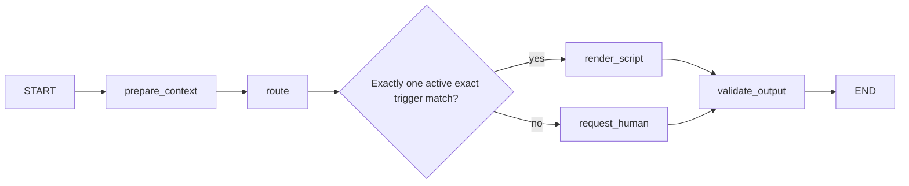

# Internal gRPC, AI graph and durable run design

## Authoritative wire contract (IMPLEMENTED)

Source: [service.proto](../../../proto/hexta/ai/v1/service.proto), package `hexta.ai.v1`, service `AIService`. Generated Go code: `services/api/internal/infrastructure/ai/rpc`; generated Python: `services/ai/generated`. Regeneration instructions/pinned tools are in [proto README](../../../proto/README.md). Never hand-edit generated bindings.

All three methods are unary RPCs. StartRun accepts work asynchronously rather than blocking for inference; GetRun polls. Browser clients do not call Python directly. The Go smoke CLI is implemented; the operational Go conversation dispatcher is not.

| Method | Request | Response |
| --- | --- | --- |
| StartRun | StartRunRequest | Current Run after committed acceptance or idempotent lookup |
| GetRun | RunRequest | Tenant-qualified Run or NOT_FOUND |
| CancelRun | RunRequest | Durable cancelled state for queued/running work; completed state remains unchanged |

### Script message

| Tag | Field | Type |
| --- | --- | --- |
| 1 | id | string |
| 2 | trigger | string |
| 3 | text | string |
| 4 | active | bool |

### StartRunRequest

| Tag | Field | Type / semantics |
| --- | --- | --- |
| 1 | tenant_id | string; authorized business identity |
| 2 | run_id | string; stable Go-generated idempotency identity |
| 3 | turn_id | string; supplied context identity; Python currently does not query a business turn table |
| 4 | context_revision | int64 nonnegative; echo for later acceptance gate |
| 5 | control_generation | int64 nonnegative; echo takeover fence |
| 6 | message | string |
| 7 | scripts | repeated Script authorized snapshot |

RunRequest fields: tag 1 tenant_id string, tag 2 run_id string.

### Run

| Tag | Field | Type / semantics |
| --- | --- | --- |
| 1,2,3 | tenant_id, run_id, turn_id | string identities |
| 4,5 | context_revision, control_generation | int64 echoed basis |
| 6 | status | RunStatus enum |
| 7 | simulated | bool; true in current fake runtime |
| 8 | route | string; current graph script/human only |
| 9 | text | string; empty when no candidate |
| 10 | script_id | string; current snapshot identifier, not yet a full immutable business script-version contract |
| 11 | reason | string safe decision category |
| 12 | steps | repeated string graph node path |
| 13 | error_code | string safe failure category |

Enum values: 0 UNSPECIFIED, 1 QUEUED, 2 RUNNING, 3 SUCCEEDED, 4 FAILED, 5 CANCELLED. Protobuf scalar defaults are real contract defaults; absent int64 revisions decode as 0 and absent bool active as false. Current Python rejects negative revisions but does not require positive revisions.

## Authentication and validation

All RPCs require exactly one `authorization: Bearer <AI_INTERNAL_TOKEN>` metadata item. Startup token minimum 24 characters; constant-time comparison. The shared token authenticates a service, not a sales user. Go must derive and authorize tenant context; Python's tenant-qualified lookup alone does not prevent a malicious trusted caller from naming another tenant.

Identifiers tenant/run/turn match `[A-Za-z0-9_-]{1,100}`. Preview input strips leading/trailing whitespace, rejects whitespace-only values/unknown JSON fields, caps message at 8000 characters, scripts at 50, script ID at 100, trigger at 200 and text at 4000. gRPC receive cap is 1 MiB. StartRun checks the full snapshot before accepting. Idempotency digest covers deterministic serialization of the original request, so differently padded wire input can conflict even if graph normalization would produce equivalent text.

| Condition | RPC code |
| --- | --- |
| Missing/wrong/duplicated token metadata | UNAUTHENTICATED |
| Invalid identifiers/input/negative revisions | INVALID_ARGUMENT |
| Same tenant/run with changed request digest | ALREADY_EXISTS |
| Missing tenant/run identity | NOT_FOUND |
| Runtime DB error | UNAVAILABLE |
| Offline memory adapter capacity reached | RESOURCE_EXHAUSTED; not the current PostgreSQL runtime capacity policy |

Caller deadlines bound the transport operation, not accepted durable work. On timeout reuse/query the same run ID; do not create a new ID merely because the response was lost. CancelRun is explicit and best effort for computation; durable state revokes result publication. Actual model requests may already have incurred costs in future adapters.

## Implemented graph

Matching strips/case-folds message and trigger. Ambiguous/inactive/no-match => human result with no invented text. A script containing unresolved braces goes to human. Both graph-level and result-level step arrays include validation. This is a fake boundary probe, not a trained model, semantic routing or proof of real provider integration. Hosted LangSmith tracing is disabled around graph calls.

## Implemented PostgreSQL execution protocol

`RunStore` owns ai_runtime.runs. INSERT ON CONFLICT plus immutable digest comparison commits before StartRun returns. Data survives process/container restart. Request/result bytes preserve the exact snapshot; tenant/run PK prevents duplicate acceptance across processes.

Worker flow:

1. Poll for work (idle delay 0.2s); claim one queued or expired running row via short `FOR UPDATE SKIP LOCKED` transaction.
2. Persist fresh UUID lease token, increment attempts and set 60-second lease. Execute graph outside transaction.
3. Check/renew lease at up to one-second intervals while awaiting task completion. Whole execution budget is 60 seconds. A lost/cancelled/expired lease cannot publish.
4. Serialize a complete candidate privately; update result/status atomically only if tenant/run/token match and lease remains unexpired/running.
5. CancelRun durably sets CANCELLED and clears lease before response. Worker renewal/finish subsequently fails; cooperative task cancellation is secondary protection.
6. Expired attempts below 3 may be reclaimed. Expired attempt at 3 fails with RECOVERY_ATTEMPTS_EXHAUSTED. Normal runner/serialization/timeout failure stores SIMULATION_RUN_FAILED. No arbitrary infinite retry of provider effects.
7. Graceful shutdown cancels the worker and requeues its still-owned run, decrementing the claim attempt; abrupt crash relies on expiry. Terminal states are not requeued.

A runtime instance processes one graph at a time. Multiple instances can claim different rows, but fair scheduling, tenant quotas, pooling, batching and load performance are not yet established. Runtime requires AI_DATABASE_URL and never falls back to memory when DB fails. Readiness checks worker liveness and DB access; DB exception bodies/credentials are not returned over RPC.

## Decided AI target and missing fields

Target graph: validate input -> prepare context -> model router -> script / generation / clarification / human -> output validation. Provider adapters: OpenAI, Anthropic, Gemini with configured server secrets; one provider/model per run and explicit capability checks. The owner asked for simple AI, not a multi-agent platform.

The current wire contract lacks immutable script version, prompt/graph version, selected provider/model/config version, evidence IDs, usage/cost, trace references, richer history/product facts, execution budgets and typed branch/error detail. Add compatible fields with new tags before live use. Reserve removed tags/names; introduce a new package/version for incompatible changes. Do not pretend these fields exist in v1 today.

Persistent LangGraph node checkpoints and AI result outbox are TARGET. Current recovery re-executes the complete deterministic fake graph. Before paid models/tools, define replay/cost budgets and node idempotency; a checkpoint does not make external side effects exactly once. Go must reject stale results after takeover, new message, config/script changes or closure regardless of Python run success. Self-host trace export is separate from durable run storage.

## Internal HTTP diagnostic endpoints

GET /health/live reports process/fake mode; GET /health/ready checks durable runtime dependencies when enabled. POST /internal/v1/preview requires Bearer token and invokes the fake graph synchronously without creating a durable run. Docs UI is disabled. HTTP preview is never the new business reply API. Test-only AI_GRPC_ENABLED=false allows offline HTTP tests.

## Explicit schema migration — 2026-10-20

AI startup now checks storage readiness and starts its worker only after a successful explicit Atlas migrations/ai job; RunStore has no migrate method or bundled startup DDL. Durable run/RPC/lease contracts unchanged. Existing compatible rows retained and verified; 27 Python tests passed. See [primary session](../../epics/EPIC-003-local-docker/sessions/2026-10-20_atlas-all-services.md).
