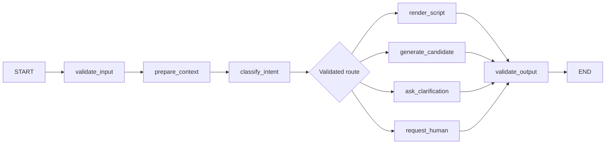

# Internal gRPC, AI graph and durable run design

## Authoritative wire contract (IMPLEMENTED)

Source: [service.proto](../../../proto/hexta/ai/v1/service.proto), package `hexta.ai.v1`, service `AIService`. Generated Go code: `services/api/internal/infrastructure/ai/rpc`; generated Python: `services/ai/generated`. Regeneration instructions/pinned tools are in [proto README](../../../proto/README.md). Never hand-edit generated bindings.

All three methods are unary RPCs. StartRun accepts work asynchronously rather than blocking for inference; GetRun polls. Browser clients do not call Python directly. The Go smoke CLI is implemented; the operational Go conversation dispatcher is not.

| Method | Request | Response |
| --- | --- | --- |
| StartRun | StartRunRequest | Current Run after committed acceptance or idempotent lookup |
| GetRun | RunRequest | Tenant-qualified Run or NOT_FOUND |
| CancelRun | RunRequest | Durable cancelled state for queued/running work; completed state remains unchanged |

### Script message

| Tag | Field | Type |
| --- | --- | --- |
| 1 | id | string |
| 2 | trigger | string |
| 3 | text | string |
| 4 | active | bool |

### StartRunRequest

| Tag | Field | Type / semantics |
| --- | --- | --- |
| 1 | tenant_id | string; authorized business identity |
| 2 | run_id | string; stable Go-generated idempotency identity |
| 3 | turn_id | string; supplied context identity; Python currently does not query a business turn table |
| 4 | context_revision | int64 nonnegative; echo for later acceptance gate |
| 5 | control_generation | int64 nonnegative; echo takeover fence |
| 6 | message | string |
| 7 | scripts | repeated Script authorized snapshot |
| 8 | history | repeated ConversationMessage (role, text), max 20 |
| 9 | facts | repeated DomainFact (id, text), max 50 |
| 10 | constraints | repeated string, max 20 |
| 11 | allow_generation | bool; defaults false for existing callers |

RunRequest fields: tag 1 tenant_id string, tag 2 run_id string.

### Run

| Tag | Field | Type / semantics |
| --- | --- | --- |
| 1,2,3 | tenant_id, run_id, turn_id | string identities |
| 4,5 | context_revision, control_generation | int64 echoed basis |
| 6 | status | RunStatus enum |
| 7 | simulated | bool; true in current fake runtime |
| 8 | route | string; script/generate/clarify/human |
| 9 | text | string; empty when no candidate |
| 10 | script_id | string; current snapshot identifier, not yet a full immutable business script-version contract |
| 11 | reason | string safe decision category |
| 12 | steps | repeated string graph node path |
| 13 | error_code | string safe failure category |
| 14,15 | provider, model | selected effective provider/model |
| 16 | confidence | double in [0,1], model score rather than calibrated probability |
| 17,18 | input_tokens, output_tokens | int64, provider usage or labeled estimate |
| 19 | usage_estimated | bool, true when usage is locally estimated |

Enum values: 0 UNSPECIFIED, 1 QUEUED, 2 RUNNING, 3 SUCCEEDED, 4 FAILED, 5 CANCELLED. Protobuf scalar defaults are real contract defaults; absent int64 revisions decode as 0 and absent bool active as false. Current Python rejects negative revisions but does not require positive revisions.

## Authentication and validation

All RPCs require exactly one `authorization: Bearer <AI_INTERNAL_TOKEN>` metadata item. Startup token minimum 24 characters; constant-time comparison. The shared token authenticates a service, not a sales user. Go must derive and authorize tenant context; Python's tenant-qualified lookup alone does not prevent a malicious trusted caller from naming another tenant.

Identifiers tenant/run/turn match `[A-Za-z0-9_-]{1,100}`. Preview input strips leading/trailing whitespace, rejects whitespace-only values/unknown JSON fields, caps message at 8000 characters, scripts at 50, script ID at 100, trigger at 200 and text at 4000. gRPC receive cap is 1 MiB. StartRun checks the full snapshot before accepting. Idempotency digest covers deterministic serialization of the original request, so differently padded wire input can conflict even if graph normalization would produce equivalent text.

| Condition | RPC code |
| --- | --- |
| Missing/wrong/duplicated token metadata | UNAUTHENTICATED |
| Invalid identifiers/input/negative revisions | INVALID_ARGUMENT |
| Same tenant/run with changed request digest | ALREADY_EXISTS |
| Missing tenant/run identity | NOT_FOUND |
| Runtime DB error | UNAVAILABLE |
| Offline memory adapter capacity reached | RESOURCE_EXHAUSTED; not the current PostgreSQL runtime capacity policy |

Caller deadlines bound the transport operation, not accepted durable work. On timeout reuse/query the same run ID; do not create a new ID merely because the response was lost. CancelRun is explicit and best effort for computation; durable state revokes result publication. A model request may already have incurred cost even if cancelled or its response is lost.

## Implemented graph (local provider extension, 2026-11-03)

Fake routing retains unique active exact matching; no/ambiguous match returns
human. Real adapters share LangChain init_chat_model / with_structured_output / ainvoke
through the Gemini/OpenAI/Anthropic integrations, with retries disabled, 20-second default call timeout (max 30), bounded
output and estimated input budgets. Missing credentials select fake explicitly
in health; invalid supplied credentials do not trigger provider failover.

Scripts must be active and confidence must meet the configured threshold. Only
trusted-caller generation opt-in plus bounded facts permits generation. Candidate
text must equal cited facts joined verbatim with newlines; unsupported text/IDs
require human review. Unresolved template braces also require human. Email/number
redaction is heuristic. History/constraints are data, not tool authority.
Both step arrays include validation; no hidden reasoning is exposed. Hosted tracing
stays disabled. Provider streaming is buffered structured output, not token/RPC
streaming. See [design](../2026-11-03_ai-providers_design.md).

## Implemented PostgreSQL execution protocol

`RunStore` owns ai_runtime.runs. INSERT ON CONFLICT plus immutable digest comparison commits before StartRun returns. Data survives process/container restart. Request/result bytes preserve the exact snapshot; tenant/run PK prevents duplicate acceptance across processes.

Worker flow:

1. Poll for work (idle delay 0.2s); claim one queued or expired running row via short `FOR UPDATE SKIP LOCKED` transaction.
2. Persist fresh UUID lease token, increment attempts and set 60-second lease. For live work commit a fenced LLM_CALL_STARTED marker before inference. Execute graph outside transaction.
3. Check/renew lease at up to one-second intervals while awaiting task completion. Whole execution budget is 65 seconds. A lost/cancelled/expired lease cannot publish.
4. Serialize a complete candidate privately; update result/status atomically only if tenant/run/token match and lease remains unexpired/running.
5. CancelRun durably sets CANCELLED and clears lease before response. Worker renewal/finish subsequently fails; cooperative task cancellation is secondary protection.
6. Expired attempts below 3 may be reclaimed. Expired attempt at 3 fails with RECOVERY_ATTEMPTS_EXHAUSTED. Normal runner/serialization/timeout failure stores SIMULATION_RUN_FAILED. Live recovery with LLM_CALL_STARTED fails as LLM_RECOVERY_UNCERTAIN before inference; SDK retry is disabled. Saved output is reused. Provider/model mismatch fails as PROVIDER_CONFIG_CHANGED.
7. Graceful shutdown cancels the worker and requeues its still-owned run, decrementing the claim attempt; abrupt crash relies on expiry. Release retains the paid marker, so live work is not called again. Terminal states are not requeued. Drain older workers before enabling live providers because older binaries do not honor this marker.

A runtime instance processes one graph at a time. Multiple instances can claim different rows, but fair scheduling, tenant quotas, pooling, batching and load performance are not yet established. Runtime requires AI_DATABASE_URL and never falls back to memory when DB fails. Readiness checks worker liveness and DB access; DB exception bodies/credentials are not returned over RPC.

## Remaining target fields and recovery

Provider/model/confidence/usage and bounded history/facts now have additive v1
fields. Immutable script/prompt/graph/config versions, explicit cost, trace
references, execution budget contracts and richer typed branch detail remain
open. Add fields compatibly; reserve removed names/tags or version breaking changes.

Persistent LangGraph node checkpoints and result outbox remain TARGET. Fake work
can replay; live work favors avoiding duplicate charges over automatic recovery.
The marker is not exactly-once provider billing or a node checkpoint. Go must
still reject stale results after takeover, new messages or changed permissions.
Self-host trace export remains separate. Local implementation and test evidence:
[provider session](../../epics/EPIC-002-ai-runtime/sessions/2026-11-03_ai-providers.md).

## Internal HTTP diagnostic endpoints

GET /health/live reports process and effective provider/simulation mode; GET /health/ready checks durable runtime dependencies when enabled. POST /internal/v1/preview requires Bearer token and awaits the configured graph without creating a durable run (each live preview can incur new cost). Docs UI is disabled. HTTP preview is never the new business reply API. Test-only AI_GRPC_ENABLED=false allows offline HTTP tests.

## Explicit schema migration — 2026-10-20

AI startup now checks storage readiness and starts its worker only after a successful explicit Atlas migrations/ai job; RunStore has no migrate method or bundled startup DDL. Durable run/RPC/lease contracts unchanged. Existing compatible rows retained and verified; 27 Python tests passed. See [primary session](../../epics/EPIC-003-local-docker/sessions/2026-10-20_atlas-all-services.md).
