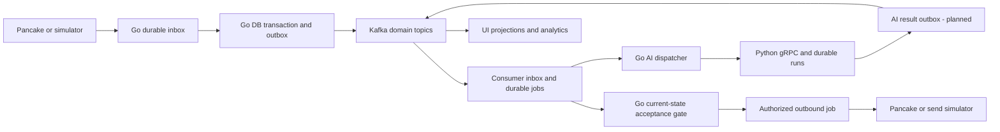

# Kafka event backbone (TARGET implementation design)

## Decision and scope

The owner requested Kafka because message/event traffic may become large. Adopt Kafka as the durable integration log and consumer fan-out backbone. PostgreSQL remains authoritative for conversations, ownership, scripts, AI runs, proposals and outbound authorization. Kafka adoption is DECIDED; topic/operational details here are TARGET for implementation. The inspected baseline has no application producers/consumers or measured Kafka throughput. The current PostgreSQL run queue is a runnable foundation that can later consume Kafka-triggered work without changing the gRPC contract.

Kafka retains events for a configured window; it is not permanent business history or a substitute for database transactions. High traffic alone does not define partition count, retention or cluster size: measure ingress/sustained and burst rates, payload sizes, hot pages/tenants and acceptable processing lag first.

## Data flow



The dispatcher/consumer/outbox paths in this diagram are planned. The Python run store and local runtime are the currently implemented foundation.

## Use cases

| Use case / trigger | Proposed topic and partition key | Consumers and behavior |
| --- | --- | --- |
| Pancake webhook accepted | `hexta.ingress.received.v1`, key `tenant_id:connector_id:external_thread_id` | Ingestion normalizer deduplicates source IDs and creates/updates messages and turns. HTTP acknowledges only after a durable inbox/outbox transaction, even while Kafka is unavailable. Unsupported events go to quarantine. |
| New/edited/deleted customer or sale message | `hexta.conversation.events.v1`, key `tenant_id:thread_id` | Routing scheduler, UI notification projector, audit/analytics. Scheduler coalesces rapid customer messages by context revision; invalidates work for edits/deletes. Sale claim/ownership events use the same logical thread key, but Go DB checks remain the final arbiter. |
| Claim, assign, return-to-system, close/reopen turn, tenant mode change | conversation topic for thread changes; `hexta.configuration.events.v1` keyed by tenant for tenant config | Invalidate proposals/runs, update UI projections. Tenant configuration and thread topics have no cross-topic ordering guarantee; consumers read current DB policy. Sale takeover commits control_generation and invalidates pending dispatch in one transaction before event publication. |
| Script create/edit/activate/archive or product fact changes | `hexta.configuration.events.v1`, key `tenant_id` | Invalidate caches/eligible script versions and schedule selective reevaluation. Carry references/revisions, not entire catalogs or secrets. No event grants permission to use an archived script. |
| AI work requested after routing/coalescing | `hexta.ai.requested.v1`, key `tenant_id:turn_id` | Go AI dispatcher commits inbox/job record, then calls Python StartRun with deterministic run_id. Kafka offset advances after durable job acceptance, not after the model finishes. Python remains owner of run leases/recovery. Avoid holding a Kafka partition hostage to a long model call. |
| AI succeeded, failed, cancelled | `hexta.ai.results.v1`, key `tenant_id:turn_id` | Python stores run result and AI outbox in one transaction; relay publishes result reference/run_id, revision and safe decision summary. Go fetches authenticated result and rechecks context/control/script/config before storing a proposal or outbound intent. Duplicate results cannot produce duplicate proposals. Polling GetRun is reconciliation, not a second independent sender. |
| Proposal created/edited/approved/rejected | `hexta.proposal.events.v1`, key `tenant_id:turn_id` | UI/audit/analytics. Commands stay authenticated Go HTTP operations with expected_version. Text drafts are PostgreSQL versioned records, not Kafka-only mutable state. Coalesce typing changes; do not emit an event per keystroke. |
| Authorized outbound intent becomes dispatchable | `hexta.outbound.requested.v1`, key `tenant_id:connector_id:thread_id` | Dispatch service stores a durable attempt and checks the current DB gate immediately before dispatch. Apply per-connector/channel quotas. Sale takeover may race with event consumption; consuming a valid old intent is not sufficient authorization. |
| Outbound sent, failed or unknown; provider delivery/read receipt | `hexta.outbound.events.v1`, key `tenant_id:thread_id` | Message timeline, 24h inactivity scheduler, UI and reconciliation. Unknown timeout never means safe automatic retry. Confirmed successful send alone changes the relevant inactivity clock; replay does not reset it to processing time. |
| 24h expiry, human handoff timeout, delayed retry | Original domain topics after a DB scheduler reaches due_at | Use indexed DB due jobs or a purpose-built scheduler. Kafka is not a native per-record delayed queue. `needs_human` exemptions and revision checks apply when the job executes. |
| Order/workflow state changed (later, separate module) | `hexta.order.events.v1`, key `tenant_id:order_id` | Workflow/analytics consumers; keep separate from conversation control. A conversation closing never implicitly confirms or cancels an order. |
| Search/reporting/notifications and audit projections | Subscribe to the relevant domain topics with independent groups | Slow analytics does not block operational consumers. Rebuild projections from events plus DB snapshots; trace payloads and full transcripts remain access-controlled elsewhere. |

## End-to-end publish and consume contract

1. Webhook verifies the connector/source mechanism actually supported by Pancake, resolves tenant server-side, persists inbox + outbox in one Go DB transaction and acknowledges. Do not invent a signature scheme or trust a client-supplied tenant.
2. Outbox relay claims rows with leases and publishes with producer idempotence and `acks=all`. Record publication only after broker acknowledgement. A crash between publish and marking can duplicate the event.
3. Consumers insert `(consumer_name,event_id)` in an inbox/dedup table in the same transaction as their database mutation/job creation. Commit Kafka offsets only after that transaction. External AI/send calls are separate durable jobs outside the transaction.
4. Domain changes and their outbox event are atomic. Python needs its own outbox for AI results; Go owns the business outbox. Future CDC/Debezium can replace polling relays when measured volume justifies it.
5. A versioned envelope carries `event_id`, `event_type`, `schema_version`, `occurred_at` (UTC), `tenant_id`, `aggregate_type/id/version`, `correlation_id`, `causation_id`, trace context, source ID and a small typed payload. No API keys or model internal reasoning. Generated server IDs and schema validation are required.

Example:

```json
{
  "event_id": "uuid",
  "event_type": "conversation.message_received",
  "schema_version": 1,
  "occurred_at": "2026-10-18T12:00:00Z",
  "tenant_id": "tenant-1",
  "aggregate_type": "thread",
  "aggregate_id": "thread-42",
  "aggregate_version": 17,
  "correlation_id": "webhook-or-request-id",
  "causation_id": "source-event-id",
  "payload": {"message_id": "msg-7", "turn_id": "turn-3", "context_revision": 8, "control_generation": 2}
}
```

Use a schema registry with backward-compatible Protobuf/Avro evolution before multiple independently released consumers. Topic `.v2` only for incompatible semantic changes; reserve field numbers. The exact registry implementation is an operational choice still to measure.

## Ordering, partitioning and traffic control

Ordering exists only inside a partition, not between topics or multiple outbox publishers. Stable thread keys preserve per-thread distribution, but aggregate revisions and DB gates protect against delayed publication and concurrent producers. Detect gaps; refetch current state or reconcile rather than guessing. Timestamp ordering is insufficient. Increasing partition counts can remap keys and disrupt per-key ordering across old/new partitions; plan a drain/versioned migration.

Start with measured modest partition counts and separate consumer groups by function, not a topic per tenant. Kafka ACLs isolate services/topics; application-level tenant authorization is still mandatory. One hot thread cannot be split freely without losing its ordering; coalescing and per-tenant/provider quotas prevent a busy tenant from monopolizing AI tokens. Pause/backpressure operational consumers when downstream jobs exceed capacity. Keep payloads small with media/object references; do not put image binaries in Kafka.

Consumer rebalance must stop new assignments, finish/rollback DB work, then relinquish offsets. Set processing deadlines below polling limits. Long AI work is detached into durable jobs. Kafka exactly-once stream transactions do not make PostgreSQL, LLM billing or Pancake sends exactly once.

## Retry, quarantine and replay

Transient DB/network failures retry with bounded exponential backoff/jitter and a durable due_at job or explicit retry topics. Retry topics lose original partition ordering; use aggregate version fencing and document which consumers may tolerate this. Pause a partition or reconcile aggregates where strict causal order is required. Validation/unknown schema poison events go to restricted quarantine/DLQ with original event ID, safe error category, attempt count and operator disposition. DLQ topic per operational family is enough; do not mirror all data indefinitely.

Replay uses a separate consumer group and explicit dry-run/projection mode. Default replay cannot send customer messages, call paid models or re-enable expired proposals. For recovery of operational work, resolve current DB status/idempotency first and require an explicit bounded operation. Existing processed-event records prevent business effects on duplicate replay. Never change occurred_at to replay time.

## Storage, privacy and operations

Draft retention targets for estimation: ingress and operational domain events 7 days; quarantine 7 days; longer history from business DB/audit and controlled archives. These are proposals, not finalized privacy/retention decisions. Run/result/checkpoint/trace retention needs an explicit policy. Compact only current-state projection topics where tombstone and consumer semantics are defined; event history topics use delete retention. Kafka copies may retain PII after a DB delete until retention expires; minimize payloads and design deletion handling before live data.

Local demo can use one KRaft broker, persistent named volume and explicit `broker:9092` internal versus `localhost:...` host advertised listeners. No ZooKeeper. Do not inherit the existing compose's localhost-only advertised listener for container clients. A single VPS/broker is a failure domain, not HA. Production candidate: three brokers across failure domains, replication factor 3/min ISR 2 with authenticated encrypted transport, durable disks, ACLs, disk alerts and tested recovery. Version and capacity must be verified at implementation time; no promise this fits an unspecified VPS.

Measure ingress rates, consumer lag/age, outbox oldest unpublished age, retries/DLQ rate, duplicate/gap count, lease backlog, per-tenant AI concurrency, unknown sends, disk utilization/retention, under-replicated partitions and broker outages. Alert on age/SLO rather than lag count alone. Carry trace context Go -> Kafka -> Go dispatcher -> Python -> Go acceptance -> outbound attempt; Langfuse is tracing, not event authority.

## Implementation sequence and acceptance

1. Version envelope; add Go inbox/outbox and leased relay; add isolated local Kafka profile with dual listeners and smoke producer/consumer.
2. Ingest simulator -> normalized conversation events -> scheduler; test duplicate and out-of-order source events before live Pancake.
3. AI request consumer -> durable Go job -> current gRPC API; Python result outbox -> Go candidate acceptance. Keep database polling reconciliation.
4. Outbound intent/result consumers with takeover fence, quota and unknown-send reconciliation; no automatic live replay.
5. Add UI projections/analytics and later independent order events.

Required tests: broker outage after inbox commit; publish ack lost; consumer crash before/after DB commit; rebalance during claim; duplicate/reordered events; stale AI result after sale takeover; cancel during lease; hot-tenant throttling; poison schema; retry ordering; replay with no external effects; retention expiry followed by DB snapshot reconciliation; disk full and degraded ISR. Throughput and latency SLOs are agreed only after representative load tests.

References: [Kafka delivery semantics](https://kafka.apache.org/41/design/design/#message-delivery-semantics), [Kafka producer configuration](https://kafka.apache.org/41/configuration/producer-configs/), [Debezium outbox event router](https://debezium.io/documentation/reference/stable/transformations/outbox-event-router.html), [PostgreSQL locking](https://www.postgresql.org/docs/17/sql-select.html).
