# Business workflows, state transitions and concurrency

Status: TARGET unless explicitly described as implemented in the gRPC module. These workflows implement approved product decisions; the messaging schema/Go dispatcher/send gate are not present yet.

## Independent state dimensions

| Dimension | Values / meaning |
| --- | --- |
| Turn lifecycle | open / closed |
| Assignee | nullable current tenant member |
| Control | system / sales; separate from assignee |
| Escalation | needs_human bool plus reason/resolution history |
| Tenant reply mode | suggest / auto_send |
| Context revision | Monotonic revision of customer/message facts used for generation |
| Control generation | Monotonic takeover/control fence |
| Resource version | Optimistic concurrency token for commands |
| Proposal version | Independent saved draft revision; retain human edits |

Do not collapse these into one conversation status. A sale may remain assigned while explicitly returning system control. Proposal review and control are different gates. An escalation blocks automation even if tenant mode is auto_send.

## 1. Inbound message to decision

1. Resolve tenant/connector server-side; validate real provider entitlement/auth or explicit simulator identity.
2. Commit raw inbox receipt plus publication/job intent. Acknowledge durable acceptance; broker/model work follows asynchronously.
3. Deduplicate source event identity and revision. Lock thread/current turn, normalize message/revision, update context and source activity monotonically; append domain events/outbox.
4. If no active turn exists and this is a genuinely new customer message, create a new unassigned open turn under current configuration. Historical replay/edit/receipt alone must not open one.
5. Invalidate stale candidate/send jobs, retaining any sale-edited draft. Coalesce rapid context changes before routing; do not invoke the generator per keystroke/message fragment without policy.
6. Persist Go AI job with stable run_id and authorized snapshot. StartRun acceptance is idempotent. Result acceptance compares latest context/control/config/script eligibility before storing a proposal or intent.

Source time and received time are separate. Provider out-of-order events require version-aware reconciliation; do not infer newer state solely from delivery order.

## 2. Claim, reassign, return, escalation and resolve

| Command | Authorized actor | Transactional effect |
| --- | --- | --- |
| Claim unassigned open turn | Current tenant sale | Lock/compare version, set self as assignee, sales control, increment control generation/version; revoke unstarted auto intents/jobs |
| Reassign | Business owner | Verify target membership; replace assignee, advance generation/version; invalidate obsolete user/automatic work |
| Return-to-system | Assigned sale | Explicit control change; advance generation/version, apply current business reply policy; do not replay cancelled drafts/sends |
| Escalate | Authorized router/policy or explicit permitted user action | Set needs_human/reason; stop automation; keep/enter assignment queue when unassigned |
| Resolve | Assigned sale | Clear needs_human, restart 24h timer, append history; do not switch sales control back automatically |
| Close on inactivity | Conditional scheduler | Only eligible open non-escalated turn; close and revoke unstarted output; retain history |

Simultaneous self-claim must produce exactly one winner and one conflict. New assignments need an existing current member. Owner administration of permissions is distinct from owning a conversation; do not imply that viewing or being owner automatically makes every manual send valid.

## 3. Reply routing and scripts

The target router chooses script, generator, clarify or human based on authorized context and active script applicability. Scripts are not blindly trusted: validate variables and source facts. Missing data => clarification or human, not guessed price/policy/availability. Current fake runtime implements only unique exact script/human behavior.

New script -> inactive draft. Edit active -> new immutable draft; current active remains until explicit activation. Activate/deactivate uses script.activate. Archive requires script.archive and removes eligibility while preserving references. On script archive/activation, cached eligibility and affected unstarted auto intents must be invalidated; the dispatch gate still checks current state even if invalidation events lag.

In suggest mode, save proposal for review; an assigned sale sends after checking current context. Unassigned suggestions remain visible in the queue; they do not automatically pick a sender. In auto_send mode, an eligible system-controlled turn can produce an automatic intent. Any takeover or needs_human flag stops further automation.

Sale edits compare draft_version. New input marks a proposal stale; retain edits and require current-context review. Generation completion never overwrites newer human content. Trace/usage records describe an execution but do not authorize publication.

## 4. Outbound intent and final gate

Target intent states: queued -> dispatching -> accepted / failed / unknown; queued may become cancelled. A sent/accepted intent is not necessarily delivered/read. Store individual attempts and source receipts.

Before dispatch, under the turn gate validate tenant, actor/assignee, open lifecycle, control generation, context revision, review state, tenant mode, escalation, active script/data, connector readiness, channel rules and idempotency. Persist a one-shot dispatch permit/attempt boundary atomically with the state transition; commit before external I/O. Claim/reassign/close uses the same gate and cancels only intents that have not crossed that boundary.

Once handed to the transport, the external request can complete despite later takeover. Expose in-flight/unknown status and reconcile; do not promise remote revocation. A worker crash/lease expiry after the dispatch boundary must not reissue a permit automatically. Avoid holding a business DB transaction across network I/O.

Timeout after possible acceptance => unknown. Reconciliation queries provider/source evidence and can update to accepted/failed only when justified. A reconcile endpoint is not a resend. If the provider cannot support reliable lookup/idempotency, require an explicit operational resolution path; do not fabricate exactly-once delivery.

## 5. 24-hour turn lifecycle

```mermaid
stateDiagram-v2
    [*] --> Open
    Open --> Human: escalation
    Human --> Open: assigned sale resolves; restart clock
    Open --> Closed: 24h inactivity, still eligible
    Closed --> NewTurn: new customer message
    NewTurn --> Open: unassigned with current tenant mode
```

Human here represents the escalation flag, not a replacement for assignment/control. Closure checks expected version, last_activity and needs_human under the thread/turn lock. A simultaneous inbound message/expiry cannot produce two open turns. Use injected/test clocks; UTC persists timestamps.

Confirmed customer activity and successful sale/system messages advance last_activity from source time. Resolve advances from command time. Draft/failed/unknown/duplicate events do not. Unknown->accepted reconciliation uses confirmed original send time, not reconcile time. Late receipt does not reopen a closed turn. Retain all old messages and their source turn/history.

## 6. Orders, exceptions and configurable work

Order draft may be incomplete; confirmation is explicit and validates customer/contact/product/quantity/explicit price/assigned sale and delivery address when required. The current sales HTTP boundary now implements incomplete drafts and explicit assigned-sale confirmation without inventory/payment side effects. Versioned edits and confirmation reject stale commands; current customer/member/active-product references are checked transactionally. The legacy auto-confirm/stock/payment service remains internal; its HTTP mutation routes were removed. Conversation control never implies order confirmation.

Cancellation/return opens an operational case referencing original order/lines. Assigned handler records progress/received quantities/condition; guard duplicate receipt and quantities exceeding original items. Business owner finalizes the outcome; no financial refund execution. Final state transitions and stock implications need detailed compatible implementation before adopting old service behavior.

Workflow version contains ordered steps and handoff policy; an instance records its chosen version. A business can omit packing/shipping. Handoff can await explicit acceptance by a nominated recipient; owner reassignment and unassigned queue are separate actions with audit history. Exact workflow templates and role gates beyond decided ownership remain TARGET.

## Acceptance scenarios for future implementations

- Duplicate/revised/out-of-order webhook, burst coalescing and one-open-turn creation race.
- Cross-tenant reads/commands, revoked membership/grants during operation and concurrent claims.
- Takeover during queued AI, result acceptance, final dispatch initiation and transport timeout.
- New message after edited draft; archive active script during generation; mode changes while events lag.
- Expiry versus incoming message, needs_human exemption, resolution without resume and late send receipt.
- Kafka duplicate publication/offset loss, outbox backlog, replay without sending or paid generation.
- Return-line over-receipt, missing confirmation data, zero versus omitted price and optional delivery/packing.

These are required acceptance cases, not claims of test coverage already present.

## Tenant onboarding — implemented local slice

Account signup -> pending registration request -> explicit Hexta operator review -> tenant + initial owner in one transaction. Approval locks the request; repeated same decision is idempotent, opposite final decision conflicts. Owner-issued email invitation -> manual private link -> signed-in matching recipient preview -> explicit accept/decline. Preview has no activation effect. Acceptance checks active tenant, recipient, token status and seven-day expiry and creates membership atomically. Repeated accept never restores subsequently removed membership. Reissue revokes the prior pending link; owner may revoke. Tenant-before-invitation lock ordering serializes acceptance/revocation. PostgreSQL concurrent approval/accept tests pass; real email delivery remains deferred.
