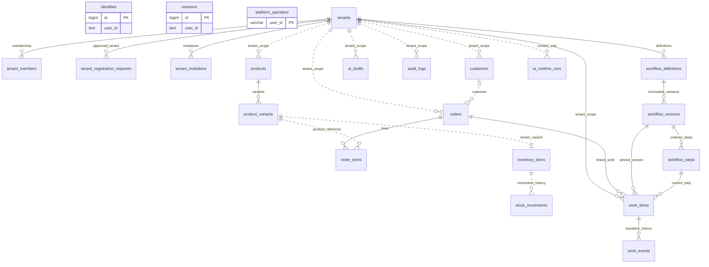
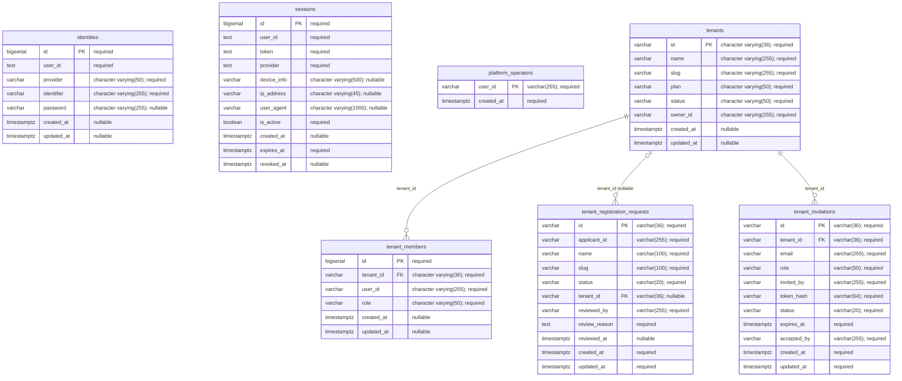
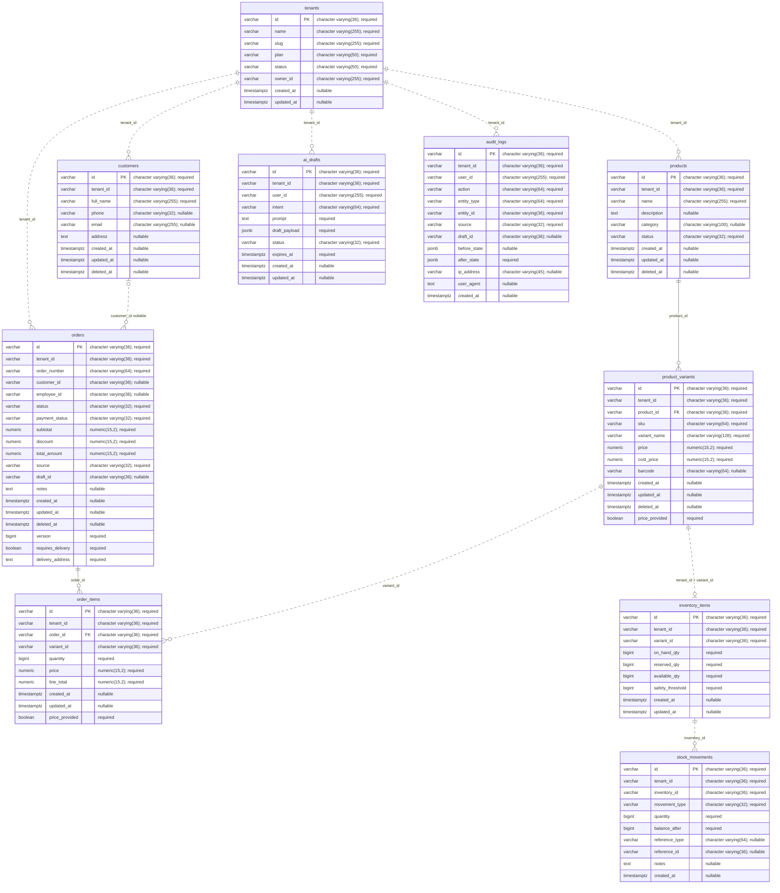
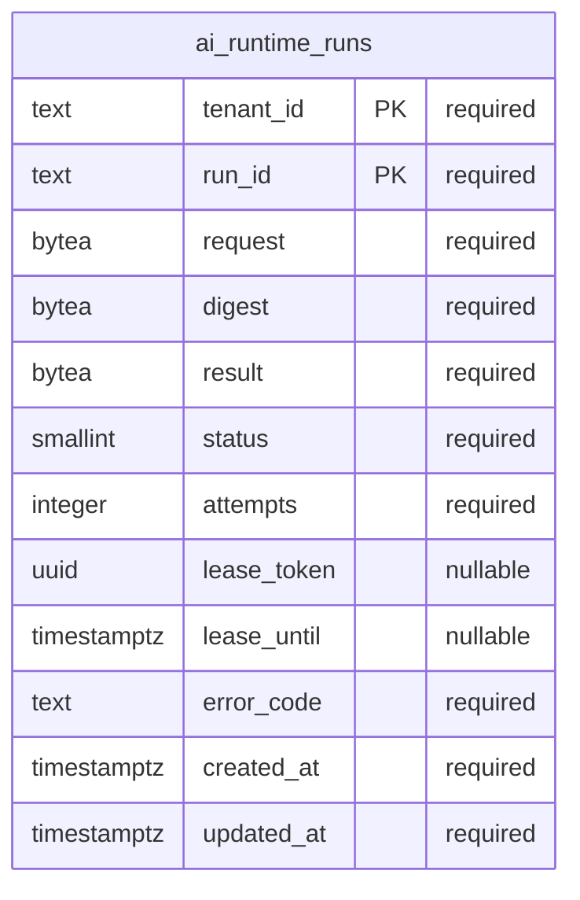

# Current Hexta ERD

Code snapshot: `af06cf4` on `codex/order-workflows`, 2026-10-20. Includes all seven Atlas API migrations and Python migration 001. **21 public business tables + 1 ai_runtime table**. Migration metadata is omitted. This is a code/migration diagram, not a new live database introspection.

Solid lines represent migration-declared foreign keys. Dashed lines represent application/domain references without a declared FK; their cardinality describes intended references, not a database guarantee. Mermaid normally uses line style for identifying relationships; this document explicitly repurposes it as the FK/application-reference legend. PK/FK attribute labels refer only to actual constraints. All attributes are shown; type precision is retained in comments. Composite uniqueness is listed separately.

There is no users table. identities.id identifies a login identity, while user_id is the account identifier shared by identity records, sessions, membership, ownership and actor fields. user_id is not unique in identities and is not a referenced account primary key. No FK edges to a fictional users table are drawn.

## Complete relationship overview

## Accounts and onboarding

## Catalog, sales and inventory

## Versioned workflows and work

```mermaid
erDiagram
    direction TB
    tenants {
        varchar id PK "character varying(36); required"
        varchar name "character varying(255); required"
        varchar slug "character varying(255); required"
        varchar plan "character varying(50); required"
        varchar status "character varying(50); required"
        varchar owner_id "character varying(255); required"
        timestamptz created_at "nullable"
        timestamptz updated_at "nullable"
    }
    orders {
        varchar id PK "character varying(36); required"
        varchar tenant_id "character varying(36); required"
        varchar order_number "character varying(64); required"
        varchar customer_id "character varying(36); nullable"
        varchar employee_id "character varying(36); nullable"
        varchar status "character varying(32); required"
        varchar payment_status "character varying(32); required"
        numeric subtotal "numeric(15,2); required"
        numeric discount "numeric(15,2); required"
        numeric total_amount "numeric(15,2); required"
        varchar source "character varying(32); required"
        varchar draft_id "character varying(36); nullable"
        text notes "nullable"
        timestamptz created_at "nullable"
        timestamptz updated_at "nullable"
        timestamptz deleted_at "nullable"
        bigint version "required"
        boolean requires_delivery "required"
        text delivery_address "required"
    }
    workflow_definitions {
        varchar id PK "character varying(36); required"
        varchar tenant_id FK "character varying(36); required"
        varchar name "character varying(120); required"
        bigint version "required"
        varchar create_hash "character varying(64); required"
        timestamptz created_at "required"
        timestamptz updated_at "required"
    }
    workflow_versions {
        varchar id PK "character varying(36); required"
        varchar tenant_id FK "character varying(36); required"
        varchar definition_id FK "character varying(36); required"
        bigint number "required"
        varchar name "character varying(120); required"
        timestamptz created_at "required"
    }
    workflow_steps {
        varchar id PK "character varying(36); required"
        varchar tenant_id FK "character varying(36); required"
        varchar workflow_version_id FK "character varying(36); required"
        integer ordinal "required"
        varchar name "character varying(120); required"
        varchar handoff_mode "character varying(16); required"
    }
    work_items {
        varchar id PK "character varying(36); required"
        varchar tenant_id FK "character varying(36); required"
        varchar order_id FK "character varying(36); required"
        varchar workflow_version_id FK "character varying(36); required"
        integer current_step FK "required"
        varchar responsible_id "character varying(255); nullable"
        varchar recipient_id "character varying(255); nullable"
        varchar state "character varying(16); required"
        bigint version "required"
        varchar created_by "character varying(255); required"
        varchar request_key "character varying(36); required"
        varchar create_hash "character varying(64); required"
        timestamptz created_at "required"
        timestamptz updated_at "required"
    }
    work_events {
        varchar id PK "character varying(36); required"
        varchar tenant_id FK "character varying(36); required"
        varchar work_item_id FK "character varying(36); required"
        bigint version "required"
        varchar actor_id "character varying(255); required"
        varchar action "character varying(32); required"
        varchar from_responsible_id "character varying(255); nullable"
        varchar responsible_id "character varying(255); nullable"
        varchar recipient_id "character varying(255); nullable"
        integer from_step "required"
        integer current_step "required"
        varchar state "character varying(16); required"
        timestamptz created_at "required"
    }
    tenants ||--o{ workflow_definitions : "tenant_id"
    workflow_definitions ||--o{ workflow_versions : "tenant_id + definition_id"
    workflow_versions ||--o{ workflow_steps : "tenant_id + workflow_version_id"
    tenants ||--o{ work_items : "tenant_id"
    orders ||--o{ work_items : "tenant_id + order_id"
    workflow_versions ||--o{ work_items : "tenant_id + workflow_version_id"
    workflow_steps ||--o{ work_items : "tenant_id + workflow_version_id + current_step"
    work_items ||--o{ work_events : "tenant_id + work_item_id"
    tenants ||..o{ orders : "tenant_id"
```

## Python AI runtime

## Constraint and interpretation notes

- identities: unique (provider, identifier); password nullable after migration 20260912083721.
- tenant_members: unique (tenant_id, user_id). Registration requests: unique slug where status is not rejected. Pending invitations: unique (tenant_id, email) where status is pending; token_hash unique.
- product_variants: unique (tenant_id, sku). inventory_items: unique (tenant_id, variant_id), so a variant has at most one inventory row within a tenant, but no FK enforces its existence.
- customers: unique (tenant_id, phone) only for nonempty phone and nondeleted rows. orders: unique (tenant_id, order_number) and (tenant_id, id).
- order_items.price is the SQL column exposed as unit_price by the model/JSON API. price_provided distinguishes missing from explicit zero. Customer and employee references may be absent on drafts.
- workflow_definitions and workflow_versions have unique (tenant_id, id). Versions: unique (tenant_id, definition_id, number). Steps: unique (workflow_version_id, ordinal) and (tenant_id, workflow_version_id, ordinal). Ordinals are zero-based, bounded 0–29.
- work_items: unique (tenant_id, id) and (tenant_id, created_by, request_key). Pinned workflow and current step use composite tenant FKs. State is active/waiting/completed; waiting retains a responsible employee and distinct nominated recipient.
- work_events: unique (work_item_id, version); transition/history references use a composite tenant FK. Actor/responsible/recipient fields contain account user IDs but have no membership FK; service authorization checks current membership.
- ai_runtime.runs: composite PK (tenant_id, run_id), no public-table FK. Request/digest/result are bytea, not jsonb. Lease fields and status checks support durable execution; lease_token is not an entity FK.
- audit_logs.entity_type/entity_id and stock_movements.reference_type/reference_id are polymorphic application references; they are not blanket FKs to orders. ai_drafts and audit_logs have draft references at selected callers, not newly declared constraints.
- Inventory/stock/legacy AI draft tables exist physically; this does not imply current manual-sales routes execute stock, payment or AI-draft workflows.
- Selected GORM associations describe simpler single-ID links than the composite workflow FKs installed by Atlas. SQL migrations define the physical constraints shown here. No future conversation, Kafka inbox/outbox, exception or checkpoint tables are included.

## Sources

- [migrations/api/20260220100303_init.sql](../../../migrations/api/20260220100303_init.sql)
- [migrations/api/20260912083721_fix_identities_provider_unique_index.sql](../../../migrations/api/20260912083721_fix_identities_provider_unique_index.sql)
- [migrations/api/20260912160000_create_tenants.sql](../../../migrations/api/20260912160000_create_tenants.sql)
- [migrations/api/20261009180000_create_core_business_schema.sql](../../../migrations/api/20261009180000_create_core_business_schema.sql)
- [migrations/api/20261019030000_sales_demo.sql](../../../migrations/api/20261019030000_sales_demo.sql)
- [migrations/api/20261019040000_tenant_onboarding.sql](../../../migrations/api/20261019040000_tenant_onboarding.sql)
- [migrations/api/20261020075908_order_workflows.sql](../../../migrations/api/20261020075908_order_workflows.sql)
- [migrations/ai/20261020100000_durable_runs.sql](../../../migrations/ai/20261020100000_durable_runs.sql)
- GORM schema inventory: [cmd/tools/main.go](../../../services/api/cmd/tools/main.go).
- Workflow models: [workflowmodel/models.go](../../../services/api/internal/repository/workflowmodel/models.go).

Atlas ownership follow-up (2026-10-20): AI table shape is unchanged, but its SQL is now in the Atlas AI history; runtime startup no longer migrates. Independent Atlas metadata schemas remain excluded from this business ERD.
