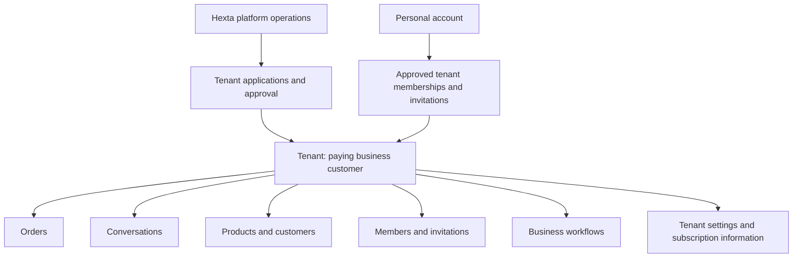

# Tenant-first product framework and delivery plan

Date: 2026-10-19. Status: planning in progress; no implementation in this session.

## Overview and confirmed decisions

The owner clarified that a tenant is Hexta's paying business customer and the top-level boundary of the customer product. Orders, conversations, customers, products, employees, settings and the commercial relationship belong inside that tenant. Account registration alone grants no tenant access. A workspace is the current UI name for a tenant, not another peer resource or an additional organizational layer.

Owner-confirmed onboarding:
1. A customer applies to register a tenant.
2. Hexta reviews the application; only approval grants tenant ownership/access.
3. The tenant owner invites employees by email.
4. An employee signs in and explicitly accepts the invitation before becoming an active member.

The applicant's initial owner membership is provisioned by Hexta approval, rather than a staff invitation. This is the necessary bootstrap interpretation of the approved application flow; all employee access follows invitation acceptance. Approval must not be represented as payment received. Provider keys, prepared datasets and automated payment integration remain deferred under the owner's earlier demo-first instruction.

## Current-state analysis

Inspected source on codex/manual-sales-demo with existing uncommitted changes preserved:
- Existing tenants/tenant_members and tenant_id-scoped business rows already represent useful isolation foundations. The sales service checks current membership and tenant state transactionally; preserve this implementation.
- POST /api/v1/tenants currently creates an active tenant and owner membership immediately. This contradicts approval-first onboarding.
- POST /tenants/{id}/invites currently adds a member directly by user ID. There is no durable invitation, email delivery, expiry/revocation or acceptance state.
- /orders, /customers, /products and /tenant plus X-Tenant-ID make the UI/resources appear as peers. The new /workspaces chooser still exposes unrestricted create-and-open. It is a selection improvement, not the approved tenancy framework.
- Tenant.plan/status exist as basic fields, not subscriptions, entitlement enforcement, invoices or payment processing. The current tenant update path permits owner/admin changes to plan/status; these commercial/platform-managed fields must move behind platform authority.
- apps/admin is a starter; there is no implemented Hexta operator authorization or tenant application review workflow. A tenant admin role must never substitute for Hexta platform authority.
- The previous workspace-entry rebuild was not executed because approval review failed at capacity. This session changes planning artifacts only and does not claim a new running UI.

## Product structure

Platform administration is a separate authority boundary for operating Hexta. It is not a sibling business module visible to tenant employees, and platform operator access does not automatically authorize reading every customer's chat/order data. Accounts are identities, not the unit being billed. One account can retain memberships in multiple approved tenants, matching the existing model; each membership and resource is checked independently.

## User journeys and information architecture

### Application and approval

Register/sign in -> account home -> request tenant registration -> pending review -> Hexta approves/rejects -> approved owner sees tenant -> explicitly enters tenant -> order management.

An applicant sees their own request status without membership or access to business resources. Rejected requests show a safe reason; resubmission behavior is an open detail. Pending requests are separate from active tenants, avoiding accidental access through an active-looking row. Approval creates the tenant and initial owner membership atomically; repeated approval cannot create duplicates. Rejection creates no active tenant membership.

### Invitation and acceptance

Owner opens Tenant settings -> Members -> enters email -> pending invitation -> recipient signs in -> views invitation -> accepts -> active membership -> tenant appears in their tenant list -> enters its resources.

Issuing an invitation is not activation. Recipient identity/email must be bound to the invitation; unverified registration email equality alone is not sufficient proof of email ownership. Persist one-use token hashes, expiry and revocation; never log raw invitation tokens. Acceptance is transactional/idempotent and cannot choose a different tenant or elevated role. Existing accounts/multiple tenants are supported. Email delivery implementation and email ownership verification remain explicitly open rather than silently adding a provider/key dependency. For a local demo, a clearly labeled owner-copied invitation link is a proposed temporary delivery method, not a claim that email was sent; confirm that delivery choice before implementation.

### Inside the tenant

A tenant-specific shell displays the tenant's identity and navigation. Example browser routes:
- /tenants: account-level tenant selection, request status and invitations.
- /tenant-requests/new and /tenant-requests/{requestId}: applicant-owned requests.
- /invitations/{token}: accept/decline experience after sign-in; a GET never consumes the invitation.
- /tenants/{tenantId}/orders and /orders/{orderId} beneath that prefix.
- /tenants/{tenantId}/customers, /products, /conversations and /workflows.
- /tenants/{tenantId}/settings/members and /settings/subscription.

The slash-shortened paths above mean resources below /tenants/{tenantId}, not global routes. Prefer tenantId in the URL as the browser's explicit context, so reload, deep links, multiple tabs and browser history retain the selected business. Session/local storage is not the tenancy authority. Change tenant returns to account-level selection. Generic /orders links may redirect to selection during transition, but must not pick the first available tenant.

## Ownership and permissions

| Actor | Allowed responsibility | Boundary |
| --- | --- | --- |
| Hexta operator | Review applications, approve tenant provisioning, manage platform commercial/status fields | Explicit server-side platform permission; not tenant owner/admin |
| Applicant | Submit/read their own registration request | No tenant resource access while pending |
| Tenant owner | Manage own business, invite members, assign tenant work, view tenant commercial information | Cannot approve their own application or self-upgrade platform plan/status |
| Active tenant member | Authorized business operations under current membership/assignment/grants | Cannot invite themselves, accept another recipient's invite or cross tenants |
| Invited account | View/accept their invitation after recipient verification | No business reads/writes before activation |

Existing fine-grained script grants and assigned-sale confirmation rules remain intact. The meaning of any retained tenant admin role must be explicit; it does not inherit owner billing/invitation/platform powers. Membership revocation takes effect on subsequent commands, regardless of cached UI state. Preserve existing history and submitted drafts; suspension must not delete data.

## Data and API direction (target, not implemented)

- tenant_registration_requests: applicant, proposed business details, pending/approved/rejected state, review actor/time/reason and optional resulting tenant ID. No approval/payment credentials in the record.
- tenant_invitations: tenant, intended email, intended bounded role, inviter, pending/accepted/declined/revoked state, expiry, token hash and acceptance actor/time. Expiry may be derived; no invented duration is approved here.
- tenant_members: active accepted memberships, with owner bootstrap on approval; pending invitation is not an active member.
- platform operator grants: an explicit server-side model/bootstrap mechanism, separate from tenant roles. Never trust browser-supplied role flags or a hardcoded public email match.
- Commercial tenant fields: platform-managed plan/access state and, if needed for the demo, explicit manual subscription metadata. Payment provider, pricing, quota, grace period, suspension/read-only policy and invoice requirements remain OPEN.
- Tenant-scoped APIs should use /api/v1/tenants/{tenantId}/{resource}; actor comes from auth and tenant from the authorized route. Remove ambiguous body/header tenant claims, or reject conflicting claims during a short compatibility period. A nested URL alone is not authorization.
- Applicant request endpoints, recipient invitation acceptance endpoints and platform review endpoints have distinct actor checks. Existing GET /tenants remains a list of approved memberships, not all businesses or pending requests.
- Existing create-tenant and plan/status update paths must be replaced/restricted so the new review gate cannot be bypassed by calling old endpoints.

## Prioritized task breakdown

| Slice | Work and likely paths | Demo acceptance |
| --- | --- | --- |
| F1: approval foundation | Tenant request migration/model/repository/service/DTO/controller, platform authorization and guarded approval command; existing tenant endpoints | New account cannot create/access an active tenant directly; application remains pending; authorized approval provisions exactly one tenant and owner; applicant/tenant admin cannot approve |
| F2: onboarding UI | Applicant request/status and operator review screen; account-level tenant list; remove create-and-open | Sign-up -> request -> approve -> approved tenant appears; rejected/pending accounts have useful screens without business navigation |
| F3: tenant shell and routing | apps/web tenant nested routes/layout, route-aware clients, scoped API router; reuse sales components and rules | /tenants/{id}/orders contains only that tenant's data; reload/deep links/two tabs work independently; wrong membership/resource/tenant is denied |
| F4: invitation lifecycle | Invitation migration/service/HTTP, owner member UI, recipient acceptance page; selected delivery mechanism | Pending invite grants no access; correct recipient accepts once; revoked/expired/wrong-recipient invitations cannot activate membership; owner can see pending/active separately |
| F5: commercial boundary | Restrict existing plan/status writes to platform authority; optional tenant subscription summary | Tenant is the customer/unit of billing; staff cannot alter plan/access state; no fake charge/invoice/payment success |

Implementation order: establish F1 authorization and bypass closure, then F2/F3 as a usable tenant-first demo, then F4 to complete employee onboarding. F5 initially needs only authority separation, not a payment engine. Workflow/handoff and chat UI continue after this framework is confirmed; preserve already implemented catalog/order code. F4 design can be prepared while F1–F3 proceed, but delivery/key-dependent email work stays outside the first increment until a method is selected.

## Risk assessment and edge cases

Concurrent approve/accept requests; rejection after approval; invitation email ownership; duplicate existing members; stale invitations after suspension; membership revoked while a tab remains open; platform privilege bootstrap; conflicting URL/header tenant IDs; archived legacy tenants and existing owner memberships; two tenant tabs; stale cross-tenant query/form caches; response loss after approval. Use transaction/version/uniqueness gates and explicit actor scoping. Do not reset current demo data or retroactively lock out existing tenants without a documented migration/backfill decision.

## Definition of done

- A full browser flow from applicant account through approval and owner access; employee invitation acceptance through a selected verifiable delivery method.
- Tenant resource navigation is structurally nested; no business view mounts for pending/nonmember accounts. Existing owner/sale order confirmation behavior remains functional.
- Integration/race tests for approval and acceptance idempotency, cross-tenant access, wrong-recipient/expired/revoked invitation, removed-member access and old endpoint bypass attempts.
- Applicable Go race/vet, Atlas fresh/upgrade/integrity, Swagger, frontend lint/type/build and browser verification. No runtime result is asserted by this planning document.
- Relevant epic/session/architecture records updated; review and confirmed merge before completion.

## Open decisions for the next design pass

Invitation delivery/email verification without introducing a key dependency; exact tenant application fields; verified operator bootstrap; resubmission/ownership transfer; whether commercial suspension blocks all access or keeps a read-only/export path; pricing/limits/payment provider. These are not prerequisites to agreeing the hierarchy and route framework, and no payment integration is scheduled by this plan.

## Local implementation follow-up — 2026-10-19

The five foundation slices are implemented locally: approval authority/bypass closure, tenant shell, application/review, email-addressed manual invitation acceptance and preserved sales integration. See [implementation session](../epics/EPIC-001-system-design/sessions/2026-10-19_tenant-first-implementation.md) for exact checks/limits. Operator bootstrap uses an explicit trusted CLI; no real email integration is claimed. Live privileged approval verification requires explicit authorization after automatic approval review rejected a temporary grant. Review/merge remain pending; parent epics are not complete.
