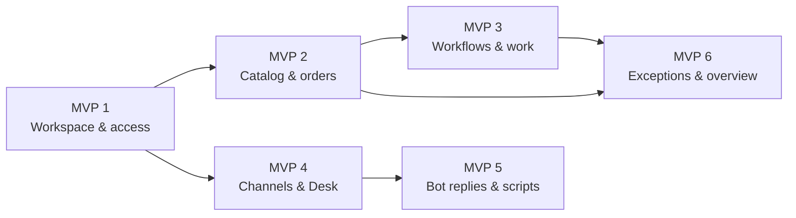
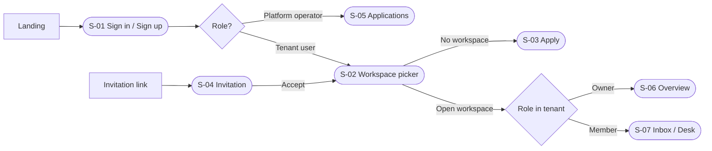

# Hexta PRD — index

- **Version**: 2.1.0 (split into MVP slices, 2026-11-21)
- **Status**: Draft (Bản nháp) — ready for wireframing, not signed off
- **Scope**: *what* and *why* only. Implementation lives in [the system design index](../../../agentic-memory/designs/2026-10-18_system-design_design.md). Sources: [vision](../../vision.md), [product decisions](../../../agentic-memory/designs/system/01-product-decisions.md), graduation thesis chapter 3 (separate repository).

Read this page first (5 minutes), then only the MVP file you are wireframing.

## Product in one paragraph

Hexta is a multi-tenant operations platform for small businesses that sell through chat. It brings customer conversations (Facebook Page, Telegram Bot), customers, products, orders and internal work steps into one workspace. An AI assistant suggests answers and orders, but **people stay in control**: AI never sends, confirms or edits business data by itself.

## MVP slices

Each slice is usable on its own and builds on the previous ones.

| MVP | File | Outcome for the user | Screens | Status |
| --- | --- | --- | --- | --- |
| 1 | [Workspace and access](mvp-1-workspace-access.md) | A business gets an approved workspace and its team | S-01–S-05, S-16, S-20 | Built |
| 2 | [Catalog and orders](mvp-2-catalog-orders.md) | Staff keep customers/products and turn chats into confirmed orders, helped by AI | S-08–S-10, S-12, S-13 | Built |
| 3 | [Workflows and work](mvp-3-workflows-work.md) | Each order moves through the business's own steps with one responsible person | S-11, S-14 | Built |
| 4 | [Channels and Desk](mvp-4-channels-desk.md) | Customer messages arrive in one inbox with clear bot/staff control | S-07, S-18 | Built (live channel acceptance open) |
| 5 | [Bot replies and scripts](mvp-5-bot-replies.md) | Owner decides how much the bot may answer alone, using approved scripts | S-15, S-17, S-19 | Target (implemented on `integrate/mvp5-6`, not merged) |
| 6 | [Exceptions and overview](mvp-6-exceptions-overview.md) | Owner handles cancellations/returns and sees how the business runs | S-06 | Target |

**Built** = implemented and verified in isolation. **Target** = approved, not implemented. **Open** = undecided. Wireframes may include Target screens; label them.



## Roles

| Role | Who | In short |
| --- | --- | --- |
| **Owner** (Chủ doanh nghiệp) | One per tenant | Sets up, invites, connects channels, defines steps, decides bot policy |
| **Member / Sale** (Nhân viên tư vấn) | Employees | Answers customers, drafts and confirms orders, does work steps |
| **Platform operator** (Vận hành Hexta) | Hexta staff | Approves tenant applications; no tenant data access |
| **End customer** (Khách hàng) | Buyer on Facebook/Telegram | No Hexta login |
| **AI assistant** | System component | Suggests only |

## Rules that apply to every MVP

1. An account sees only tenants where it has approved membership; every action checks current permission.
2. Conflicting edits show a conflict message and ask to reload; nothing is silently overwritten.
3. Errors are short, safe and show a reference code for support.
4. Vietnamese UI copy using landing terminology: nhân viên tư vấn, đơn nháp / đơn chính thức, bàn giao / nhận việc.
5. Keyboard operable, visible focus, labelled controls, light and dark themes; desktop-first for Desk, usable on phone width.

## Sitemap and navigation

```text
Public: Landing · S-01 Sign in/up · S-04 Invitation
S-02 Workspace picker → S-03 Apply
Operator: S-05 Applications
Tenant workspace sidebar:
  S-06 Overview [T] · S-07 Inbox/Desk · S-08 Consultant · S-09/S-10 Orders · S-11 Work
  S-12 Customers · S-13 Products · S-14 Workflows · S-15 Scripts [T]
  Settings: S-16 Members · S-17 Script permissions [T] · S-18 Channels · S-19 Reply mode [T] · S-20 Plan
```



## Out of scope for all MVPs

Payments, refunds, invoices; inventory and stock; shipping-carrier integration; media processing; Telegram groups, Facebook comments, Pancake; per-tenant AI keys or model choice; customer-facing shop/login; HR, accounting, ads; native mobile app.

## Cross-cutting open questions

| # | Question | Affects |
| --- | --- | --- |
| Q1 | Default landing screen: Overview for owners and Inbox for members? | Navigation |
| Q2 | Sign-in methods: email/password only, or Google too? | S-01 |

Slice-specific questions live in each MVP file.
