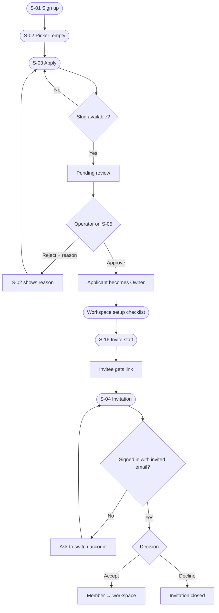

# MVP 1 — Workspace and access

[← PRD index](README.md) · Status: **Built** · Next: [MVP 2](mvp-2-catalog-orders.md)

## Why

A business needs its own isolated workspace and a safe way to bring staff in. Hexta reviews applications so only legitimate businesses get access; an account alone never sees tenant data.

## Users

Visitor, Platform operator, Owner, invited Member.

## Scope

**In:** sign up/in, workspace application and approval, workspace picker, email invitations, member list, read-only plan.
**Out:** payment, billing, email verification provider, member role editing beyond Member, tenant suspension policy.

## User stories

| ID | As a | I want to | So that |
| --- | --- | --- | --- |
| US-1.1 | Visitor | create an account and apply for a workspace | Hexta can open it for me |
| US-1.2 | Operator | approve or reject (with reason) | only legitimate businesses get a workspace |
| US-1.3 | Owner | invite staff by email and revoke pending invitations | my team joins the right workspace |
| US-1.4 | Invitee | preview, accept or decline | I join only workspaces I intend to |
| US-1.5 | User with several workspaces | choose which one to open | I work in the right business |

## Functional requirements

| ID | Requirement | Priority |
| --- | --- | --- |
| FR-1.1 | Sign up/sign in; an account alone grants no workspace access | Must |
| FR-1.2 | Apply with business name and unique slug; see application status | Must |
| FR-1.3 | Operator approves or rejects; rejection requires a reason; approval makes the applicant owner | Must |
| FR-1.4 | Workspace picker lists workspaces with role and status | Must |
| FR-1.5 | Owner invites by email (role Member), sees pending invitations and expiry, revokes; 7-day expiry; one pending invitation per email | Must |
| FR-1.6 | Invitee must be signed in with the invited email to preview/accept/decline | Must |
| FR-1.7 | Plan and access status shown read-only; states that payments are not connected | Could |

## Screens

| ID | Screen | Roles | Content | Actions | States to wireframe |
| --- | --- | --- | --- | --- | --- |
| S-01 | Sign in / Sign up | Visitor | Email, password | Sign in, create account | Error, loading |
| S-02 | Workspace picker | Account | Workspace cards (name, role, status), application status | Open, apply | **Empty**, pending, rejected with reason |
| S-03 | Apply | Account | Business name, slug preview | Submit | Slug taken, submitted |
| S-04 | Invitation | Invitee | Business, inviter, role, expiry | Accept, decline | Wrong email, expired, revoked, already member |
| S-05 | Applications | Operator | Queue: applicant, name, slug, date | Approve, reject + reason | Empty queue, already decided |
| S-16 | Members | Owner manages, Member views | Members, pending invitations + expiry | Invite, revoke | Already pending, expired |
| S-20 | Plan | All | Plan, access status, payment note | — | — |

After approval, the empty workspace should show a setup checklist: connect a channel (MVP 4), add products (MVP 2), invite staff.

## Flow — onboarding



## Business rules

1. Only the operator decides applications; the operator does not become a tenant member.
2. Only the owner invites and revokes.
3. Invitation acceptance needs the exact invited email.

## Acceptance criteria

```gherkin
Scenario: Account without workspace
  Given a signed-in account with no approved membership
  When it opens the workspace picker
  Then it sees an empty state with "Apply for a workspace" and no tenant data

Scenario: Rejection requires a reason
  Given a pending application
  When the operator rejects without a reason
  Then the rejection is refused and the reason field is highlighted

Scenario: Invitation for another email
  Given an invitation sent to a@x.com
  When b@x.com opens the link
  Then it is asked to sign in with the invited email and cannot accept

Scenario: Duplicate invitation
  Given a pending invitation for a@x.com
  When the owner invites a@x.com again
  Then they see that an invitation is already pending
```

## Open questions

| # | Question |
| --- | --- |
| Q1.1 | Should the invitation email be sent automatically or should the owner copy the link? (No email provider yet.) |
| Q1.2 | Can an owner remove an active member in MVP? |
