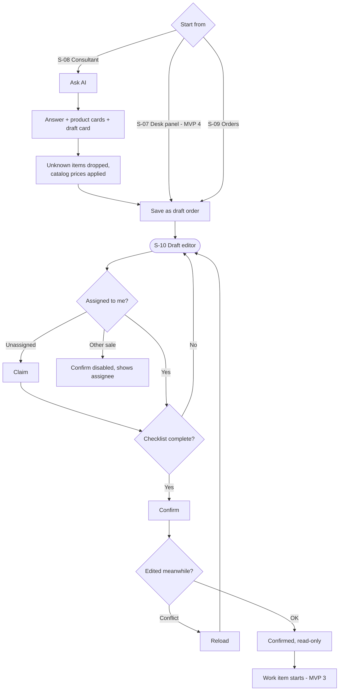
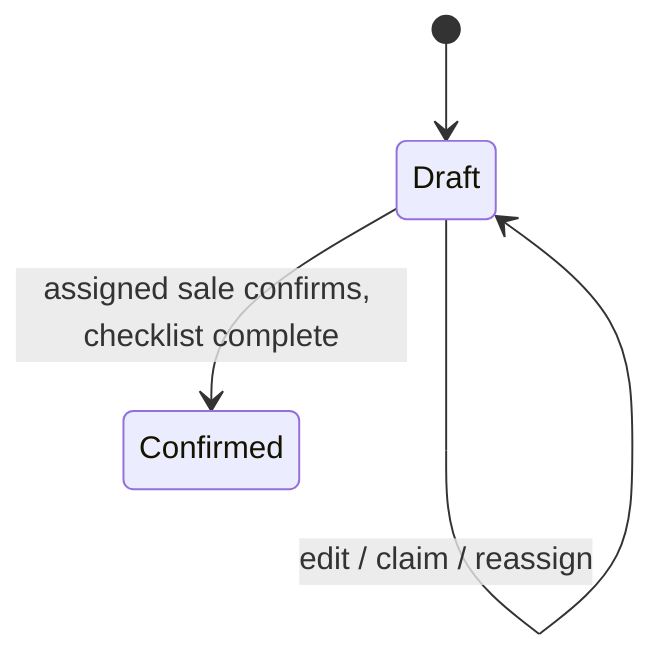

# MVP 2 — Catalog and orders

[← PRD index](README.md) · Status: **Built** · Depends on: [MVP 1](mvp-1-workspace-access.md) · Next: [MVP 3](mvp-3-workflows-work.md)

## Why

Sales retype customer details and products from chat into spreadsheets, and prices get guessed. Hexta keeps one catalog, lets staff save incomplete orders mid-conversation, and only confirms an order when it is complete. The AI consultant speeds this up but never invents prices or saves orders by itself.

## Users

Owner, Member (sale).

## Scope

**In:** customers, products with variants and prices, search, draft and confirmed orders, assignment, AI consultant producing a draft.
**Out:** stock, payment, discounts/tax, shipping carriers, cancellation/return (→ [MVP 6](mvp-6-exceptions-overview.md)).

## User stories

| ID | As a | I want to | So that |
| --- | --- | --- | --- |
| US-2.1 | Sale | manage customers and products | orders use correct data |
| US-2.2 | Sale | save an incomplete draft and confirm it later | I capture orders mid-conversation |
| US-2.3 | Sale | ask the AI what to recommend and get a draft order | I build orders from chat quickly |
| US-2.4 | Owner | reassign a draft to another sale | work is balanced |

## Functional requirements

| ID | Requirement | Priority |
| --- | --- | --- |
| FR-2.1 | Create/edit/archive customers; phone unique per tenant when present | Must |
| FR-2.2 | Create/edit/archive products with variants; each variant has a price or is explicitly "price not set" (not free) | Must |
| FR-2.3 | Search products by name, category, description | Should |
| FR-2.4 | Save draft orders with missing fields | Must |
| FR-2.5 | Confirm only when: actor is the assigned sale; customer has name and contact; ≥1 line with positive quantity; every line has a set, non-negative price; delivery address present if delivery selected | Must |
| FR-2.6 | Show a checklist of unmet confirmation conditions | Must |
| FR-2.7 | Unassigned draft can be self-claimed; owner can reassign | Must |
| FR-2.8 | Consultant returns a streamed answer, product cards, optional draft order and quick replies | Must |
| FR-2.9 | AI items are checked against the catalog; unknown items dropped; prices recalculated | Must |
| FR-2.10 | AI draft becomes a real draft order only when a sale saves it | Must |

## Screens

| ID | Screen | Content | Actions | States to wireframe |
| --- | --- | --- | --- | --- |
| S-08 | Consultant | Chat, streamed answer, product cards, draft card, quick replies | Ask, add to draft, save as draft order | Streaming, AI error, item dropped, price not set |
| S-09 | Orders list | Code, customer, assignee, status, total, updated | Filter, new draft, open | Empty, filtered empty |
| S-10 | Order editor | Customer, lines (variant, qty, price), delivery toggle + address, assignee, **confirmation checklist** | Save draft, claim, confirm, reassign (owner) | Incomplete, not assignee (confirm disabled + reason), conflict, confirmed read-only |
| S-12 | Customers | Table + form (name, phone, email, address) | Create, edit, archive | Duplicate phone, empty |
| S-13 | Products | Table + editor with variants and prices | Create, edit, archive, search | "Price not set" vs 0 đ, empty |

## Flow — chat to confirmed order



## Order states



## Business rules

1. Missing price is not zero; confirmation is blocked until a price is set.
2. Confirming does not take payment or reduce stock.
3. Archived customers/products stay visible on old orders.
4. AI never saves or confirms; a person does.

## Acceptance criteria

```gherkin
Scenario: Confirm incomplete order
  Given a draft with a line whose price is not set
  When the assigned sale confirms
  Then it is refused and the checklist marks "price missing"

Scenario: Only the assignee confirms
  Given a complete draft assigned to sale A
  When sale B tries to confirm
  Then the action is refused

Scenario: Edit conflict
  Given two users editing the same draft
  When the second saves after the first
  Then they see a conflict message and reload

Scenario: AI suggests unknown product
  Given the AI returns an item not in the catalog
  Then the item is dropped and prices come from the catalog
```

## Open questions

| # | Question |
| --- | --- |
| Q2.1 | Consultant as a standalone page, a panel inside Desk, or both? (Built: standalone page.) |
| Q2.2 | Show order total as "giá trị đơn" everywhere to avoid implying revenue? |
