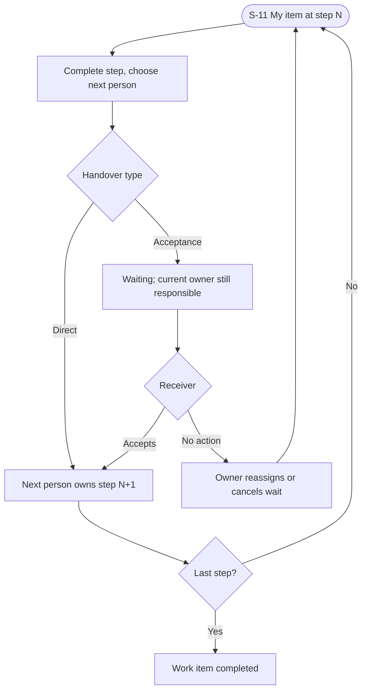

# MVP 3 — Workflows and work

[← PRD index](README.md) · Status: **Built** · Depends on: [MVP 2](mvp-2-catalog-orders.md) · Next: [MVP 4](mvp-4-channels-desk.md)

## Why

Businesses process orders differently (some pack and deliver, some don't). Handover through chat groups loses track of who is responsible. Hexta lets each owner define their own steps and always shows one responsible person per item.

## Users

Owner (defines and supervises), Member (does steps).

## Scope

**In:** workflow definitions with 1–30 steps, versions, work items from confirmed orders, Direct and Acceptance handover, owner reassignment.
**Out:** branching or parallel steps, SLA timers, templates library, notifications (→ later).

## User stories

| ID | As a | I want to | So that |
| --- | --- | --- | --- |
| US-3.1 | Owner | define steps (e.g., pack → deliver) and publish versions | Hexta fits my business |
| US-3.2 | Member | see my items, finish my step and hand over | the next person knows it's theirs |
| US-3.3 | Member | accept work handed to me when acceptance is required | I take responsibility explicitly |
| US-3.4 | Owner | reassign or cancel a pending acceptance | nothing gets stuck |

## Functional requirements

| ID | Requirement | Priority |
| --- | --- | --- |
| FR-3.1 | Workflow of 1–30 ordered steps; each step uses **Direct** (moves immediately) or **Acceptance** (receiver must accept) | Must |
| FR-3.2 | Publishing creates a new version; running items keep their version | Must |
| FR-3.3 | Confirmed order creates a work item at step 1 | Must |
| FR-3.4 | Assignee completes the step and chooses the next person | Must |
| FR-3.5 | Owner reassigns or cancels a pending acceptance | Must |

## Screens

| ID | Screen | Roles | Content | Actions | States to wireframe |
| --- | --- | --- | --- | --- | --- |
| S-11 | Work | Owner, Member | Tabs: My items, Waiting for my acceptance, All (owner); order, current step, version, assignee | Complete & hand over, accept, reassign / cancel wait (owner) | Empty, waiting acceptance, conflict |
| S-14 | Workflows | Owner edits, Member views | Definitions; step builder (name, Direct/Acceptance); version history | Add/reorder steps, publish | Unpublished changes, 30-step limit, "running items keep old version" note |

## Flow — work handover



## Business rules

1. Only the owner publishes workflows and reassigns.
2. Work items keep the workflow version they started with.
3. During Acceptance waiting, the previous assignee stays responsible.

## Acceptance criteria

```gherkin
Scenario: Acceptance handover
  Given a step with Acceptance handover
  When the assignee hands over to member C
  Then the item waits until C accepts
  And the owner can reassign or cancel the wait

Scenario: New version does not change running work
  Given a work item running on version 1
  When the owner publishes version 2
  Then the item still shows version 1 steps
```

## Open questions

| # | Question |
| --- | --- |
| Q3.1 | Which workflow applies when a tenant has several definitions — chosen per order or one default? |
