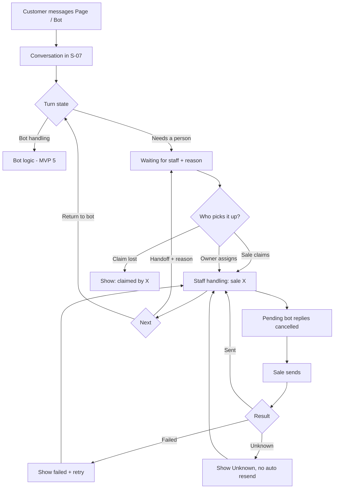
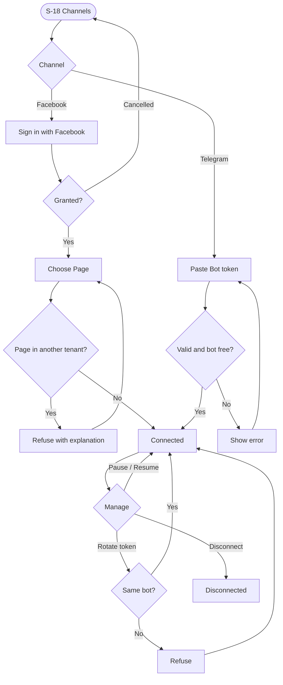
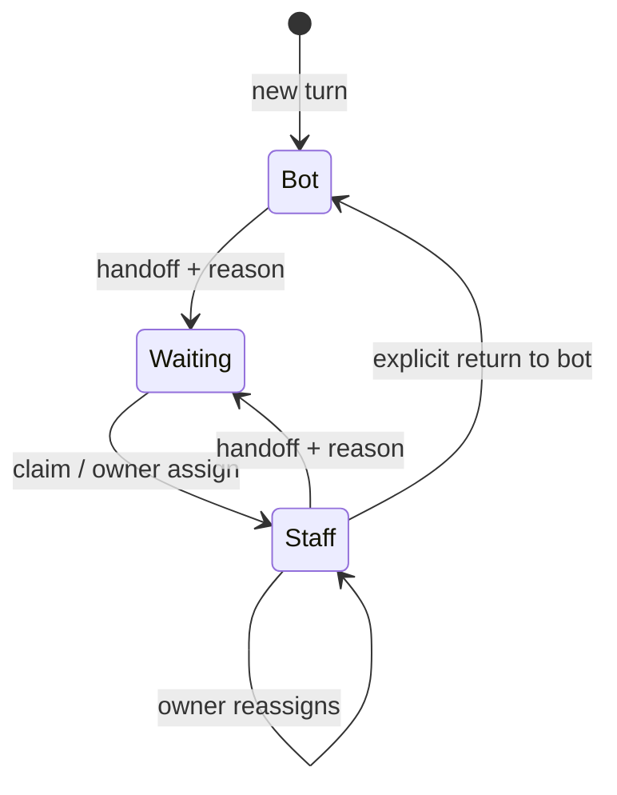
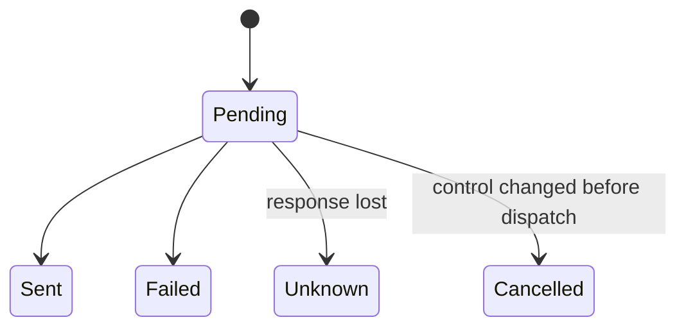

# MVP 4 — Channels and Desk

[← PRD index](README.md) · Status: **Built** (live Facebook/Telegram acceptance open) · Depends on: [MVP 1](mvp-1-workspace-access.md) · Next: [MVP 5](mvp-5-bot-replies.md)

## Why

Customer messages are spread across Pages and bots, and when a bot and several sales share a chat nobody knows who must answer, so messages are missed or answered twice. Hexta collects all conversations in one inbox and always shows exactly one controller: the bot, the waiting queue, or a named sale.

## Users

Owner, Member (sale), End customer (indirect).

## Scope

**In:** connect Facebook Page and Telegram Bot; pause/resume/disconnect; unified inbox; Desk control states; claim/assign/handoff/return; sending with outcome; labelled simulator.
**Out:** bot reply logic and scripts (→ [MVP 5](mvp-5-bot-replies.md)), media processing, Telegram groups, Facebook comments.

## User stories

| ID | As a | I want to | So that |
| --- | --- | --- | --- |
| US-4.1 | Owner | connect my Page or Bot and pause/disconnect it | customer messages arrive in Hexta |
| US-4.2 | Sale | see all conversations and who controls each | I know who needs me |
| US-4.3 | Sale | claim a waiting conversation and reply | the customer gets a human answer |
| US-4.4 | Sale | hand off with a reason or return to the bot | control is always explicit |
| US-4.5 | Owner | assign a conversation to a sale | nothing waits too long |

## Functional requirements

| ID | Requirement | Priority |
| --- | --- | --- |
| FR-4.1 | Facebook: sign in with Facebook, choose Page; one Page per active tenant | Must |
| FR-4.2 | Telegram: paste Bot token; one Bot per tenant; private chats only | Must |
| FR-4.3 | Pause, resume, disconnect; rotate Telegram token (same bot only) | Must |
| FR-4.4 | Members see connection status but cannot change it | Must |
| FR-4.5 | Inbox lists conversations across channels: channel, customer, last message, controller, waiting time | Must |
| FR-4.6 | Each open turn is **Bot handling**, **Waiting for staff** or **Staff handling (named sale)** | Must |
| FR-4.7 | Claim (first wins), owner assign, handoff with one of 5 reasons, explicit return to bot | Must |
| FR-4.8 | Only the controlling sale can send; status Pending / Sent / Failed / **Unknown** | Must |
| FR-4.9 | Unsupported attachments shown as a placeholder with file type | Must |
| FR-4.10 | Simulated conversations visibly labelled | Must |
| FR-4.11 | Taking over cancels pending automatic replies; return to bot never replays old messages | Must |
| FR-4.12 | Notifications for waiting conversations | Should (Target) |

Handoff reasons: customer requested staff · insufficient information · AI error · business review · staff handoff.

## Screens

| ID | Screen | Roles | Content | Actions | States to wireframe |
| --- | --- | --- | --- | --- | --- |
| S-07 | Inbox / Desk | Owner, Member | 3 panes: list (filters Bot / Waiting / Mine / All, channel), thread, customer & order panel | Claim, assign (owner), handoff + reason, return to bot, send, create draft order (MVP 2) | No channel connected, empty, simulated label, unsupported media, send Pending/Failed/Unknown, read-only composer (not controller), "claimed by X", turn closed |
| S-18 | Channels | Owner manages, Member views | Facebook Page and Telegram Bot cards with status | Connect, pick Page, enter token, pause, resume, disconnect, rotate | Page used by another tenant, wrong bot on rotate, OAuth cancelled, paused |

## Flow — customer message to answer



## Flow — channel connection



## State models





## Business rules

1. All members see all tenant conversations; only the controller sends.
2. Control never returns to the bot implicitly (timeout, staff offline, closing Desk).
3. An Unknown send is never resent automatically.
4. Closing a conversation never creates or changes an order.
5. A Page or Bot belongs to one active tenant.
6. Simulated data never alters real conversations.

## Acceptance criteria

```gherkin
Scenario: Claim race
  Given a conversation Waiting for staff
  When two sales claim at the same time
  Then exactly one becomes the controller and the other sees who claimed it

Scenario: Non-controller cannot send
  Given a conversation controlled by sale A
  When sale B opens it
  Then the composer is read-only with A's name

Scenario: Takeover stops automation
  Given the bot has a queued reply
  When a sale claims the conversation
  Then the queued reply is not sent

Scenario: Unknown send
  Given a send whose provider response is lost
  Then it shows "Unknown" and is not resent automatically

Scenario: Page already used
  Given Page P is active in tenant T1
  When the owner of T2 connects P
  Then it is refused with an explanation
```

## Open questions

| # | Question |
| --- | --- |
| Q4.1 | Notification channel for waiting conversations: in-app, sound, email? |
| Q4.2 | Should some sales see only some Pages? (Currently all see all.) |
| Q4.3 | Vietnamese labels for the 5 handoff reasons. |
