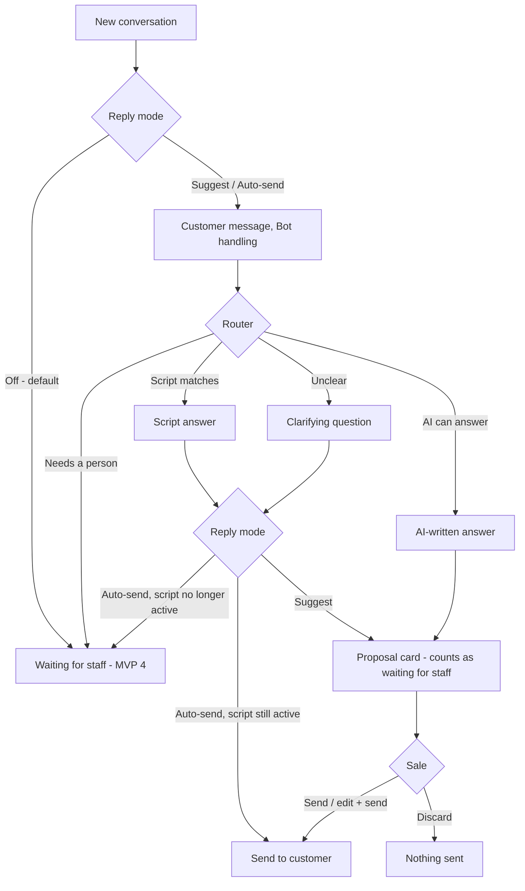
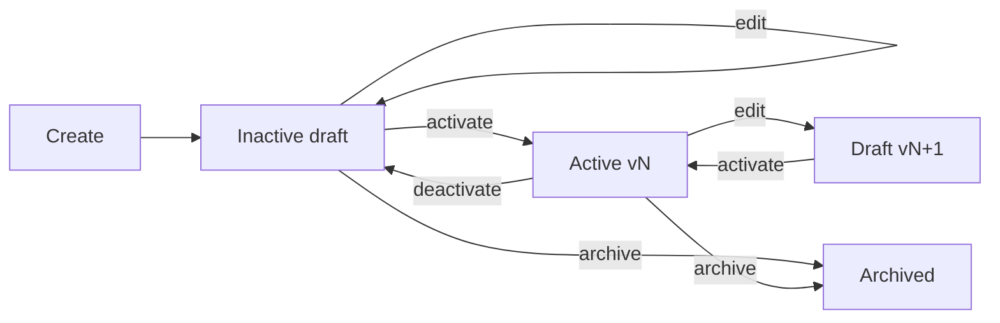
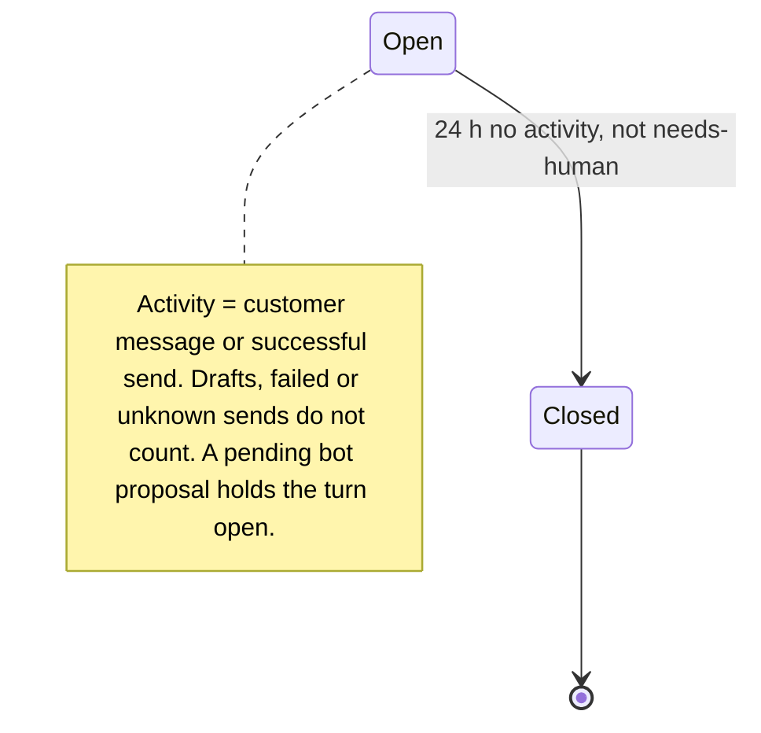

# MVP 5 — Bot replies and scripts

[← PRD index](README.md) · Status: **Target** — implemented on integration branch `integrate/mvp5-6`, not merged into main · Depends on: [MVP 4](mvp-4-channels-desk.md)

## Why

Owners want the bot to answer repetitive questions but fear wrong prices or unreviewed sends. The owner decides the bot's freedom (off, suggest only, or auto-send), common answers come from approved scripts, answers the AI writes itself are always reviewed by a person, and anything uncertain goes to a person.

## Users

Owner (policy, permissions), Members with granted script permissions, Sale (reviews proposals).

## Scope

**In:** reply mode Off/Suggest/Auto-send; routing between script, AI answer, clarification and handoff; proposals; scripts with versions; 4 delegated permissions; needs-human flag; 24-hour turn expiry.
**Out:** per-tenant AI keys or model choice, multi-agent features, scheduled campaigns.

## User stories

| ID | As a | I want to | So that |
| --- | --- | --- | --- |
| US-5.1 | Owner | choose Off, Suggest or Auto-send | I control how much the bot does alone, and nothing changes until I opt in |
| US-5.2 | Sale | review, edit or discard bot proposals | nothing wrong reaches customers |
| US-5.3 | Owner / granted member | create, edit, activate, archive scripts | answers are consistent and approved |
| US-5.4 | Owner | grant script permissions separately | I delegate only what I trust |

## Functional requirements

| ID | Requirement | Priority |
| --- | --- | --- |
| FR-5.1 | Reply mode, set by the owner: **Off** (default for every workspace; new conversations wait for staff exactly as in MVP 4, the bot does nothing), **Suggest** (bot proposes, sale reviews) or **Auto-send** (while Bot handling, the bot sends script answers and clarifying questions itself; answers written by the AI are always proposals for review) | Must |
| FR-5.2 | Per message, route to script, AI answer, clarification question or human handoff | Must |
| FR-5.3 | Proposal: send as-is, edit then send, discard | Must |
| FR-5.4 | New scripts inactive; editing an active script creates a new version; one active version; archive keeps history | Must |
| FR-5.5 | Owner grants/revokes per member: `script.create`, `script.edit`, `script.activate`, `script.archive` | Must |
| FR-5.6 | "Needs human" flag blocks automation; assigned sale marks it resolved. A bot conversation with a proposal awaiting review counts as waiting for staff | Must |
| FR-5.7 | Turn closes after 24 h inactivity (not while needs-human or while a bot proposal awaits review); next message opens a new unassigned turn | Must |

## Screens

| ID | Screen | Roles | Content | Actions | States to wireframe |
| --- | --- | --- | --- | --- | --- |
| S-07 additions | Desk | Sale | Proposal card in thread, needs-human badge, closed turn divider; conversations with a proposal awaiting review appear under "Chờ nhân viên" | Send, edit + send, discard, resolve | Proposal stale (control changed), bot off |
| S-15 | Scripts | Owner, granted members | List (name, active version, status); version editor | Create, edit, activate, archive | Inactive, active, archived, no permission |
| S-17 | Script permissions | Owner | Member × 4 toggles | Grant, revoke | Owner row locked |
| S-19 | Reply mode | Owner | Choice of Off / Suggest / Auto-send with a plain explanation of each | Switch | Off (default), confirmation dialog |

## Flow — bot handling



If the owner switches to Off, conversations the bot is already handling are not moved: their proposals stay for staff to send or discard, while a reply the bot was still preparing, or the next customer message, hands the conversation to staff (reason "bot off").

## Flow — script lifecycle



## Turn expiry



## Business rules

1. Active script content never changes; edits create a new version. Old proposals keep their source version.
2. Each permission grants only its own action.
3. Resolving needs-human restarts the timer but does not return control to the bot.
4. Not every message calls the AI model.
5. Reply mode starts at Off for every workspace; only the owner changes it. While Off, the bot cannot be given a conversation back and staff cannot ask it for a new proposal.
6. Only approved content is sent without a person: in Auto-send the bot sends a script answer (only if that script version is still active at the moment of sending) or a clarifying question. An answer the AI wrote itself is always a proposal, in every mode.
7. A customer message is never left unanswered under the bot: if the script it would have been answered with is deactivated or archived before sending, the conversation goes to staff instead.
8. A bot proposal awaiting review counts as waiting for staff and keeps the turn from expiring until it is sent, discarded or replaced.

## Acceptance criteria

```gherkin
Scenario: Script permission
  Given a member with only script.edit
  When they try to activate a version
  Then the action is refused

Scenario: Off by default
  Given a workspace whose owner never chose a reply mode
  When a customer starts a conversation
  Then it waits for staff and the bot prepares nothing

Scenario: Switching the bot off
  Given a conversation under Bot handling and the owner switches the reply mode to Off
  When the customer sends another message
  Then the conversation waits for staff with the reason "bot off"

Scenario: Suggest mode
  Given reply mode Suggest
  When the bot prepares a reply
  Then nothing is sent until a sale sends it
  And the conversation counts as waiting for staff and does not expire while the proposal is pending

Scenario: Auto-send sends only approved content
  Given reply mode Auto-send
  When the bot matches an active script or asks a clarifying question
  Then it is sent to the customer
  But when the AI writes its own answer
  Then it waits as a proposal for a sale to review

Scenario: Script withdrawn before sending
  Given reply mode Auto-send and a matched script that is deactivated or archived before the bot sends
  Then nothing is sent and the conversation waits for staff

Scenario: Turn expiry
  Given an open turn with no activity for 24 h and not needs-human
  Then it closes and a new message opens a new unassigned turn
```

## Open questions

| # | Question |
| --- | --- |
| Q5.1 | Customer-facing fallback message when no staff is available — text and who configures it? |
| Q5.2 | Can a script be used in Auto-send immediately on activation, or does it need a test step? |
