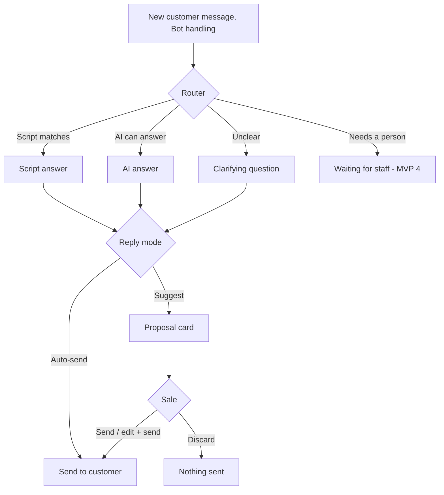
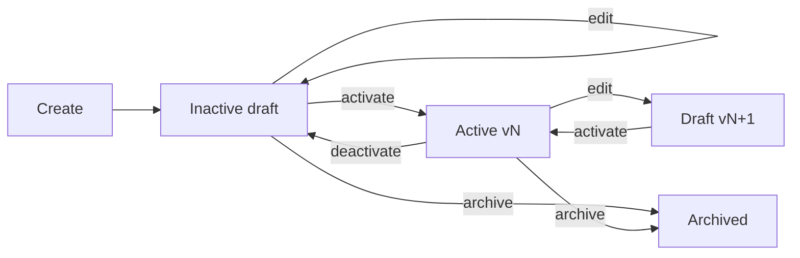
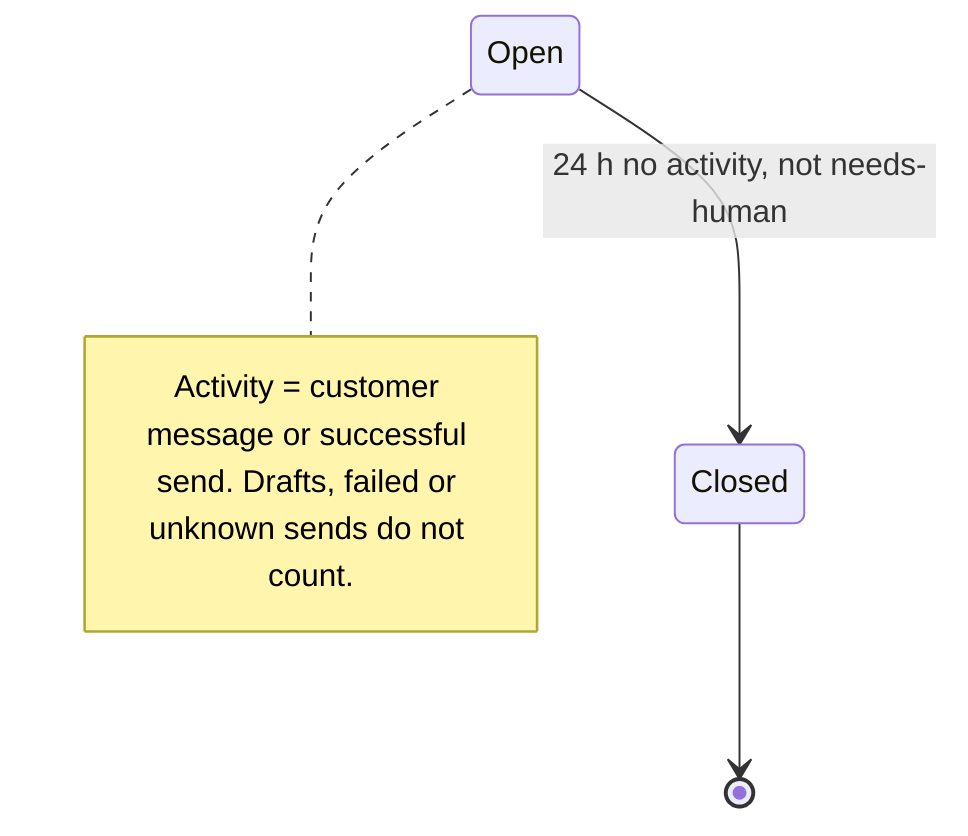

# MVP 5 — Bot replies and scripts

[← PRD index](README.md) · Status: **Target** (not implemented) · Depends on: [MVP 4](mvp-4-channels-desk.md)

## Why

Owners want the bot to answer repetitive questions but fear wrong prices or unreviewed sends. The owner decides the bot's freedom (suggest only, or auto-send), common answers come from approved scripts, and anything uncertain goes to a person.

## Users

Owner (policy, permissions), Members with granted script permissions, Sale (reviews proposals).

## Scope

**In:** reply mode Suggest/Auto-send; routing between script, AI answer, clarification and handoff; proposals; scripts with versions; 4 delegated permissions; needs-human flag; 24-hour turn expiry.
**Out:** per-tenant AI keys or model choice, multi-agent features, scheduled campaigns.

## User stories

| ID | As a | I want to | So that |
| --- | --- | --- | --- |
| US-5.1 | Owner | choose Suggest or Auto-send | I control how much the bot does alone |
| US-5.2 | Sale | review, edit or discard bot proposals | nothing wrong reaches customers |
| US-5.3 | Owner / granted member | create, edit, activate, archive scripts | answers are consistent and approved |
| US-5.4 | Owner | grant script permissions separately | I delegate only what I trust |

## Functional requirements

| ID | Requirement | Priority |
| --- | --- | --- |
| FR-5.1 | Reply mode: **Suggest** (bot proposes, sale reviews) or **Auto-send** (bot sends eligible replies while Bot handling) | Must |
| FR-5.2 | Per message, route to script, AI answer, clarification question or human handoff | Must |
| FR-5.3 | Proposal: send as-is, edit then send, discard | Must |
| FR-5.4 | New scripts inactive; editing an active script creates a new version; one active version; archive keeps history | Must |
| FR-5.5 | Owner grants/revokes per member: `script.create`, `script.edit`, `script.activate`, `script.archive` | Must |
| FR-5.6 | "Needs human" flag blocks automation; assigned sale marks it resolved | Must |
| FR-5.7 | Turn closes after 24 h inactivity (not while needs-human); next message opens a new unassigned turn | Must |

## Screens

| ID | Screen | Roles | Content | Actions | States to wireframe |
| --- | --- | --- | --- | --- | --- |
| S-07 additions | Desk | Sale | Proposal card in thread, needs-human badge, closed turn divider | Send, edit + send, discard, resolve | Proposal stale (control changed) |
| S-15 | Scripts | Owner, granted members | List (name, active version, status); version editor | Create, edit, activate, archive | Inactive, active, archived, no permission |
| S-17 | Script permissions | Owner | Member × 4 toggles | Grant, revoke | Owner row locked |
| S-19 | Reply mode | Owner | Toggle with plain explanation of each mode | Switch | Confirmation dialog |

## Flow — bot handling



## Flow — script lifecycle



## Turn expiry



## Business rules

1. Active script content never changes; edits create a new version. Old proposals keep their source version.
2. Each permission grants only its own action.
3. Resolving needs-human restarts the timer but does not return control to the bot.
4. Not every message calls the AI model.

## Acceptance criteria

```gherkin
Scenario: Script permission
  Given a member with only script.edit
  When they try to activate a version
  Then the action is refused

Scenario: Suggest mode
  Given reply mode Suggest
  When the bot prepares a reply
  Then nothing is sent until a sale sends it

Scenario: Turn expiry
  Given an open turn with no activity for 24 h and not needs-human
  Then it closes and a new message opens a new unassigned turn
```

## Open questions

| # | Question |
| --- | --- |
| Q5.1 | Customer-facing fallback message when no staff is available — text and who configures it? |
| Q5.2 | Can a script be used in Auto-send immediately on activation, or does it need a test step? |
