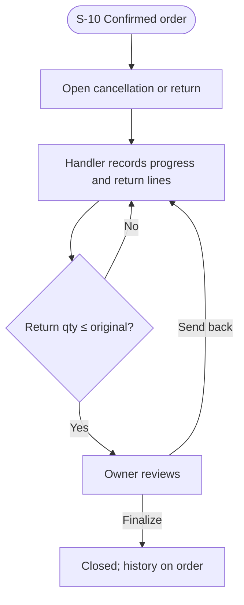
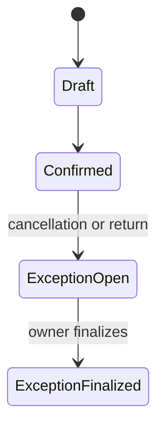

# MVP 6 — Exceptions and overview

[← PRD index](README.md) · Status: **Target** (not implemented) · Depends on: [MVP 2](mvp-2-catalog-orders.md), [MVP 3](mvp-3-workflows-work.md)

## Why

Cancellations and returns are handled in chat with no trace, and the owner cannot answer "how is the business doing today?" without asking everyone. This slice makes exceptions traceable and gives the owner one read-only overview.

## Users

Owner, assigned handler (Member).

## Scope

**In:** cancellation/return cases on confirmed orders; owner overview of orders and work.
**Out:** refunds or payment, stock restock, revenue or profit reporting, configurable dashboards.

## User stories

| ID | As a | I want to | So that |
| --- | --- | --- | --- |
| US-6.1 | Handler | record cancellation/return progress | the case is traceable |
| US-6.2 | Owner | finalize the case | I keep final authority |
| US-6.3 | Owner | see order and work counts and stuck items | I know how the business is running |

## Functional requirements

| ID | Requirement | Priority |
| --- | --- | --- |
| FR-6.1 | Open a cancellation or return case on a confirmed order | Must |
| FR-6.2 | Return quantity per line cannot exceed the original | Must |
| FR-6.3 | Handler updates progress; only owner finalizes; history kept | Must |
| FR-6.4 | Overview: order counts by status, work counts by step/state, list of work rows; filter by period and employee | Must |
| FR-6.5 | Order totals shown as "order value", never "revenue" | Must |

## Screens

| ID | Screen | Roles | Content | Actions | States to wireframe |
| --- | --- | --- | --- | --- | --- |
| S-06 | Overview | Owner | Period filter, employee filter; order counts; work counts; waiting/stuck list | Open item | Empty tenant, no data in period, member denied |
| S-10 additions | Order editor | Handler, Owner | Exception case panel with timeline and return lines | Open case, update, finalize (owner), send back | Over-quantity error, finalized read-only |

## Flow — cancellation / return



## Order states (extended)



## Business rules

1. Original order and history are preserved.
2. No refund or stock movement happens in Hexta.
3. Overview is read-only and owner-only.

## Acceptance criteria

```gherkin
Scenario: Return over quantity
  Given an order line with quantity 2
  When the handler records a return of 3
  Then it is refused

Scenario: Only owner finalizes
  Given an open case
  When the handler tries to finalize
  Then the action is refused

Scenario: Member opens overview
  Given a member
  When they open the overview
  Then they see an access-denied state
```

## Open questions

| # | Question |
| --- | --- |
| Q6.1 | Which extra overview metrics (e.g., products asked vs bought) and their exact definitions? |
| Q6.2 | Is Overview the default screen for owners? |
